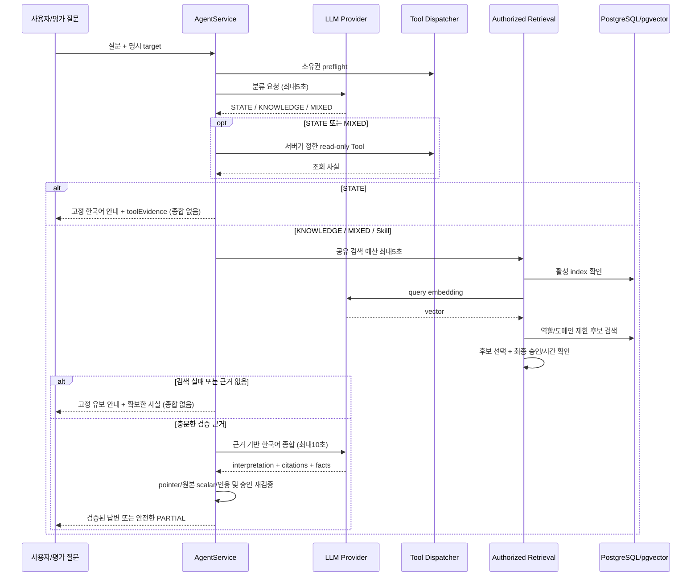
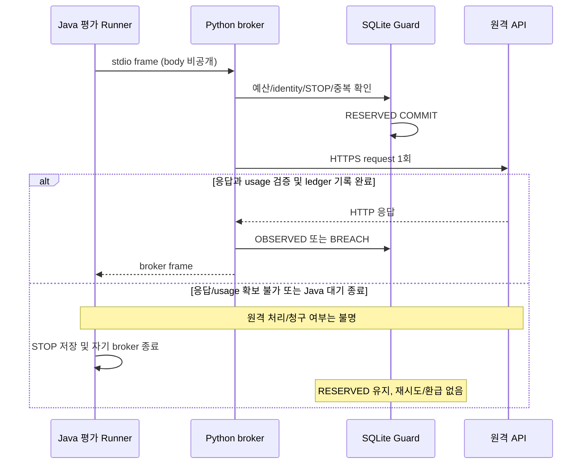

# AI Agent Q5/Q6 복구 조사와 자연어 답변 경계 — 누적 기록

작성: 2026-10-21. 이번 작업은 **무과금 조사·진단 관측 보완·Mock 회귀**다. 실제 Q5/Q6 성공 재평가 또는 자연어 품질 복구 완료 보고서가 아니다.

## 1. 결론과 보존 경계

- Q5: Tool/embedding 성공 후 RAG 실패는 실제 증거로 확인했다. 당시 하위 오류/단계 로그가 없어 SQL·deadline·승인 상태 중 정확한 실패 지점은 **미확정**이다.
- Q6: 마지막 LLM 예약은 RESERVED, 완료 응답/usage 없음, STOP 있음이 확인됐다. 원격 미처리·무료·timeout 확정 중 어느 것도 주장하지 않는다.
- STATE의 짧은 안내는 우발적 오류가 아니다. AgentService가 의도적으로 Tool 사실만 반환하며 종합 LLM을 생략한다. Q2~4 조회 PASS와 자연어 설명 품질 PASS는 다르다.
- 별도 `feat/ai-failure-observability` worktree에서 진단 metadata만 추가했다. 모델/프롬프트·질문/정답·timeout·검색 알고리즘·금융/청산 정책·단일 child/예산/STOP 정책은 바꾸지 않았다.
- 원본 HEAD `melon-init@f9353c33244565b30fb130dfb6159eab441a3523`. 이전 실행 sourceHash `332499954d0041f87faa0deccded99965b2433efa98a129a1d2b14051bcdb9fd`.
- 진단1차 sourceHash `d9b474682d858df7d5578d462dcb3cd3a66bd81bf48b774f57737ff28f94cf08`; **호출 직전 잔여시간 재검사를 포함한 최종 sourceHash는 `a9df9af3472d7d65d72c1b2e7ed94fe8ef94db4c81a66831af6b39a8904780cb`**다. corpusHash는 기존 `c106ed6e152602dd56a48c855316ad23fd4bb563ffc099755aabcbb7794067ba` 유지. sourceHash 변경은 이전 manifest/IndexLease에 자동으로 허용되지 않는다.
- 원본 dirty9경로와 UI `feat/futures-ui-p0`의 소스/문서, 평가 증거/ledger/STOP/claim 등 **53개 파일의 시작 SHA-256**을 대조용으로 보관했다. 인증 키/DB 비밀번호 파일은 읽거나 복사하지 않았다.
- 원본의 검증된 미커밋 Synthetic fixture 수정2개는 **새 worktree에만 동일하게 반영**했다. 이번 신규 수정으로 오인하거나 원본에서 커밋하지 않는다.
- 기존 거래 DB/AI DB/index/Docker/Anvil·private runtime을 기동·재개·초기화하지 않았다. paid approval/child/run 생성, 실제 LLM/embedding 호출, commit/merge/push/배포는 하지 않는다.

## 2. 근거 자료와 실제 증거 재확인

기준 문서:

- [Q2~16 실평가 중단](ai-q2-16-real-quality-evaluation-2026-10-20.md): 당시 결과는 그대로 유지한다.
- [직전 preflight](ai-q2-16-presentation-preflight-2026-10-20.md), [부모 실평가](ai-real-model-evaluation-rerun-2026-10-20.md).
- [Instant/fixture 보완](ai-evaluation-harness-followup-2026-10-20.md), [누적 input v4](krx-priority-ai-input-v4-2026-10-20.md).

원본 private child 폴더 `deployment/runtime/ai-real-evaluation-q2-16-20261020-01/`에서 다음만 읽었다. `questions.json`의 상태/메트릭/Tool 이름·성공 여부, SQLite `mode=ro&immutable=1`의 예약 집계, 정제 오류 코드와 파일 존재 여부다. 질문 원문·답변 전체·API 키·환경 파일·approval 원문은 출력하지 않았다.

| 관측 | 실제 확인 결과 |
|---|---|
| 완료 질문 | Q2, Q3, Q4, Q5만 존재. Q6 row 없음 |
| Q5 응답 | PARTIAL / MIXED, RAG_UNAVAILABLE + KNOWLEDGE_EVIDENCE_MISSING |
| Q5 Tool | getQuote SUCCESS, Tool1/검색1/model1, 인용 근거0 |
| Q5 메트릭 | input564/output24/문항6481ms. 이 값은 문항 전체이며 검색/API 개별 latency 아님 |
| 예약 결과 | LLM OBSERVED5, embedding OBSERVED2, LLM RESERVED1 |
| child 합계 | input48138/output3600/embedding194, 무환급 예약 US$0.163548880 |
| Q6 미확정 슬롯 | LLM input15490/output1600, 예약 US$0.057925000, RESERVED |
| 종료 증거 | STOP 존재, usage 파일7개. completion 없음은 기존 결과와 일치 |
| 당시 오류 로그 | 읽은 Java 로그에 단계별 RAG/transport 고정 코드가 남지 않음. 원문 HTTP 상태/remote request ID는 미보존 |

최초 로컬 요약 시 ACL 권한/Windows 기본 CP949와 명령 인용 오류가 있었다. 권한을 변경하지 않고 승인된 읽기 권한 및 UTF-8/매개변수 SQL로 다시 확인했다. 이는 과거 AI 장애 원인이 아니라 **이번 조사 도구 실행의 별도 오류**다. SQLite는 쓰기 연결을 열지 않았다.

## 3. 실제 호출 흐름

주요 소스(저장소 상대 경로):

| 책임 | 파일/심볼 |
|---|---|
| 인증/분류/Tool/검색/종합 | `backend/src/main/java/com/pricetrack/exchange/ai/agent/AgentService.java`, Run.execute (120행 부근), remaining (117) |
| 계획/자연어 structured 요청 | `.../ai/agent/OpenAiAgentProvider.java`, classify / synthesize |
| 사실 삭제/인용·pointer 검증 | `.../ai/agent/AgentEvidence.java`, modelInput / validate |
| 검색 파이프라인 | `.../ai/retrieval/AuthorizedKnowledgeRetrieval.java`, searchInternal (65), verify (93) |
| pgvector/역할·도메인 필터 | `.../ai/store/PgKnowledgeStore.java`, active / searchScoped |
| 고정 Skill 핸들러 | `.../ai/skill/SkillRunner.java`, execute / futures / settlement / quote / market |
| Java provider 전송 | `.../ai/provider/OpenAiProvider.java`, postInternal / structured / embed |
| 평가 전송 경계 | `backend/src/test/java/com/pricetrack/exchange/ai/evaluation/GuardedAiEvaluationRunner.java`, postWithId (83), receive / halt |
| 선예약/불확실 보존 | `deployment/ai_evaluation_guard.py`, dispatch (206 부근), 예약 COMMIT (233), sender 예외 (241), usage 결과 (253) |
| 실제 HTTPS | `deployment/ai_evaluation_broker.py`, live_sender (89), request/getresponse/read1 (138~165) |

행 번호는 이번 별도 worktree 기준이며 이후 코드 변경 시 심볼로 재확인한다.
표의 `...`는 `backend/src/main/java/com/pricetrack/exchange`를 뜻한다.

### Q5와 자연어 응답의 경계

### Q6의 전송 불확실 경계

## 4. 제한시간과 단계별 책임

| 단계 | 현재 경계 | 주의점 |
|---|---|---|
| Agent 전체 | 기본40초 outer Future/get 및 remaining | 개별 단계 제한의 합을 보장하는 모델 SLA가 아님 |
| 분류 | remaining(5) | 명시 Skill은 분류 LLM을 생략 |
| Tool | 호출별 remaining(5), 최대4/동일 요청 내 재사용 | 권한은 모델이 아닌 서버 Dispatcher가 확인 |
| retrieval | loader/active/embedding/SQL/selection/verify 공유 remaining(5) | embedding만의5초가 아님 |
| 초기/최종 active SQL | pool 대기2초, queryTimeout5초 | 공유 잔여시간을 받지 않음. 엄밀한 전체 검색 hard deadline과 다른 하위 경계 |
| 후보 SQL | pool 대기2초, queryTimeout ceil(remaining), 1~5초 | 초 단위 SQL timeout·pool 대기·최종 checkpoint를 구분해야 함 |
| embedding | 공유 예산의 남은 Duration | broker 예약/IPC/usage 관측 비용도 호출 시간에 포함될 수 있음 |
| 종합 | remaining(10) | Java broker 대기와 Python HTTP timeout이 유사한 길이여도 시작점은 다름 |
| broker HTTP | 설정 timeout + body loop의 monotonic deadline | setup/request/headers를 거친 뒤 body loop에서 잔여시간 검사. 단일 총 hard deadline으로 오인하지 않음 |

특히 실평가 `ApprovedAiModelEvaluationTest`의 provider observer는 응답 후 `runner.summary()`(3초 대기 경계), usage 파일 기록/force를 수행한다. 따라서 retrieval의 embedding 단계 시간에는 네트워크뿐 아니라 **평가 관측 overhead**도 들어갈 수 있다. 이것은 코드로 확인한 시간 귀속이지 Q5의 실제 초과 원인 확정은 아니다. 이번에는 제한시간이나 관측 정책을 바꾸지 않았다.

## 5. Q5 가설과 배제 가능 범위

| 가설 | 근거/재현 | 현재 판단 |
|---|---|---|
| 이전 Instant 직렬화 결함 재발 | Tool getQuote SUCCESS, 모델 분류 성공, mapper 보완 유지 | 이번 Q5 원인 근거 없음. 과거 결함과 혼동하지 않음 |
| 공유 예산이 embedding 뒤 소진 | 실제 embedding 성공 후 RAG 실패; Mock에서 성공 vector 뒤 deadline 소진 재현 | **가능하지만 당시 원인 미확정** |
| 후보 SQL/relay 일시 장애 | embedding 이후 store 호출이 있고 SQL 예외도 AiFailure→RAG_UNAVAILABLE로 축약 | Mock AI_DATABASE_UNAVAILABLE 재현. 당시 배제 불가 |
| 최종 corpus/승인 상태 변경 | verify 실패 역시 동일 외부 실패로 축약 | Mock AI_APPROVAL_MISMATCH 재현. 당시 변경 증거 없음 |
| 검색은 성공했으나 hit 없음 | 이 경우 KNOWLEDGE_EVIDENCE_MISSING은 가능하지만 RAG_UNAVAILABLE 예외와 구분됨 | Q5에 명시 RAG_UNAVAILABLE이 있으므로 단순0건만으로 충분한 설명 아님 |
| API 모델이 잘못된 답변 생성 | Q5 종합 LLM 자체가 실행되지 않음 | 자연어 오답 생성으로 볼 수 없음 |

검색 preflight PASS는 실행 중 SQL/승인 상태 무장애 증명이 아니다. usage 파일 시각과 문항6481ms만으로 embedding timeout·SQL timeout을 역산 확정하지 않는다.

## 6. Q6 가설과 확인 한계

확인된 강한 경계는 **선예약 이후부터 검증된 usage의 OBSERVED 저장 이전 사이**다. RESERVED가 있다고 원격 API에 도달했다는 뜻은 아니다. DNS/TLS/로컬 전송 실패도 가능하다. HTTP200이 있었다 하더라도 body/JSON/usage 기록이 끝났는지는 별개다.

- Java는 frame을 보낸 뒤 같은 요청의 응답을 기다린다. 기다림에는 broker의 identity/lineage/SQLite 예약과 HTTP·usage 처리도 포함된다.
- Java timeout 또는 I/O 실패는 halt→STOP→broker 종료로 이어진다. provider 관측 콜백 역시 summary 실패/usage 불확실을 감지하면 중단한다.
- Python sender 예외는 Guard에서 TRANSPORT_UNCERTAIN으로 축약된다. Java에서는 broker의 상세 code도 AI_EVALUATION_GUARD_REJECTED로 축약됐다. Python stderr도 기존 Runner가 DISCARD한다.
- 당시23:19:43~53 간격은10초 종합 예산과 부합하지만 **timeout 확정 증거가 아니다**. HTTP status·하위 예외·원격 요청 식별자가 없어 네트워크/HTTP/본문/클라이언트 대기를 구분할 수 없다.
- 이번 Mock는 Java 대기 종료→STOP/예약 유지, HTTP429/본문 timeout/JSON decode 실패/연결 setup 실패를 각각 재현한다. 이것이 과거 Q6의 동일 원인이었다고 주장하지 않는다.

공식 OpenAI 문서는 오류 및 응답 헤더의 request ID를 진단 근거로 권장한다([API debugging](https://developers.openai.com/api/reference/overview#debugging-requests)). 이번에는 실제 계정/API를 조회하지 않았고 응답 헤더 전체도 기록하지 않는다. 과거 request ID를 복원했다고 주장하지 않는다.

## 7. 이번 최소 관측 보완

### RAG (제품 검색 알고리즘·응답 계약 불변)

`AuthorizedKnowledgeRetrieval.diagnose(Consumer<Diagnostic>)`는 선택적 관측 sink다. 기본은 noop이며 기존 운영 API나 공개 observability DTO를 확장하지 않는다. 평가 Runner만 새 run의 private JSONL에 연결한다.

고정 stage: CORPUS_LOAD → INDEX_ACTIVE → EMBEDDING_BUDGET → EMBEDDING → VECTOR_VALIDATION → CANDIDATE_BUDGET → CANDIDATE_SEARCH → FILTER_RESULTS → APPROVAL_VERIFY → DEADLINE_CHECK.

각 stage에 success/고정 allow-list resultCode/elapsedMillis/remainingMillis/budgetMillis만 제공한다. 임의 exception message는 OTHER_FAILURE로 줄인다. 질문, 문서, vector, ID, SQL/URL/credential은 기록하지 않는다. sink 실패는 원래 성공/예외를 바꾸지 않는다.

중요: CANDIDATE_BUDGET 실패는 **SQL 호출 전** 시간 소진이다. CANDIDATE_SEARCH에는 호출 직전 잔여시간 재검사와 store 호출이 함께 포함된다. 따라서 이 단계의 AI_QUERY_TIMEOUT만으로 실제 SQL 실행을 단정하지 않는다. 관측 I/O가 시간을 소비했어도 provider/store에 예전 Duration을 전달하지 않도록 실제 호출 직전에 remaining을 다시 계산한다. APPROVAL_VERIFY는 최종 corpus/활성 index 재검증 묶음이며, 이 묶음 내부의 파일·SQL 구분까지 자동으로 추가하지 않았다.

### Java 평가 경계

- 신규 `EvaluationStageTrace.java`: bounded best-effort JSONL writer, 고정 enum·local request UUID·UTC 관측시각·elapsed/timeout만 기록.
- Runner는 FRAME_SEND_BEGIN / FRAME_FLUSHED / BROKER_REPLIED / RESPONSE_DECODED / GUARD_REJECTED / ABORTED를 기록한다.
- Java TimeoutException은 BROKER_REPLY_TIMEOUT으로만 표현한다. 이 코드는 **Java가 broker reply를 제때 받지 못했다는 사실**이며 원격 모델 timeout·미처리 확정이 아니다.
- `java-transport-diagnostics.jsonl`, `retrieval-diagnostics.jsonl`은 새 평가/임시 테스트 폴더에만 기록하며 심볼릭 링크/최대 크기를 방어한다. 기존 run을 열어 기록을 소급 생성하지 않는다.

### Python HTTP 경계

- `ai_evaluation_broker.py`: CONNECTION_SETUP / REQUEST_CALL_BEGIN / REQUEST_CALL_RETURNED / RESPONSE_HEADERS / RESPONSE_BODY / PAYLOAD_DECODED를 고정 코드·소요시간·timeout·정수 HTTP status와 함께 기록.
- 파일은 새 local attempt UUID 이름의 `python-transport-*.jsonl`. API key, Authorization, prompt/body/원문 오류/응답 헤더는 기록하지 않는다.
- REQUEST_CALL_RETURNED는 로컬 request() 반환이지 원격 처리·과금 확정이 아니다. PAYLOAD_DECODED도 Guard usage 검증/OBSERVED와 다르다.
- 관측 저장 실패는 sender의 원래 결과/예외를 대체하지 않는다. Guard 파일·예산·reservation·STOP 로직은 수정하지 않았다. API 재시도0/모델/기존 상한은 유지한다.

### 파일 범위

신규 변경: AuthorizedKnowledgeRetrieval.java, GuardedAiEvaluationRunner.java, EvaluationStageTrace.java, RetrievalStageDiagnosticTest.java, GuardedAiEvaluationRunnerTest.java, ai_evaluation_broker.py, test_ai_transport_diagnostics.py, 본 문서와 별도 worktree implementation-log.

별도 기존 변경: EvaluationToolFixture.java / EvaluationPositiveSmokeTest.java의 Synthetic 상태 보완은 원본 dirty2개를 유지한 것이다. AgentService/OpenAiAgentProvider/AgentEvidence/Skill/금융/웹 코드는 이번에 변경하지 않았다.

## 8. 자연어 답변 설계 점검

| 경로 | 실제 분류/실행 | 최종 답변 |
|---|---|---|
| STATE | LLM 계획1회→서버 Tool→일관성 검사 | 고정 한국어 안내 + toolEvidence, RAG0/종합0. 의도된 현재 정책 |
| KNOWLEDGE | LLM 계획→role-aware RAG | 승인 근거 있으면 LLM 한국어 종합→인용 검증; 없으면 고정 유보 |
| MIXED | 명시 target 소유권→LLM 계획→고정 Tool→RAG | 사실/정책 모두 있을 때 종합; 한쪽 실패 시 확보 근거만 PARTIAL |
| 명시 Skill | 권한·target 확인→고정 Skill 핸들러, 계획 LLM 생략 | scoped RAG+검증 근거로 종합. 모델이 청산을 결정하지 않음 |
| 모델 선택 Skill | LLM이 eligible 목록에서1개만 제안→서버 재검증→고정 핸들러 | 이후 명시 Skill과 동일한 경계 |

`AgentServiceTest.stateUsesOneToolWithoutRetrievalOrSynthesis`가 STATE 설계를 검증한다. Q2~4를 자연어 생성 실패로 오인하면 불필요한 유료 호출 확대가 생긴다. Tool 호출 이름/target/사용자 역할은 모델이 자유롭게 만들 수 없다.

종합 답변도 LLM에 무조건 맡기지 않는다. AgentEvidence는 개인정보를 제거하고 인용 ID/Tool JSON pointer/scalar 정확 문자열을 검증한다. 다만 **자유 서술의 모든 문장과 숫자·인과를 의미적으로 증명하는 장치는 아니다**. 실제 답변 수동 대조가 필요하다. 미확정 Futures/조회 cut 불일치·불충분 체인 근거는 종합 자체를 건너뛰는 보호 경로가 있다.

### 다음 변경 대안 — 이번에는 구현하지 않음

| 대안 | 장점 | 위험/추가 작업 |
|---|---|---|
| A. STATE에 deterministic 한국어 요약 템플릿 | 추가 LLM0, 수치 문자열/단위/상태를 서버 사실 그대로 설명, 낮은 latency | Tool별 템플릿과 누락/음수/정밀도/권한 테스트 필요. 임의 원인 설명 금지 |
| B. STATE도 사실 전용 LLM 종합 | 질문에 맞는 자연스러운 서술 | 호출/비용/지연 추가, STATE 사실 인용/facts 필수 검증 보완과 새 품질평가 필요. 단순 route 변경으로 적용하면 안 됨 |
| C. 기존 STATE 유지, MIXED/Skill만 자연어 | 승인 구조 유지, 청산 보조 시연의 핵심에 집중 | 일반 조회 문장은 여전히 짧음. 실제 Skill의 RAG/종합 신뢰성 검증 필요 |

**최소 권장 순서: C로 장애 관측/청산 Skill 실제 품질을 먼저 검증하고, 일반 조회 사용성 개선이 필요하면 A를 별도 승인으로 추가한다.** 모든 STATE를 B로 바꾸거나 프롬프트를 바꾸는 수정은 이번에 하지 않았다. 금융 계산·청산 여부는 기존 서버/계약이 판단하며 AI는 조회·설명만 한다.

## 9. 무과금 검증 기록

첫 Java 선택 회귀: **72 PASS / 0 FAIL / 0 SKIP**. AgentService22, AuthorizedRetrieval5, OpenAiAgent4, 신규RetrievalStage5, PositiveSmoke19, GuardedRunner10, OpenAiProvider7. 원래 STATE 고정 응답·10 Tool/4 Skill 정상 및 권한·미확정 억제를 유지했다.

첫 Python: 관측5개+기존broker/guard 포함 **50 PASS / 0 FAIL / 0 ERROR**. 이후 connection setup/body timeout/정상 decode 관측3개를 추가하고 최종 범위를 확대했다. 초기 결과를 최종 소스의 결과로 재사용하지 않는다.

최종 실행/독립 검토/보존 대조는 아래 확정 절에 누적한다. 실제 PostgreSQL·pgvector·Docker·Anvil·Chrome·Google·키움·LLM/embedding은 이번 조사에서 실행하지 않는다. 새 임시 SQLite는 테스트용 fake ledger일 뿐 승인받은 live 평가 run/child가 아니다.

## 10. 안전한 유료 평가 재개 조건

부모 포함 누적: LLM11/32, embedding37/80, input87575/400000, output6800/32000, embedding73395/100000, 무환급 예약 US$0.30200540/2. 산술 잔여는21LLM/43embedding/input312425/output25200/embedding26605/US$1.69799460이다. **이는 실행 가능한 새 권한이 아니다.** 불확실 요청1건도 전액 차감한다.

현재 자동 재개 불가 이유는 독립적이다: STOP, RESERVED, 이미 소비된 단일 child claim, EVALUATION_STARTED, 변경된 sourceHash/IndexLease identity. 어느 하나를 삭제/덮어써도 안전한 복구가 되지 않는다.

다음 순서를 사용자가 별도로 결정해야 한다.

1. Q5/Q6가 아직 원인 미확정임을 수용하고, 새 관측으로 최소 재평가할 질문 범위를 정한다. Q1/전체 재색인/기존 검색 품질 평가는 반복하지 않는 것을 우선한다.
2. **기존 단일 child 정책을 보존한 상태에서 가능한 재개 방법은 현재 없다.** 새 continuation을 허용하려면 이전 부모+child의 모든 무환급 사용/예약 및 불확실 슬롯을 carry하는 별도 lineage 정책을 명시적으로 승인하고, Guard를 먼저 무과금 검증해야 한다. 단순 새 ledger·기존 approval 재사용은 금지다. 이번에는 그 정책을 구현하지 않았다.
3. 원본 STOP/ledger/claim/manifest는 보존한다. 새로운 source/corpus/DB/index identity의 방식은 별도 결정한다. 검증된 vector 복사는 기존 READY 데이터의 read-only checksum과 새 owner 검증을 통과해야 하며 기존 lease를 재작성하지 않는다. 현재 이번 작업에서 DB 복사도 실행하지 않았다.
4. 모델을 바꾸지 않고 실제 직렬화 body 기반 dry-run과 남은 호출/input/output/embedding/비용을 다시 산정한다. 진단 metadata가 답변을 바꿨다고 가정하지 않되 sourceHash 검사를 우회하지 않는다.
5. 유료 실행 전에 새 정책/모델·횟수·총 누적 상한·자동 retry0·불확실 중단을 사용자에게 승인받는다. 지금 요청은 무과금 준비만 승인했다.
6. 실패한 Q6를 무료/미호출로 환급하거나 동일 질문을 자동 재전송하지 않는다. 필요하면 사용자 계정의 사용량/지원 자료를 별도로 확인하되 원격 요청 처리 여부와 ledger 변경 승인을 혼동하지 않는다.

## 11. 발표·면접 복기

현재 AI 라이브 청산 설명 또는 검증된 답변 영상은 **아직 권장하지 않는다**. Q11~16 실제 답변은 NOT_RUN이다. 기존 현물/선물/청산/감사/Chrome PASS는 AI 답변의 근거 데이터이지 새 실모델 품질 PASS가 아니다.

안전한 발표 설명: “서버 worker가 가격·유예 조건으로 계약을 호출하고 Solidity가 검증한다. AI는 Tool로 조회한 확정 기록과 승인된 지식을 설명하는 읽기 전용 보조 기능이며 현재 실모델 인수 중이다.” 시연을 넣으려면 다음 실평가에서 Long10 원인·5% 유지증거금·60초 유예·canonical 확정·journal 및 지급 한계를 실제 답변과 대조한 뒤, 실제 웹 통합을 별도로 검증해야 한다.

면접 복기 포인트:

- **현상과 원인을 분리**: RAG_UNAVAILABLE 하나로 embedding/API/DB/승인 실패를 구분할 수 없었다. 관측 보완이지 원인 없이 timeout을 늘린 해결이 아니다.
- **성공 응답과 end-to-end 성공을 분리**: embedding usage 성공만으로 검색·승인·인용 성공을 증명하지 못한다. Tool 성공도 자연어 종합 성공이 아니다.
- **불확실 전송과 재시도**: 예약 COMMIT 후 응답이 없으면 원격 실행 여부를 알 수 없다. 비용/중복 안전을 위해 STOP·무환급 예약을 유지했다.
- **실험의 범위**: Mock에서 원인별 현상을 재현했으나 과거 사건의 원인을 소급 확정하지 않았다. 새 유료 증거 없이는 “복구 완료”라고 말하지 않는다.
- **AI 구현 기여 표현**: 코드/테스트/문서는 AI 에이전트가 승인된 절차에 따라 작성하고 별도 검토했다. 개발자가 혼자 직접 작성·원인 확정했다고 과장하지 않는다.

## 12. 최종 확정 기록

- 확대 Java 회귀1차 **116 PASS / 0 FAIL / 0 ERROR / 0 SKIP**, `--offline --no-daemon --rerun-tasks`로 실제 새 실행했다. Mockito·loopback HTTP/가짜 broker 및 관측 API의 격리 H2 테스트를 포함한다. PostgreSQL/체인 실환경 결과가 아니다.
- 실행 selector: `*RetrievalStageDiagnosticTest`, `*AuthorizedKnowledgeRetrievalTest`, `*GuardedAiEvaluationRunnerTest`, `*AgentServiceTest`, `*EvaluationPositiveSmokeTest`, `*OpenAiProviderTest`, `*OpenAiAgentProviderTest`, `*ToolDispatcherTest`, `*SkillServiceTest`, `*SkillRegistryTest`, `*AiObservability*`, `*EvaluationHarnessSerializationTest`, `*EvaluationVerdictTest`.
- 집계: Agent22 / 기존retrieval5 / 신규stage5 / AgentProvider4 / 일반Provider7 / positive19 / Runner10 / serialization3 / verdict4 / observability5 / SkillRegistry4 / SkillService22 / ToolDispatcher6. PositiveSmoke19에서 Tool10·Skill4 정상 handler/직렬화 및 USER/ADMIN/타인 거부 경계를 확인한다. 실제 모델의 선택이나 자연어 정답성 결과는 아니다.
- Python 최종 **76 PASS / 0 FAIL / 0 ERROR**: `python -B -S -m unittest test_ai_transport_diagnostics test_ai_evaluation_broker test_ai_evaluation_guard test_ai_evaluation_lineage test_ai_reevaluation_plan test_ai_input_budget_v4`. HTTPSConnection은 Mock이며 실제 인증정보 대신 임시 fake key를 사용한다. stop/예약 무환급/재시작/단일 child/누적 한도 회귀도 통과했다.
- 신규 transport8개와 RAG5개는 원인별 관측을 검증하며, 과거 Q5/Q6의 원인 확정이나 유료 재평가 PASS가 아니다. timeout/DB/승인 실패가 구별되고 sink 쓰기 실패가 원래 결과를 대체하지 않는 것을 확인했다.
- 원본/보호 파일 최종 대조와 독립 검토 결과는 완료 후 이 절에 추가한다. 현재 소스의 자연어 실제 품질 평가·새 index 복사/생성·기존 STOP 해제는 모두 NOT_RUN이다.

### 호출 직전 잔여시간 보완 후 최종 실행

- 자체 점검에서 관측 sink I/O 이후에는 전달 Duration이 낡을 수 있음을 확인했다. provider/store 실제 호출 직전에 기존처럼 remaining(end)을 다시 계산하도록 정리했다. 시간 한도를 늘리거나 old run을 재실행한 것이 아니다.
- 새 `diagnosticLatencyNeverExtendsTheBudgetPassedToSql`은 관측 지연으로 시간이 소진되면 **store를 호출하지 않는 것**을 검증한다. CANDIDATE_SEARCH 라벨은 SQL 호출 경계까지 포함한다는 문서 설명도 독립 검토 지적에 따라 정확히 수정했다.
- 최종 같은 selector의 새 Java 회귀 **117 PASS / 0 FAIL / 0 ERROR / 0 SKIP**, Gradle 종료0. 신규 RAG stage는6개이며 앞선116집계를 덮어쓰지 않는다. Python도 같은6모듈을 새 실행해 **76 PASS / 0 FAIL / 0 ERROR**.
- 과거 live run의 질문·예약·STOP 상태는 그대로이며, 최종 진단 코드에서 실제 유료 평가를 새로 실행한 결과는 없다.
- 독립 검토 `review_ai_recovery_diagnostics`: **발견된 필수 수정 없음**. 검토자는 최종 코드/신규 파일/문서를 대조하고 Python transport/broker/guard **53 PASS**를 직접 실행했다. 신규 Java stage XML **6 PASS**도 확인했다. 전체117/76 실행은 구현자 실행 결과이며 검토자의 직접 실행으로 과장하지 않는다. CANDIDATE_SEARCH의 SQL 실행 단정 표현은 지적에 따라 수정했다.
- 최종 원본 HEAD/status 동일, 보호 파일 **53/53 SHA-256 동일**. 기존 AI ledger/STOP/approval/manifest/child claim/private 자료와 UI worktree 사용자 변경을 보존했다. 원본 브랜치/서버/DB/index/체인에 이 변경을 반영하지 않았다.
- `git diff --check` 통과. 이번 결과와 코드는 별도 worktree에 미커밋 상태로 남겼고 commit/merge/push/배포는 수행하지 않았다. 실제 LLM/embedding 요청0, 기존 실패 원인을 성공으로 덮어쓰기0이다.

## 후속 Q12 재개 및 Docker 복구 시도 연결

[Q12 continuation 무과금준비](ai-q12-continuation-preparation-2026-10-21.md)후단일유료실행이승인됐지만[사전검사](ai-q12-real-evaluation-2026-10-21.md)에서DockerServer무응답으로중단했다. 사용자공간확보·정상재시작승인후에도정상종료완료를확인하지못해재기동/Q12를실행하지않았다. [별도복구시도결과](docker-normal-restart-q12-attempt-2026-10-21.md)에현재디스크수치·collector오류·Engine관측·서비스영향을기록했다. 과거Q5/Q6의원인이나실제AI답변품질은여전히미확정/NOT_RUN이며기존STOP/예약을바꾸지않는다.

이후사용자재부팅으로Server가회복된후Q12단일실제평가를완료했다. 실제RAG단계/HTTP양쪽응답/usage를확보했고한국어청산요약을생성했다. 과거Q5/Q6원인은여전히소급확정할수없다. 신규원문·근거·수치14/14일치·PARTIAL이유·비용·발표한계는[새실제평가결과](ai-q12-postreboot-real-evaluation-2026-10-21.md)에분리했다. 기존실패STOP/예약은유지하며Q14/Q15는실행하지않았다.
