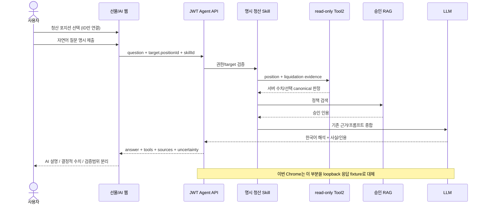

# Q12 이후 AI 발표 웹 연동 — 무과금 통합 준비

작성: 2026-10-21. **오프라인 구현·검증 PASS / 실제 웹 Agent·live DB/RPC·신규 유료 요청 NOT_RUN.** 독립 검토 결과는 아래 누적한다.

## 1. 기준과 격리

- HEAD `f9353c33244565b30fb130dfb6159eab441a3523`.
- 새 브랜치 `feat/ai-presentation-integration`, ignored `deployment/runtime/ai-presentation-worktree`.
- 원본 dirty9, 기존 UI dirty12, AI dirty22의 파일43개를 시작 기준 SHA-256으로 기록했다. 원본 및 두 worktree를 변경하지 않는다.
- P0에서 웹 index/src/test/browser-smoke의 명시된 diff와 신규 표시 helper/test만 apply_patch로 반영했다. README/implementation-log 전체를 복사하지 않았다. 출처는 기존 UI worktree의 `claude-docs/futures-ui-p0-implementation-2026-10-21.md`.
- AI 평가 runner/continuation/Guard/broker/ledger/STOP/claim/approval을 반영하거나 수정하지 않았다. UI에 불필요한 retrieval 관측 코드도 복사하지 않았다. 기존 Agent API/Tool/Skill 재사용으로 충분하다.
- 원본 병합·commit·push·배포·Docker/DB/Anvil 조작·외부 공급자·LLM/embedding 요청 없음.

기준 문서: AI worktree의 `ai-q12-postreboot-real-evaluation-2026-10-21.md`, `ai-agent-recovery-investigation-2026-10-21.md`, `ai-q12-continuation-preparation-2026-10-21.md`; 원본 `futures-final-demo-guide.md`; UI worktree의 위 구현 문서. 과거 데모 guide의 실모델 NOT_RUN은 당시 이력이며 이후 Q12 harness PARTIAL과 구분한다. 이번 fixture PASS로 과거 Q5/Q6 원인을 확정하지 않는다.

## 2. LIQUIDATED / GRACE 원인

| 책임 | 실제 코드와 확인 결과 |
|---|---|
| 온체인 기한 | `contracts/src/FuturesEngine.sol::_execute`의 action 처리: START_CALL은 MARGIN_CALL/deadline=block.timestamp+60. CLEAR_CALL/회복 TOP_UP은 ACTIVE/deadline0. LIQUIDATE는 LIQUIDATED로 바꾸지만 deadline을 지우지 않는다. `_emit`에 그대로 남긴다. |
| DB 위험 상태 | `backend/src/main/java/com/pricetrack/exchange/futures/ledger/FuturesLedger.java::settle`: 기존 risk/deadline에서 START_CALL만 GRACE/새기한, CLEAR_CALL/회복 TOP_UP만 HEALTHY/0. LIQUIDATE는 status=LIQUIDATED와 기존 GRACE/deadline을 저장한다. 이벤트 deadline과 DB deadline이 같아야 정산된다. |
| 원자적 정산 | 같은 @Transactional에서 position/operation/transaction/journal/잔고 갱신 후 Changed 발행. `FuturesPersonalEvents.committed`는 AFTER_COMMIT에서 ID만 개인 전송. 웹은 본인 REST 재조회. |
| 위험 worker | `FuturesRiskEvaluator.evaluate`, ledger.riskCandidates는 OPEN/pending없음만 신규 위험 행동 대상. 종료의 GRACE로 재청산하지 않는다. |
| DTO | `FuturesReadService.view`는 원본 status/risk/deadline 노출. terminal의 현재 unrealized/equity/maintenance는 null. markPrice는 현재 참고가로 청산판단가가 아니다. |
| 체인 비교 | `FuturesAuditVerifier.current`는 CLOSED/LIQUIDATED를 GRACE보다 먼저 매핑. `FuturesToolReader.evidence`는 선택 CALL/LIQ Receipt/Event·journal만 검증한다. |
| 실제 기록 | Q12 원본 보존 Long10 자체에 LIQUIDATED/GRACE. call1792454685/deadline1792454745/liquidation1792454753, 실제68초. 과거 원본은 변경하지 않았다. |

**판단:** 현재 코드의 일관된 저장 결과이며 금융 정산의 상태 역행 결함으로 확인되지 않았다. 종료 후 마지막 위험 기록을 유지하는 구조다. 최초 작성자의 개인 의도까지 입증하는 ADR은 확인하지 못했다. DB/Solidity를 HEALTHY/0으로 정리하면 기존 이벤트 계약을 건드린다. 최소 보완은 **최종 status 우선 표시와 과거 GRACE의 의미 안내**다.

기존 웹의 GRACE-only countdown은 종료 후 0초를 표시할 수 있는 표시 결함이었다. P0의 terminalPosition/futuresRisk가 이미 수정했으므로 재구현하지 않는다. 이번 AI 요약에도 종료 후 마지막 위험 이력임을 명시한다. 원본 snapshot을 지우거나 불일치를 숨기지 않는다.

## 3. 기존 연결과 신규 UI

기존 `futures-panel.js` 진단버튼 → `main.js::selectAi` → target.positionId + `futures-liquidation-diagnosis` → `ApiClient.agent` → JWT 보호 `POST /api/ai/agent/answers`가 이미 존재했다. 새 API/Tool/Skill은 없다. 버튼은 입력만 선택하며 제출 전 호출하지 않는다. 권한 정본은 서버 AuthenticatedUser/ToolContext/FuturesToolReader이며 UI UUID 검사가 소유권 검사를 대신하지 않는다.

### 이번 변경 파일

모두 `tools/websocket-test-client/` 아래다. P0 유래 파일은 index.html, src/futures-panel.js, src/futures-display.js, src/futures-audit-panel.js, src/style.css, test/futures*.test.js, scripts/browser-smoke.mjs다. 신규 작업은 다음과 같다.

- `src/ai-futures-evidence.js`: 성공한 고정 Tool2만 선택, 대상ID 불일치 시 요약 금지. 청산 price/collateral/equity/maintenance/chainTime은 LIQUIDATE operation, 진입/수량/실현/badDebt는 포지션 원본에서만 읽는다. 현재 markPrice나 LLM 문장을 역산하지 않는다. 누락은 확인 불가.
- `src/ui.js`: **Tool 원본 수치 요약 · LLM 생성 문장 아님** 영역 추가. PARTIAL·불확실성·오류·인용·Skill trace 유지. captureScope 또는 fresh=false이면 snapshot/freshRPC아님을 명시한다. 일반 응답도 선택 증거 범위만 설명하며 전체 감사/지속적인 fresh 보증으로 승격하지 않는다. 전체 원본 JSON은 textContent로 접힌 Tool 상세에 보존한다.
- `src/decimal-display.js`: 기존 P0 함수를 그대로 분리·재사용, futures-display의 기존 export 유지. 금융 계산/Number 변환/반올림 없음. 약/극소 비영/음수 방어 유지, 원본은 상세에 남긴다.
- `src/main.js`: 질문·종류·대상 수정/새선택/route이탈 시 이전 AI ticket 무효화. 진행요청 완료 전 버튼과 handler로 중복제출 차단. logout/계정변경 generation 보호 유지. 오류 후 명시 제출만, 자동재시도 없음. 새로고침 때 메모리JWT가 사라지며 자동 AI 재호출하지 않는다.
- `src/style.css`: 수치/hash 줄바꿈·390px 단일열. 기존 P0 감사/포지션 스타일 유지.
- `fixtures/futures-ai-response.js`: Q12 보고서의 한국어 본문 재생과 비민감 숫자/인용 선별 재구성인 **controlled fixture**. private 전체 원본 복사본이 아니다. 현재참고가99,000은 청산판단가60,000 혼용 방지용 인위 fixture. snapshot/fresh=false 명시.
- `test/ai-futures-evidence.test.js`: 수치출처·누락/대상불일치·INCONCLUSIVE·JWT payload·PARTIAL·원본 상세·XSS.
- 기존 `scripts/browser-smoke.mjs`: `--ai-presentation`의 새 독립 폴더/Chrome프로필. 선택/정확UUID/고정Skill/한국어/PARTIAL/수치/인용/RAG실패/전송오류/수동재요청/늦은응답/타인대상404fixture/새로고침 검증. loopback 외 CDP 차단 유지.

금융 계산/DB/DTO/API/상태전이/Oracle/Vault/모델·프롬프트·timeout·Guard 변경0.

## 4. 이번 실제 무과금 검증

| 검증 | 결과 | 범위 |
|---|---|---|
| npm ci --offline | PASS | 새 worktree dependency, 외부호출0 |
| 최종 npm test | **143 PASS / FAIL0 / SKIP0** | P0 138 + 신규5, fixture 모듈 자체는 테스트 수에서 제외 |
| npm run build | PASS | 최종 표시함수 분리 포함 |
| Java 선택 회귀 | **50 PASS / FAIL0 / ERROR0 / SKIP0** | Agent22/Skill22/FuturesToolReader4/PersonalEvents2. Mock/H2/loopback, 실제 PG/체인 아님 |
| Chrome 최종본 | **PASS** | 1366×768/390×844 및 기존360px. 실제 Chrome/compiled UI + HTTP/STOMP fixture |
| 실제 Agent REST/liveDB/RPC | **NOT_RUN** | 기존 서비스 기동 없음 |
| 신규 유료 LLM/embedding | **NOT_RUN / 0회** | Q12 과거 답변 재생 출처만 사용 |

명령: `npm test`, `npm run build`, `node scripts/browser-smoke.mjs --ai-presentation --polish-after`; Java는 `gradlew.bat test --offline --no-daemon --rerun-tasks --tests '*AgentServiceTest' --tests '*SkillServiceTest' --tests '*FuturesToolReaderTest' --tests '*FuturesPersonalEventsTest'`. JDK21/IPv4는 해당 프로세스만. 전체 backend/Foundry/PGAnvil 재실행은 NOT_RUN이며 불필요한 반복을 하지 않았다.

실패 이력: 일반 sandbox의 최초 Vite는 상위폴더 Access denied, 승인된 권한에서 재빌드 PASS. 첫 Chrome는 HTTP접수 전 호출수 샘플링으로4!=3실패, 실제접수/버튼disabled 대기를 추가해 테스트만 수정하고 PASS. 제품 오류·유료 재시도로 혼동하지 않는다. fixture모듈이 test폴더에서1테스트로 세어졌던 최초144집계는 최종143과 구분한다.

새 Chrome 증거는 본 worktree `deployment/runtime/ui-p0-evidence/` 아래 `ai-presentation-KhMNTq`(첫 성공, 원본긴숫자)와 `ai-presentation-OQ3HmQ`(최종 요약정밀도)다. 이전 실패 폴더도 삭제하지 않았다. `ai-answer-1366.png`, `ai-evidence-1366.png`, `ai-answer-390.png`, `ai-evidence-390.png`, `verification.json`을 보존한다. 실제 체인 인수 화면이 아니다.

## 5. 다음 실제 시연의 승인 경계

| 단계 | 준비/미완료 | 비용과 위험 |
|---|---|---|
| 기존 Q12 답변 fixture 재생 | 이번 브라우저 PASS. 로그인/포지션/Agent도 fixture임을 명시 | 무료. live AI 성공/실제영상으로 표현 금지 |
| 실제 Agent API 웹 제출 | NOT_RUN. 새source/image/JWT/backend/web/AI설정/index 필요 | 웹POST를 평가Guard가 자동 보호한다고 가정 금지. 전송경계 비용Guard/자동종료/상한이 포함된 새 승인 필요 |
| live PG/Anvil Tool조회 | NOT_RUN. 신규 격리 Synthetic환경·본인청산포지션·인증/WS/REST gate 필요 | 기존보존환경 변경 대신 신규환경 승인. AI없이 read gate 먼저 권장 |
| fresh canonical RPC | NOT_RUN. deployment/historicalRPC/확인수/blockhash/동일DBcut을 실제 ToolReader로 검사 | 단순라벨로 fresh 승격금지. unavailable시 INCONCLUSIVE, 선택검증과 전체감사 구분 |
| 웹 실제 LLM 답변 | 별도 유료 실행 승인 필요 | 명시Skill이면 계획LLM0·종합최대1·embedding최대1을 목표. 기존누적예약US$0.36634320/Q6 RESERVED승계. 기존Q12 STOP/claim/permit 재사용금지. 새context의 정확한 직렬화예약/기간/한도를 먼저 검증해야 하며 이번 금액 승인은 없음 |

현재 발표 추천: 자동청산/계약검증을 중심으로 하고 AI는 snapshot 한계를 밝힌 **무과금 재생/근거 설명 자료**로 보조한다. 실제 웹→모델→fresh조회 인수 후에만 라이브를 판단한다. 영상은 이번에 제작하지 않았다.

## 6. 독립 검토와 보존 확정

독립 검토 `review_ai_presentation`: **발견된 필수 수정 없음**. tracked diff/모든 신규파일/문서/상태 원인 코드/PNG4개/verification.json을 확인했다. 검토자가 직접 웹143 PASS/FAIL0/SKIP0 및 build PASS를 실행했다. Java50/Chrome실행은 구현자의 이번 실제 실행이며 검토자 재실행으로 보고하지 않는다. 검토자는 실Agent/DB/RPC·paid·시작보존해시를 직접 검증하지 않았으며 범위를 명시했다.

원본/UI/AI 미커밋43파일은 시작 대비 그대로다. 별도로 부모/child/Q12 ledger·STOP·manifest·승인·claim·결과 등 비밀파일을 제외한113개 읽기전용 해시도 대조 구간에서 동일하다. 합계 **156/156 일치**, 비밀key/DB환경파일은 값이나 fingerprint를 출력하지 않았다. 과거Q12 유료요청을 추가로 전송하거나 claim/STOP을 변경하지 않았다. Git상 원본9/UI12/AI22경로 및 HEAD를 유지하고 새 통합worktree에만 변경이 남는다. Docker/DB/체인은 이번에 조회·기동하지 않았으므로 내부정합성을 새로 검증했다고 주장하지 않는다.

`git diff --check` 최종 확인. 표시는 실제1366/390px PNG를 직접 열어 검토했다. 기존 긴원본수치(동일작업의 첫Chrome성공)와 가독성요약(최종Chrome)의 비교는 아래와 같다. 모두 offline fixture이며 새로운 거래 결과가 아니다.

| 화면 | 첫 구현 | 최종 구현 |
|---|---|---|
| 1366px 답변/수치 | `ai-presentation-KhMNTq/ai-answer-1366.png` | `ai-presentation-OQ3HmQ/ai-answer-1366.png` |
| 390px 수치 | `ai-presentation-KhMNTq/ai-evidence-390.png` | `ai-presentation-OQ3HmQ/ai-evidence-390.png` |

위 폴더는 이 worktree의 `deployment/runtime/ui-p0-evidence/` 아래이며 ignored다. exact 원본은 최종 화면에서도 Tool 상세에 그대로 유지한다. screenshot·빌드·node_modules·XML·사용자증거를 Git에 넣지 않았다.

새 source로 실행하는 실제 웹AI 단계에는 기존 평가sourceHash/permit를 그대로 사용할 수 없다. 이 작업은 미커밋 UI 통합본이고 평가Guard가 해시하는 범위와 웹 소스범위도 다르다. 이후 새로운 실행identity는 웹/서버/전송guard 각각의 파일범위를 확인해 묶어야 한다. old manifest를 덮어쓰거나 예산을 초기화하지 않는다.

최종 결과: **오프라인 발표 UI 준비 완료**, 실제 웹Agent/실시간DB·RPC/유료 추가평가/원본 병합은 **NOT_RUN**. Q14/Q15 미실행. 이 단계에서 작업을 종료하고 다음 실제 인수 승인을 기다린다.
