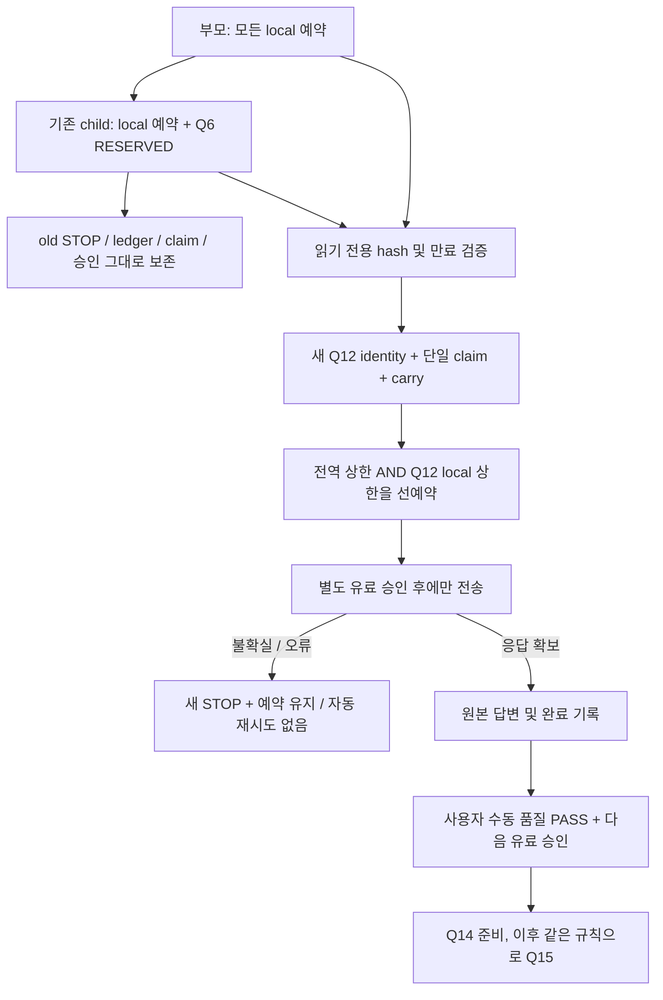

# Q12 청산 설명 continuation — 무과금 재개 준비

## 1. 범위와 현재 판정

작성: 2026-10-21. 별도 `feat/ai-failure-observability`, 기준 HEAD `f9353c33244565b30fb130dfb6159eab441a3523`의 미커밋 작업이다. 원본 melon-init 및 futures-ui-p0를 병합하지 않았다.

이번 승인은 **새 continuation 정책 구현·오프라인 검증**이다. 실제 Q12 답변, 유료 LLM/embedding, 새 실DB/index 복사, Chrome 시연은 NOT_RUN이다. 원본 STOP 해제·실패 결과 수정·새 예산으로 초기화하지 않는다. 이전 [복구 조사](ai-agent-recovery-investigation-2026-10-21.md)와 [실제 평가 실패](ai-q2-16-real-quality-evaluation-2026-10-20.md)는 당시 증거로 보존한다.

## 2. 과거 사실 / 미확정 원인 / 추가 관측

- 과거 Q5: Tool 및 embedding 응답 이후 RAG_UNAVAILABLE. 검색 승인·SQL·필터·deadline 중 정확한 실패 단계는 확인하지 못했다. 특정 SQL timeout으로 확정하지 않는다.
- 과거 Q6: 예약 COMMIT 이후 응답/usage를 확보하지 못해 RESERVED와 STOP. 원격 처리·과금 여부는 미확정이며 무료/미호출로 환급하지 않는다.
- 앞선 복구 작업의 고정 retrieval 단계 코드·잔여 deadline 및 transport 단계 관측을 그대로 활용한다. 과거 실행에 없던 로그를 소급 생성하지 않는다.
- 이번 실측: 원본 부모/child ledger를 RO SQLite로 열어 2개 ancestor, 불확실 예약 1개 및 아래 누적 합계를 확인했다. 원본 승인 파일은 만료됐으며 기존 child claim은 그대로다. 키 파일은 읽지 않았다.

| 누적 사용/예약 | 현재 값 | 전체 한도 | 산술 잔여 |
|---|---:|---:|---:|
| LLM | 11 | 32 | 21 |
| embedding | 37 | 80 | 43 |
| input | 87,575 | 400,000 | 312,425 |
| output | 6,800 | 32,000 | 25,200 |
| embedding tokens | 73,395 | 100,000 | 26,605 |
| 무환급 예약 USD | 0.30200540 | 2.00 | 1.69799460 |

이 잔여량은 **유료 실행 권한이 아니다**. Q6의 input15,490/output1,600/예약0.057925도 위 합계에 들어 있다.

## 3. 대안과 선택

| 대안 | 판단 |
|---|---|
| old STOP 삭제/기존 ledger 재개 | 불확실 전송 재실행과 실패 증거 변경 위험. 금지 |
| 기존 root에서 새로운 일반 child 생성 | 이미 소비된 claim과 전체 한도 우회. 금지 |
| ancestor 파일을 수정해 한도를 재배분 | 원본 lineage/identity 파괴. 금지 |
| **RO ancestor snapshot + 새 단일 문항 continuation** | 선택. 원본을 보존하고 모든 local 예약을 정확히 한 번 누적 |

`ai_evaluation_continuation.py`: root/child의 exact ledger identity, 원래 정책, reservation 비용·타입·UUID·digest, run/ledger/approval/STOP/old claim hash 및 corpus를 검증한다. live permit가 아직 유효하면 STOP이 있어도 거부한다. WAL/journal이 남은 실행도 채택하지 않는다. root는 기존 legacy verifier를 사용한다. 기존 child control.stopped=0이라는 사실은 유지하며 STOP+만료와 불확실 예약을 보존한다.

새 run은 새 sourceHash/DB owner/manifest/ledger를 갖지만 예산은 초기화하지 않는다. carry는 각 ancestor의 **local reservation 행만** 합산한다. 과거 carry를 다시 더해 이중 차감하지도, RESERVED를 제외하지도 않는다. source/corpus는 broker load_run과 매 dispatch lineage 검증에 연결한다. 보존 Long10 evidence 파일도 해시로 묶는다.

새 별도 registry `deployment/runtime/ai-evaluation-continuations-v1`에서 **직전 runId별 O_EXCL claim**을 fsync한다. 동시 실행은 한 개만 성공하며 준비 중 실패해도 claim을 재발급하지 않는다. 새 Guard identity에 carry와 local_limits를 포함해 plain Guard 재개/한도 생략을 차단한다. SQLite BEGIN IMMEDIATE 안에서 전역+문항 한도를 동시에 예약한다. 실제 sender는 예약 COMMIT 뒤에만 호출된다.

Q12→Q14→Q15의 단방향만 허용한다. 새 continuation 자체가 불확실해지면 다음 문항으로 넘어갈 수 없다. 이후 재개는 이번 정책 밖의 별도 결정이다. 기존 old child의 불확실 슬롯을 승계하는 최초 Q12만 명시적으로 허용했다.

## 4. 코드 경계와 진단

- `deployment/ai_evaluation_guard.py`: 선택적 immutable local_limits. legacy identity/한도는 그대로 유지한다.
- `deployment/ai_evaluation_continuation.py`: RO snapshot, 누적 carry, 단일 predecessor claim, scope, 수동 quality gate, 실제 직렬화 dry-run 판정. 키/HTTP 생성 없음.
- `deployment/ai_evaluation_broker.py`: continuation carry/scope를 Java 전송 경계 Guard에 연결. 새 approval은 contextHash·질문·localLimits에 바인딩한다. 키를 읽기 전에 dry-run과 새 index-copy proof를 확인한다. continuation 오류는 STOP+control stop으로 종결하며 재전송하지 않는다. 기존 transport whitelist 로그 유지.
- `deployment/ai_index_copy_fixture.py`: 기존 RO cold copy 도구에 명시적 continuation predecessor/evidence/legacy registry 옵션만 추가. 원본 READY vector를 새 owner로 복사하는 기존 network-none/SCRAM/Relay/JDBC/IndexLease 절차를 재사용한다. 이번에는 Docker나 이 복사 경로를 실제 실행하지 않았다.
- `EvaluationRequestDryRunTest`: 선택자를 명시한 경우 Q12/Q14/Q15 중 한 문항만 기존 실제 Provider 요청 형식으로 직렬화. 선택자 없으면 기존 Q2~16 전체 범위 유지. 두 context 크기 profile, snapshot hash, CREATE_NEW 출력.
- `ApprovedAiModelEvaluationTest`: continuation manifest에 든 단일 고정 질문만 실행, 기존 full/child 동작 유지. READY DB를 먼저 확인, 기존 16문항·Agent/Skill·40초 deadline·프롬프트·판정 기준 유지. 원본 답변을 `question-result.private.json`에 별도로 보존한다. 유료 opt-in gate는 이번에 켜지 않았다.
- 기존 RAG stage logger/Java runner/Instant mapper/Tool fixture는 기존 복구 수정과 함께 사용한다. 금융/시장/청산 정책·모델·프롬프트 수정은 없다.

수동 `quality-review.json`은 사용자 검토의 로컬 증명 파일이며 인증 서버의 전자서명이 아니다. 새 runId/sourceHash/question/resultSha256/PASS/reviewedBy=USER를 정확히 일치시켜야 한다. ANSWERED 원본, 실제 LLM 예약, 단일 문항 completion 및 불확실 없음도 요구한다. JUnit 성공이나 생성 완료를 품질 PASS로 자동 승격하지 않는다. 로컬 승인 파일/소스 자체를 악의적으로 수정하는 사용자를 방어하는 보안 sandbox는 아니다.

## 5. 오프라인 검증과 발견 사항

- 최초 Java 선택 회귀: 37 실행 중 결과 출력 디렉터리 부재로 1 실패. API 전송 실패가 아니다. XML을 private runtime에 별도 보존했다. 제품 코드나 timeout을 변경하지 않고 신규 출력 디렉터리를 준비했다.
- 출력 경로 보완 후 44 PASS, 이후 Agent/Skill 포함 선택 회귀 **92 PASS / 0 FAIL / 0 ERROR / 0 SKIP**. H2/Mock/로컬 stdio 및 실제 직렬화이며 PostgreSQL/Anvil/실모델 결과가 아니다.
- Python 중간 67 PASS, 확대 92 PASS. 전송 경계 테스트의 응답 키를 잘못 기대한 테스트 오류를 수정했고, continuation은 오류 후 다음 요청도 진행하지 않도록 STOP을 보완했다. 이후 **101 PASS**. 최종 재검증/독립 검토는 아래 누적한다.
- Q12 두 dry-run profile 모두 `embeddings` 1회 + `responses` 1회. 이는 **로컬 Mock transport 횟수**이며 실제 providerCalls=0이다. 두 profile은 예산을 두 번 사용하는 live 평가가 아니다.
- 검증 항목: 불확실 예약 승계, 동시 claim, source/corpus/evidence 변조, 원본 STOP 변경 차단, local call/cost/token 상한, 프로세스 재생성, 준비 crash 후 claim 재발급 거부, 새 전송 불확실 후 재개 차단, 품질 검토 없는 Q14 거부, 기존 Guard/broker/legacy lineage 회귀.
- paid 모델/embedding 0, 기존 DB/체인 접근 0, Docker 서비스 조작 0. 공식 문서 읽기만 수행했다. [OpenAI 공식 retry 안내](https://developers.openai.com/api/docs/guides/rate-limits)의 SDK 재시도 가능성과 별개로 본 도구는 단발 HTTP sender/자동 재시도0을 유지한다. 아래 값은 기존 프로젝트 예약 단가 계산이지 새 실청구 요금 확인 결과가 아니다.

## 6. 최소 유료 평가 승인 요청안 — 아직 실행하지 않음

| 문항 | 신규 LLM | 신규 embedding | input/output/embedding 상한 | 신규 최대 예약 USD | 전체 최대 누적 USD |
|---|---:|---:|---|---:|---:|
| **Q12만** | **1** | **1** | 32,768 / 1,600 / 1,032 | **0.10114064** | **0.40314604** |
| Q14 (Q12 수동 PASS 뒤 별도 승인) | 2 | 1 | 65,536 / 2,000 / 1,032 | 0.18786064 | 0.59100668 |
| Q15 (Q14 수동 PASS 뒤 별도 승인) | 2 | 1 | 65,536 / 2,000 / 1,032 | 0.18786064 | 0.77886732 |

모두 실행했을 때 LLM16/32, embedding40/80, input251,415/400,000, output12,400/32,000, embedding76,491/100,000이다. 모든 원본 사용/불확실 예약 포함. Q12 이후에는 최소 US$1.59685396가 남지만 추가 실행 권한은 아니다. Q12 실패/불확실/근거 부족이면 종료한다.

Q12는 기존 질문 “내 Long 포지션은 왜 강제청산됐나요? 기록된 근거로 진단해주세요.”와 명시 Skill을 유지한다. 분류 LLM은 생략하고 고정 Tool2개 → scoped RAG/embedding → 한국어 종합1회를 검증한다. 새로운 질문을 만들거나 Q1·검색 golden·전체 색인을 반복하지 않는다.

실제 답변 수동 대조: Long10 진입75,000·증거금100,000, 평가60,000, 유지증거금40,000 및 equity/손실 상한/악성부채 구분, 온체인 마진콜 이후 실제60초 이상 유예, 청산 canonical Receipt/Event와 DB journal 및 보증하지 않는 범위를 확인한다. snapshot의 원본 decimal을 기준으로 하며 위 요약의 정수 표시는 정답 기준 변경이 아니다. AI가 청산을 실행했다고 말하면 실패다.

Q14는 canonical 확정과 검증 cut 한계, Q15는 journal·실현손익·house pool 및 실제 담보 예치 아님을 확인한다. 조회 Tool이 제공하지 않은 전수 감사나 지급능력을 확정하면 실패다. 실제 UI/Chrome 호출 경로는 별도이며 harness PASS를 웹 시연 PASS로 주장하지 않는다.

## 7. 다음 실행 절차와 중단 조건

1. 사용자가 **Q12 단독 위 상한의 유료 실행**과 새 격리 AI DB/index 준비를 명시 승인한다. 이번에는 승인 파일/real claim/run을 생성하지 않았다.
2. 최신 sourceHash/corpusHash, 불변 ancestor hash, 종료된 이전 permit, 단일 claim 미사용, 원본 evidence hash 재확인. source가 바뀌면 dry-run을 새 CREATE_NEW 파일로 생성한다.
3. 현재 worktree의 `ai_index_copy_fixture.py --parent <원본 READY 부모> --continuation-predecessor <보존 child> --legacy-registry <원본 lineage registry> --evidence <보존 snapshot> --dry-run-capture <최신 Q12 capture> --run-dir <새 private 경로> --port <새 포트>`로 **새** continuation/DB만 준비. 원본 DB는 RO cold copy, 기존 ledger/STOP/claim은 수정하지 않는다. 준비 실패 claim은 자동 재발급하지 않는다.
4. 기존 `--check --run-dir <새 경로>`로 network-none/Relay/SCRAM/JDBC/pgvector/vector9문서88청크/READY owner를 무과금 확인한다. Relay 수명·최대 연결·종료 수단과 단일 Java 실행을 다시 점검한다. 실패 시 유료 전송 금지.
5. 새 run/source/corpus/context/questions=[12]/localLimits에 일치하는 신규 approval만 사용자 승인 이후 작성. 기존 approval 재사용 금지. 키는 기존 전용 private 파일 참조, 값 복사/출력 금지.
6. 해당 새 run과 evidence 경로를 지정하고 기존 `AI_APPROVED_MODEL_EVALUATION=true` 게이트의 단일 harness 실행. 전체 검색 평가는 child처럼 생략된다. Q14/15는 이 run에 포함되지 않는다. provider 단계 trace/usage/STOP/result/completion과 wall-clock latency를 새 경로에 보존한다.
7. 응답과 Tool2개/RAG 인용·정확한 숫자·시각·권한·불확실 표현을 사람이 대조. ANSWERED와 생성 완료만으로 PASS하지 않는다. Q12 품질 PASS도 별도 유료 승인 없이 Q14 자동 실행을 뜻하지 않는다.

Guard/identity/DB owner 오류, 권한 위반, deadline/RAG 실패, 응답 불확실, 한도 초과 시 추가 요청을 중단한다. 원본과 새 STOP/예약을 유지하며 새 ledger로 우회하지 않는다. paid 40초 Agent/shared5초 retrieval budget을 임의로 늘리지 않았다. 따라서 과거 Q5/Q6 원인을 확정하지 못한 상태에서 실제 재실패할 수 있다. 진단은 원인을 구분할 자료를 확보할 뿐 성공 보장이 아니다.

## 8. 최종 검토·보존 대조

- 최종 sourceHash: `86dcb3cef1b41a98f761a7c53286b252aca4f8ba8cfab6738729ab330de07fa8`. corpusHash: `c106ed6e152602dd56a48c855316ad23fd4bb563ffc099755aabcbb7794067ba` (변경 없음). source identity는 HEAD만이 아니라 미커밋 코드까지 포함한다. 원본 및 UI HEAD는 f9353c3 그대로다.
- Python 최종 **102 PASS / 0 FAIL / 0 ERROR**. `python -B -S -m unittest test_ai_evaluation_continuation test_ai_evaluation_lineage test_ai_evaluation_guard test_ai_transport_diagnostics test_ai_evaluation_broker test_ai_reevaluation_plan test_ai_input_budget_v4 test_ai_index_copy_fixture test_ai_evaluation_dry_run`. 임시 fake ledger와 mocked Docker 명령만 사용했다. 신규 continuation 21개, 기존 모듈81개다.
- 추가 cold-copy positive Mock에서 실제로 첫 `run` 명령을 찾아 RO mount를 검사하도록 수정했다. 초기 전체102 중1 FAIL은 volume-create 명령을 잘못 인덱싱한 테스트 assertion 오류였으며 제품/Docker 장애가 아니다. 수정 후 전체102 새 실행 PASS. 실제 Docker 복사 성공으로 표시하지 않는다.
- Java 선택 회귀 **92 PASS / 0 FAIL / 0 ERROR / 0 SKIP**: Agent22, SkillService22, SkillRegistry4, PositiveSmoke19, Runner10, retrieval-stage6, serialization3, verdict4, dry-run2. Tool10·Skill4 정상/직렬화/권한 및 기존 diagnostics 경계를 포함한다. XML은 private `deployment/runtime/q12-java-92-results/`에 보존했다.
- 마지막 Python broker/source identity 보완 이후 Java **Q12 직렬화/selector2 PASS / FAIL0 / SKIP0**를 새로 실행했다. 최종 private artifact `deployment/runtime/q12-continuation-dry-run-v3.private.json`의 sourceHash가 현재 값과 일치하고 `assess` 통과. 이전 v1/v2 파일을 덮어쓰지 않았다.
- 두 profile 각각 input19,063/output1,600/embedding140 보수 상계, LLM1+embedding1, 예약 US$0.06686030. 이는 fixture 기반 직렬화 산정이며 실제 token/청구액이 아니다. live Guard의 승인 요청 상한은 더 큰 **US$0.10114064**를 유지하고 실제 요청마다 다시 예약한다. 실제 providerCalls=0.
- 별도 검토 `review_ai_q12_continuation`: **발견된 필수 수정 없음**. 실제 소스/새 파일/문서 및 source·scope·STOP·고정문항·RO copy를 확인했다. 직접4모듈71 PASS, 수정 후 continuation21 PASS. 확대102 최초 실행의 잘못된 assertion1 FAIL도 확인했다. 최종전체102/Java92+2는 구현자 결과이며 검토자 직접 실행으로 혼동하지 않는다.
- 원본 HEAD/status 유지, 보호 파일 **53/53 SHA-256 동일**. 원본 dirty9개, UI 별도 worktree dirty12개, 부모·child 원본 ledger/STOP/approval/manifest/old claim/private 증거를 보존했다. 현재 작업의 real continuation registry/claim/approval 및 새 실DB를 생성하지 않았다. fake 테스트 실행은 임시 폴더로 제한했다.
- 실제 자연어 답변 품질·pgvector 복사·발표 Chrome은 **NOT_RUN/판단 보류**. 새 Q12 유료 승인과 신규 index 검증 후에만 재개한다. Q14/Q15는 이후 수동 품질 PASS + 종료된 이전 permit + 추가 실행 승인을 요구한다.
- 원본 병합·commit/push·배포 없이 현재 별도 worktree에 미커밋 상태로 남긴다. 기존 복구 문서는 변경하지 않았다.
