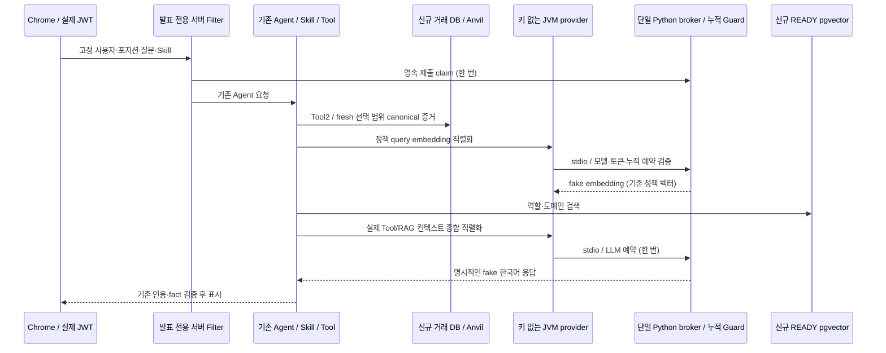

# AI 발표 웹 2단계 — 누적 Guard 및 READY Index 무과금 통합

후속 [최종 Gate1회 실행](ai-web-final-gate-2026-10-21.md): 옵션/stacktrace 보완 source88df6616의 새7527eafc는 Gradle daemon native listen에서 BLOCKED. 아래66eaf1c 및 이전실행은 당시기록이며 새로운PASS로덮어쓰지않는다. 실제유료0, 기존증거보존.

> **구현·오프라인 검증 PASS / 실제 웹 통합 1회 PASS / 최종 안전장치 소스의 전체 통합 BLOCKED(Windows Gradle socket bind).** 실제 유료 LLM/Embedding 실행과 실제 승인 파일 생성은 0회다. 유료 실행 승인만 남았다고 보고하지 않는다.

## 1. 범위와 보존

기존 `feat/ai-presentation-integration`, HEAD `f9353c33244565b30fb130dfb6159eab441a3523`의 미커밋 작업 위에서 진행한다. [1단계](ai-web-stage1-live-integration-2026-10-21.md)의 실제 Tool 성공과 EMPTY Index/PARTIAL 결과는 당시 기록으로 보존한다. 원본·UI·AI 평가 worktree와 부모/child/Q12 ledger, STOP, RESERVED, claim, approval은 변경하지 않는다. 기존 Q12의 품질은 PARTIAL이며 이번 fake 응답으로 과거 결과를 성공으로 바꾸지 않는다.

## 2. 연결 구조

제품 금융/정산/청산 계산·Agent 프롬프트·timeout은 변경하지 않는다. 현재 발표 서버 wiring은 **test classpath 전용**이며 일반 앱의 유료 호출에 자동 적용되지 않는다. `app.ai.enabled=false`, 빈 key, `guarded:stdio/`만 허용하여 일반 HTTP provider 생성을 막는다.

`FuturesWebScopedTransport`는 실제 DB에서 확정된 신규 청산 포지션과 사용자로 한 번 bind한다. Servlet 보안 인증 이후 Filter가 정확한 질문/Skill/포지션/사용자를 검사하고, Python의 제출 claim 성공 후에만 Agent로 전달한다. 다중 탭/재시작은 영속 파일 O_EXCL와 SQLite 원자 예약으로 차단한다. 클라이언트는 예산/identity/허용 사용자를 지정하지 못한다.

## 3. lineage와 예약

기존 AI worktree의 검토된 `ai_evaluation_continuation.py`, `ai_evaluation_guard.py`만 이 worktree에 명시적으로 반영했다. 기존 파일과 registry는 수정하지 않는다. 새 웹 lineage는 Q14/Q15 continuation과 별도 branch이며 부모/child/Q12 snapshot과 원래 claim을 읽기 전용 검증한다. 과거 Q6 RESERVED는 계속 전액 포함한다.

기존 누적: LLM12, embedding38, input105629, output8400, embedding tokens73535, 무환급 예약 US$0.36634320. 새 범위는 LLM1/embedding1/input32768/output1600/embedding1032/US$0.10114064 이하이며 전역 32/80/input400000/US$2와 동시에 검사한다. fake 테스트 ledger는 simulation으로 표시하며 실제 지출이나 승인으로 해석하지 않는다. 새 실제 유료 승인은 생성하지 않는다.

## 4. READY 데이터

기존 중지된 READY AI DB를 직접 시작하지 않고, 검증된 `ai_index_copy_fixture.py --probe`의 network-none / 원본 volume readonly cold copy 절차를 재사용한다. 복사본 scratch DB에서 READ ONLY repeatable-read export, 신규 owner DB로만 import한다. 새 JDBC/SCRAM/pgvector/IndexLease/metadata/vector checksum 및 역할 필터는 기존 `EvaluationIndexCopyTest`로 확인한다. 전체 재색인과 유료 embedding은 없다.

## 5. 실행 및 결과

신규 session `phase-a-20261021075611-5c5bbd60` 준비. 실제 실행 결과, 오류와 재실행 identity, 최종 소스 및 요청별 dry-run은 아래 누적한다. 실행 전 Gradle sandbox 캐시 접근 실패는 사용자 캐시를 사용하는 권한 실행으로 해결했다. Node 문법 검사의 잘못된 상대 경로 1회는 호출 경로 오류이며 올바른 root에서 재확인했다.

### 실패와 수정 이력 — 원본 증거 보존

| fixture | 실제 결과 | 확인한 원인과 수정 |
|---|---|---|
| `futures-ai-web-aff413d0` | FAIL, 유료 0 | clean child 환경에서 Windows `getpass.getuser()` 실패. 새 폴더 ACL만 token-derived SID로 설정하도록 수정. 기존 credential 환경 자동 import는 하지 않음 |
| `futures-ai-web-c5486e39` | READY 복사/JDBC 1 PASS 후 harness FAIL | `docker run` DB에는 Compose healthcheck가 없었다. 실제 JDBC 검증 proof와 Running/소유권을 확인하는 경로로 분리. PostgreSQL 결함 아님 |
| `futures-ai-web-233cc52d` | 실제 청산·Tool/RAG/fake LLM 성공 후 assertion FAIL | fake임을 명시하는 uncertainty 때문에 기존 Agent가 PARTIAL을 반환. 테스트만 잘못 ANSWERED를 기대했다. 금융/Agent 정책은 유지하고 PARTIAL + 인용 + SUMMARIZE VALIDATED를 검증하도록 수정 |
| `futures-ai-web-12e72d92` | 실제 Chrome/PG/Anvil 통합 1 PASS, FAIL/SKIP 0 | 실제 USER/JWT, Long10 자동청산, Tool2/fresh RPC, RAG1, fake LLM1, 인용2, 1366/390px 및 권한 거부, 감사 MATCH 확인 |
| `futures-ai-web-7ea5b98b` | 최종 전체 통합 BLOCKED | 새 READY DB 검증 proof는 생성됐으나 Gradle `:test`가 `java.net.SocketException: Bad address: bind`로 exit1. 새 Chrome/Agent 검증은 시작하지 않음. proof 존재만으로 전체 실행 PASS 처리하지 않음 |

`12e72d92`의 포지션은 `492a92a5-b32a-48a9-8295-1751601b4fab`이다. Agent는 PARTIAL 및 `FAKE_MODEL_NOT_REAL_QUALITY_EVALUATION`를 명시했다. 요청 직렬화 dry-run은 input16,214/output1,600/embedding140, 새 보수 예약 **US$0.05973780**이었다. 이 숫자는 fake fixture에서 생성된 요청의 보수 상계이며, 실제 모델 usage·청구액·다른 시연 컨텍스트의 예상 비용이 아니다.

이 성공 이후 독립 검토에서 cold-copy helper 정리와 watchdog 잠금 경계를 보완했다. 위 PASS를 최종 보완 소스의 PASS로 재사용하지 않는다. 마지막 소스의 별도 신규 fixture 및 dry-run은 아래 최종 판정에 기록한다.

이번 새 실행: Python97 PASS, Java 선택 회귀60 PASS/FAIL0/SKIP0(XML은 새 session `stage2-java-final`), 웹 전체143 PASS/FAIL0/SKIP0 및 build PASS, Node assertion13 PASS. Java 실행 1회는 Windows native `Bad address: listen`으로 daemon 시작 전에 실패했고, 명시 IPv4/IPv6 JVM 옵션의 1회 제한 재검증에서 위60개가 통과했다. 시스템 네트워크나 Docker/WSL은 재시작하지 않았다.

## 6. 유료 실행 경계 — 아직 승인 대기

이 단계는 fake sender만 실행하며 기존 Q12 키/승인 파일을 읽지 않는다. 실제 웹 유료 실행은 별도 사용자 승인, 새 execution identity/owner/source/context, 고정 사용자·포지션, 실제 직렬화 dry-run과 별도 permit를 요구한다. 기존 Q12 승인이나 STOP/claim을 재사용하지 않는다. 이 문서의 산술은 새 예산이 아니다.

### 새 live 경로의 준비와 실행 제한

`ai_web_demo_broker.live_sender`는 읽기 전용 3-ancestor 검증, READY copy proof, 새 context, 정확한 user/position/Skill/question, local1+1, carry, 지정 모델, retry0, 600초 이내 만료, dry-run SHA-256/직렬화 상한을 확인한 뒤에만 기존 단일 HTTPS sender를 만든다. JVM은 여전히 키를 읽지 않는다. permit 생성 코드는 추가하지 않았다. unit-test 임시 fake permit와 Mock sender 검증은 실제 승인 발급/전송이 아니다.

실행 identity와 ledger의 `mode=offline`을 live로 바꾸는 방법은 없다. simulation claim은 신규 fixture 내부, live claim은 웹 전용 전역 registry의 Q12 predecessor당 단일 슬롯이다. simulation 비용은 실제 지출에 더하지도, 실제 남은 예산을 초기화하는 데 쓰지도 않는다. live에서는 기존 실제 carry를 승계한다.

Java live wiring은 **미리 준비된 새 live manifest와 approval**을 요구한다. bind 중 승인 파일을 자동 생성하거나 UI 질문으로 live mode를 선택하지 않는다. live 서버 기동 전 별도 준비 단계에서 scope/DB/owner/질문/직렬화 proof를 확정하고, 사용자 승인 뒤에만 새 permit를 만들어야 한다.

watchdog은 in-flight post의 synchronized monitor를 기다리지 않는 Java abort와 별도 Python Timer로 보강했다. Python은 idle stdin 대기 중에도 STOP을 fsync하고 자기 프로세스를 종료한다. 예약은 SQLite COMMIT 뒤 전송하므로 강제 종료 시에도 불확실 예약이 남는다. Java 별도 worker의 진행 중 fake stdio 요청 취소 및 별도 Python 프로세스 idle 종료를 무과금으로 검증했다. 현재 브라우저 harness의 별도 Node465초 한도와 backend 테스트480초 한도도 유지한다. 이 범위 밖의 장기 상주 운영 서버까지 자동 보호한다고 표현하지 않는다.

명시적 중단은 이 **새 실행만**의 `STOP` 및 Java `close/abortWeb` 경로다. 기존 Q12 STOP/claim을 열거나 삭제하지 않는다. 브라우저가 사라져도 제출/endpoint claim과 예약은 원상 복구하지 않으며 자동 재요청하지 않는다. 요청별 허용 token usage만 새 private journal에 남긴다.

최대 신규 예약 US$0.10114064, 기존 포함 US$0.46748384. 모델은 `gpt-5.6-terra`, `text-embedding-3-small` 그대로이며 자동 재시도 0회다. 단가 근거: [Terra 공식 모델 문서](https://developers.openai.com/api/docs/models/gpt-5.6-terra), [Embedding 공식 모델 문서](https://developers.openai.com/api/docs/models/text-embedding-3-small). Guard의 기존 보수 단가를 낮추거나 모델을 대체하지 않는다.

## 7. 독립 검토 및 남은 gate

최초 독립 검토의 context 거부 후 STOP, cold-copy 부분 실패 정리 지적을 수정했다. 후속 검토의 `-cold-copy` helper 정리와 watchdog lock 지적도 수정하고, 최종 재검토를 요청한다. 일반 앱 유료 provider와 이 발표 전용 경로를 혼동하지 않으며, fake 응답 성공은 실제 LLM 한국어 품질이나 유료 웹 시연 PASS가 아니다. 승인 전 신규 유료 요청·승인 파일 생성·원본 병합·push·배포는 하지 않는다.

기존 보호156개 파일은 이번 최종 검사에서도 SHA-256 동일했다. 기존 source/ledger/STOP/claim/DB/index를 새 값으로 덮어쓰지 않았다. 전체 현물/선물 인수를 불필요하게 반복하지 않았으며 금융 변경은 없다. 별도 실제 유료 연결, Q14/Q15, Google 실인증, KRX/NXT 인수는 이번 NOT_RUN이다.

## 8. 최종 판정과 인계

### 실행 identity

- 현재 최종 sourceHash: `66eaf1c80358d067c7d940b82760eda3a3ef2abcb24158e6584230b4c0b96eac`.
- corpusHash: `c106ed6e152602dd56a48c855316ad23fd4bb563ffc099755aabcbb7794067ba`.
- 실제 웹 성공 `12e72d92`의 당시 sourceHash: `107865a5198c093d8270033e4a91fbf8a890721154375abaed09befd89b023bc`, 웹 simulation identity `eval_3f7316567d3e45e48a584e13f7ddb7cc`. 최종 소스와 동일하다고 가정하지 않는다.
- 최종 `7ea5b98b`의 AI DB identity: `eval_d1ba4153c7514002a1c22920a92114f8`, 신규 loopback Relay62643. READY proof의 data SHA-256은 `9888d43fb6a4056645efcf1c93fbd061246ef016ffbdd7244174e536b3a0869e`이며 원본 벡터 checksum과 일치한다. Gradle exit1이므로 이 환경의 최종 전체 JDBC/Chrome gate는 BLOCKED다.
- 실제 성공 환경 거래 DB42379 및 전용 Anvil35341, 기존 보존 환경과 분리했다. AI DB는 별도 network-none owner DB다. 실제 거래 JWT/비밀번호/서명 원문은 보고서에 넣지 않았다.

### 실제 성공 증거의 범위

`12e72d92`의 Long10 신규 개설 → Worker 마진콜 → 실제 60초 이상 유예 → canonical 청산 → PostgreSQL 정산 및 개인 이벤트를 확인했다. 청산 txHash는 `0x4bd37d160215ba71d3fa36b4eeee6369dd4d1d100b11a837d0ce55dae5f4c63f`, block124, 선택 근거 Tool은 VERIFIED다. 선물 감사 3/3거래·6/6이벤트, coverage.complete=true(블록87~128), 자산 대사 MATCH다. 저널·실현손실·badDebt를 기존 금융 계약 그대로 표시했다. 사용자 담보를 온체인에 예치했다는 의미가 아니다.

실제 Agent 메트릭은 Tool2/retrieval1/**fake model1**, 1,227ms다. mock usage input1/output1은 fake 응답의 테스트 값이지 실제 모델 토큰 수가 아니다. 화면에 fake임을 명시했고, 고정 Skill의 실제 조회 수치·검증된 정책 인용2개·PARTIAL을 렌더링했다. 미승인 LLM/Embedding HTTP 요청은 각각0회다.

화면: [1366px 실제 연결](../deployment/runtime/phase-a-20261021075611-5c5bbd60/fixtures/futures-ai-web-12e72d92/browser/ai-real-tools-1366.png), [390px 실제 연결](../deployment/runtime/phase-a-20261021075611-5c5bbd60/fixtures/futures-ai-web-12e72d92/browser/ai-real-tools-390.png). 직접 PNG를 열어 한국어 fake 안내, 정확 수치와 근삿값 구분, LIQUIDATED/GRACE 이력 설명, 모바일 줄바꿈을 확인했다. 기존 P0 스타일을 재구현하지 않았다.

### 최종 안전장치 회귀와 검토

- Python97 PASS: 새 child idle deadline의 실제 프로세스 exit124, STOP, 누적 carry, 단일 claim, model/token/context/permit/dry-run 제한, 기존 guard·lineage·relay·부분생성 cleanup 포함.
- Java60 PASS/0FAIL/0SKIP: Agent/Skill/FuturesTool/stdio runner와 새 watchdog/권한 경계. 새 in-flight stdio abort 테스트는 synchronized post가 진행 중이어도 abort가1초 이내 반환하고 STOP이 생기는 것을 확인했다.
- 웹143 PASS/build PASS, Node13 PASS. 이번 단계는 제품 금융 계산/현물 계약을 수정하지 않았으며, 별도의 전체 현물 PostgreSQL/Anvil·Google 실인증 재실행은 NOT_RUN이다. 과거 전체 회귀를 이번 새 실행으로 재사용하지 않는다.
- 최종 독립 재검토 `review_ai_web_stage1`: **발견된 필수 수정 없음**. 검토자는 관련 Python72와 diff-check를 직접 실행했으며 Java watchdog은 소스 검토했다. 실제 Docker/Chrome/유료 호출을 재실행한 것이 아니다. 최종 fixture BLOCKED는 검토 승인과 별개로 유지한다.

### Windows bind 장애의 확인 범위

최종 새 copy의 `index-copy-java.private.log`에 `:test FAILED`와 `Bad address: bind`, BUILD FAILED/exit1이 남았다. Docker Server28.4.0은 정상 응답했다. 제한된 별도 Java `ServerSocketChannel` loopback3회 진단은 PASS였다. 따라서 모든 Java socket이 영구적으로 실패한다고 단정할 수 없고, Gradle 실행 경계의 일시적 native bind 실패 원인은 미확정이다. 현재 TCP 상태 개수만으로 port 고갈·Docker 장애·코드 결함이라고 단정하지 않았다. 실패 실행을 무한 재시도하거나 시스템 네트워크/Docker/WSL을 변경하지 않았다.

종료 확인: 이번 새 컨테이너22개 관측, 실행 중0개. 기존 환경은 시작/정지/초기화하지 않았다. 새 DB/Anvil/AI 데이터·volume·실패/성공 증거는 모두 유지한다. 마지막 C 여유46,557,577,216bytes. Git commit/merge/push 없음.

### 실제 유료 승인안과 선행 조건

지금은 **유료 실행 보류**다. 먼저 최종 sourceHash에서 Gradle/JDBC/READY/실제 웹 fake 전송을 한 번의 신규 격리 실행으로 통과하고, 그 identity에 실제 직렬화 dry-run을 생성해야 한다. 기존 성공 sourceHash나 STOP된 simulation ledger를 최종 live proof로 대체하지 않는다. 새 source의 테스트용 DB owner/IndexLease를 재사용한 것처럼 위장하지 않는다.

이 gate 이후 별도 승인할 정확한 범위는 사용자1명·그 소유 Long10 청산 포지션1개·고정 질문/Skill·브라우저1탭, LLM `gpt-5.6-terra` 최대1회, embedding `text-embedding-3-small` 최대1회, input32768/output1600/embedding1032, 신규 예약 최대US$0.10114064, 과거 실제 예약US$0.36634320 포함 누적 최대US$0.46748384, 자동 재시도0이다. 실제 새 컨텍스트의 직렬화가 상한을 넘으면 유료 승인 전에 중단한다.

사용자 승인 후에만 새 live branch/실행 identity에 결합된 permit를 준비한다. 기존 Q12 승인/claim, 현재 simulation run/STOP을 변경하지 않는다. 새 live permit는 source/corpus/context/owner/proof/dry-run/사용자/포지션/질문/Skill/모델/만료/local limits/carry를 모두 만족해야 한다. 최대10분의 **발표 전용 bounded harness**에서만 기동하며, 일반 장기 상주 웹 서버로 무조건 확대하지 않는다. 새로운 질문·Q14/Q15·전체 재색인·원본 병합·push·배포는 별도 범위다.
