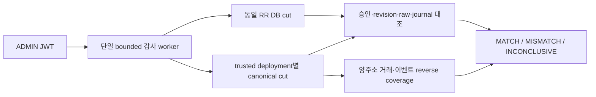

# B-v2 사용자 승인 전체 감사 — 개발·검증 기록

> 2026-10-22. 개발 중. 원본 병합·배포·기존 사용자 환경 변경 없이 별도 `dapp-audit-development-worktree`에서 진행한다. 총괄 상태는 기존 B-v2 worktree의 `claude-docs/dapp-development-progress.md`에 유지한다.

## 목적과 신뢰 경계

거래 한 건의 Receipt 정산 성공과 배포 전체 감사는 다르다. 새 감사는 동일 DB cut의 사용자 승인, 원본·활성 execution revision, 저장된 raw transaction, canonical 거래·이벤트·포지션, DB journal·잔고·house를 양방향으로 대조한다. 감사는 거래 전송, 복구, 잔고 수정, 청산을 실행하지 않는다.

MATCH는 등록한 배포와 고정 관측 범위의 일치를 뜻한다. PostgreSQL 모의 담보가 ERC-20으로 예치됐거나 지급능력이 보장된다는 의미가 아니다. 기존 legacy 감사의 authorized-position guard는 유지하며 기존 MATCH를 신규 감사로 승계하지 않는다.

## 구성

- A1: `FuturesAuthorizedAuditEvidence/Verifier`, `FuturesAuditSnapshot.readAuthorized`, `FuturesAuditStore.authorizedCut`. 승인·wallet·route·revision/head·raw를 같은 REPEATABLE_READ cut에 수집한다. 원문 서명/raw는 공개 응답에 넣지 않는다.
- A2: `FuturesAuditDeployment/Store`, additive `futures-audit-deployments-schema.sql`. 신뢰된 설정의 legacy/B-v1/B-v2 identity를 분리한다. 새 baseline은 INSERT-only이며 기존 baseline id=1을 채택·덮어쓰지 않는다. PostgreSQL append-only trigger를 추가한다.
- A3: `FuturesAuthorizedAuditObserver`, 양주소 `auditLogs/auditTransactions`, exact-block codeHash 조회. rules/controller 이벤트와 calldata·Intent·Report·owner·최종 revision을 검증하고 반대 방향의 누락 거래·이벤트도 검사한다.
- API: 기본 OFF인 `app.futures.audit.authorized-enabled=true`와 기존 futures/runtime flag가 모두 필요하다. 기존 runtime RPC와 configured identity만 사용하며 요청에서 RPC/계약 주소를 받지 않는다.



## 별도 ADMIN API

기본 경로 `/api/admin/futures/authorized-audits`:

- GET `/targets`: 등록 identity 및 history 미영속화 고지.
- GET `/baselines`: 새 deployment registry의 고정 baseline만 조회.
- POST `/baselines`, body `{"targetKey":"등록된 key"}`: 새롭고 비어 있는 배포의 기준점만 등록.
- POST 기본 경로: 전체 등록 배포 감사 실행.

기존 JWT filter의 ADMIN matcher와 controller의 actor 검증을 함께 적용한다. 단일 worker, 대기열 0, 중복 요청 429, 호출자 deadline 40초, 안전한 503 오류를 사용한다. 취소를 무시하는 I/O가 남으면 BUSY를 유지한다. baseline 등록은 명시 cancellation token, 안정성 검사 후·INSERT 전·결과 읽기 후·beforeCommit fence와 bounded 트랜잭션을 사용한다. 감지된 취소는 rollback하지만 HTTP timeout은 이미 진행 중인 JDBC commit의 철회 보증이 아니다. timeout 이후 새 baseline 생성 요청을 반복하지 말고 조회로 저장 여부를 확인해야 한다.

## 판정과 한계

- 승인/장부/정규 거래의 확정적 상충 또는 역방향 orphan은 MISMATCH.
- pending/REVIEW_REQUIRED, 미등록 identity/baseline, 역사 RPC 부재, 움직이는 cut, 중복 RPC 증거, 예산 초과는 INCONCLUSIVE.
- 취소 이벤트의 완전한 nonce 이력 coverage는 아직 미구현이다. `NonceCancelledV2`가 관측되면 INCONCLUSIVE이며 MISMATCH나 MATCH로 대체하지 않는다.
- bounded 512 RPC / 250 block / 50 transaction / observer 협력적 30초를 유지한다. 긴 이력의 페이지별 누적 인증·history 저장·사용자 화면 연결은 후속이다.
- 새 감사 결과는 DTO 관측이며 기존 legacy history 테이블에 섞어 저장하지 않는다.

## 현재 검증

API 추가 전 직접 JUnit 선택 회귀 88 PASS, 전체 선물 233 PASS/12 SKIP/3 FAIL. 실패3개는 기존 Gateway 테스트의 Windows native `Bad address: listen`이며 전체 회귀 PASS가 아니다. 소스가 추가된 현재 최종 결과로 재사용하지 않는다.

### 최종 동결 소스의 오프라인 결과

- 컴파일 PASS: `deployment/runtime/dapp-stage2-offline/classpath-20261022T141404161818.log`.
- 선택 감사/API/RPC 회귀 **105 PASS / 0 SKIP / 0 FAIL**: `audit-20261022T141521146521.log`.
- 전체 선물 **253 PASS / 12 SKIP / 0 FAIL**: `futures-20261022T141649594327.log`. 이번에는 기존 Gateway listener 테스트도 통과했지만 과거 Windows 장애의 근본 원인 해결 증거는 아니다.
- 전체 백엔드 **805 PASS / 53 SKIP / 0 FAIL**(858개 발견, aborted0): `all-20261022T141901959927.log`. 무과금·외부 opt-in 차단 실행이며 기존 AI DB/ledger나 거래 환경을 사용하지 않았다.
- 실행 방식은 기존 캐시를 이용한 Gradle 컴파일 + 직접 JUnit이다. 일반 Gradle test-worker 전체 PASS나 실제 PG/Anvil 인수와 동일하지 않다. H2/Mock과 별도 socket fixture의 결과를 포함한다.

### 신규 실환경 감사 Gate — BLOCKED

신규 session `phase-a-20261022141718-d918b7d7`, fixture `futures-api-542761d1`, HEAD `f9353c33244565b30fb130dfb6159eab441a3523`, productHash `b1a737a2625e5565e2a0454a417fd075f49d50ecb92df88457caf3974e237c3d`.

Docker Server 28.4.0 응답, C 여유 32.6GiB, 기존 실행 컨테이너 0개를 확인한 뒤 source-built tools 이미지 생성까지 성공했다. **최초 PostgreSQL 컨테이너의 Windows 호스트 포트 게시 단계에서 중단**됐다.

```text
127.0.0.1:35029 -> 127.0.0.1:0
listen tcp4 127.0.0.1:35029: listen:
The system detected an invalid pointer address in attempting to use a pointer argument in a call.
```

증거: 신규 session의 `logs/futures-api-542761d1-postgres-20261022T141727326291.private.log`, `audit-failure.json`, `before-containers.txt`, `after-containers.txt`. 기존 실패 기록과 새 컨테이너·network를 삭제하지 않는다. 포트를 바꾼 반복 실행이나 전역 재시작을 하지 않았다.

읽기 전용 owner 확인: 신규 PostgreSQL 컨테이너 `dd250d4a6084e93328e589eb3a5e59907a8aa0a765624c4da21938eb5af1fcdc`는 `Created`/Running=false/PID0/시작 이력 없음이다. exit0만 보고 정상 실행으로 판단하지 않는다. exact fixture label과 새 run 하위 password read-only/postgres RW bind가 일치한다. 새 network는 같은 owner이며 연결 컨테이너가 없다. 새 postgres/chain/release는 모두 비어 있다. 기존 **375개** 컨테이너의 ID/이름/이미지 참조/상태 분류는 전후 변경0, 신규 Created1개만 추가됐다. 기존 DB/체인 내부 baseline을 재조회한 검증은 아니다.

PG schema/JDBC, 신규 Anvil 배포, HTTP 거래, 실제 유예, 실제 감사 MATCH/MISMATCH는 **이번 Gate에서 모두 NOT_RUN**이다. 이 환경 실패를 금융 로직 FAIL이나 전체 감사 PASS로 바꾸지 않는다. 재실행 전에 Windows/Docker listener 경계의 제한된 진단이 필요하다.

후속 최소 진단은 같은35029에서만 Node24.4.1 HTTP listener1회를 실행해 LISTEN_OK22ms/exit0/즉시close를 확인했다. 현재 동적포트49152~65535와 제외목록에35029가 없고 후속netstat점유도 없었다. 이는 상시포트점유라는 설명을 뒷받침하지 않지만 실패 당시 Docker backend의 Winsock 상태를 검증하지도 않는다. 원인은 미확정이며 임의 timeout증가/포트재시도/Windows·Docker·WSL 재시작을 하지 않는다.

Docker host `monitor.log.2`의14:17:27.675~.710Z에서 apiproxy start/expose 및 vpnkit/proxy forward(TCP4 loopback35029) 활동4건을 확인했다. 14:17:20~35Z의2522줄에 `invalid/pointer/WSAEFAULT/10014` 일치는 없었다. backend 본 로그는10월21일 이후 갱신되지 않아 이번 원인을 설명하지 못한다. 로그 원문·헤더·설정은 보고서에 옮기지 않았다. 과거 Spring timeout과 동일 원인이라고 단정할 수 없다.

### 다음 실환경 실행의 권한 경계

같은 Windows 경계에서 포트·fixture를 바꾼 반복 실행은 권장하지 않는다. 전역 재시작·네트워크 초기화는 승인되지 않았다. 대안은 **새 전용 Docker network의 Linux JVM에서 PostgreSQL/Anvil을 내부 주소로 조회**해 Windows port publishing/JVM listen을 우회하는 분리 시험이다. 이 경우 Windows RPC 문제가 해결됐다고 말할 수 없고 Chrome/MetaMask 경로도 별도 인수가 필요하다. 기존 소스의 byte hash는 유지하되 Linux JDK/Gradle·경로·이미지·network·새 실행 identity를 별도 기록해야 한다. 기존 DB/키/evidence를 옮기지 않고 새 시험용 키·DB만 사용해야 한다. 기존 캐시의 Linux JDK/도구 가용성, 제한된 의존성 확보와 bounded 종료 방법부터 확인해야 한다. **실행 경계 변경은 사용자 승인 전 수행하지 않았다.**

새 helper는 controlled 가격 공급자와 독립 시험 signer를 사용하도록 작성했으며 실제 사용자 MetaMask/제품 Synthetic/Chrome 인수가 아니다. 실행 가능해져도 기존 서버 RPC timeout의 해결 증거로 사용하지 않는다. 설계된 60초 검증은 canonical deadline 차이60초 및 위험주입부터 최종 정산까지 wall 경과를 확인하며 마진콜 확정 관측 직후부터 별도 단조시계60초를 재는 것은 아니다. 동시 baseline 시험은 이미 등록된 동일 Envelope의 재등록 멱등성이고 PostgreSQL 빈 테이블 최초 INSERT 경합 검증이 아니다.

## 독립 검토 및 수정

- A1/A2 및 guard accountRef 책임 분리: 필수 지적 없음. DB guard의 legacy accountRef와 사용자 wallet 기반 accountRef를 같은 값으로 강제하던 감사 오판정을 수정하고 음성 회귀를 추가했다. 금융 장부 계산은 변경하지 않았다.
- A3: 중복 RPC log/tx를 Set으로 조용히 접으면 coverage가 완전하다고 오판할 수 있다는 지적을 수정했다. 중복 식별자를 먼저 거부하고 INCONCLUSIVE로 처리한다. 관련 회귀 후 재검토 필수 지적 없음.
- API: timeout 이후 baseline INSERT 경계에 cancellation/deadline fence가 부족하다는 필수 지적을 수정했다. 실제 H2 INSERT 후 취소/commit 준비 취소 rollback, 마지막 stable RPC 후 취소, interrupt 무시 후 token 검사 회귀를 추가했다. 독립 재검토에서 발견된 필수 수정 없음. 검토자는 소스·회귀를 읽었고 테스트 직접 실행은 하지 않았다. PostgreSQL commit/rollback 실제 검증은 환경 BLOCKED로 남는다.
- 신규 A4 helper/runner의 사전 독립 검토에서 발견된 필수 수정 없음. 실제 Gate 실행 결과는 위 환경 BLOCKED이며 사전 검토가 실환경 성공을 대체하지 않는다.

## 기존 환경 보존

실제 사용자 OPEN이 있는 `futures-browser-2557294e`는 예정된 RUNTIME_CAP으로 정지·데이터 보존 상태다. 자동 종료/재전송/사용자 서명을 실행하지 않았다. 새 개발에는 DB·키·ledger/STOP/claim/private evidence를 복사하지 않았다. 원본/UI/AI/DApp의 기존 변경과 성공·실패 fixture는 그대로 유지한다.

## 취소 coverage 후속 설계 — 구현 전

### `complete`의 정확한 범위 — 후속 독립 조사

- trusted Registry에 등록된 배포와 지정 canonical cut의 완전성이다. DB에도 흔적 없는 미등록 외부 배포를 자동 발견한다는 뜻은 아니다.
- 같은 RPC의 blockHash/head 안정성을 확인한다. 다중 RPC 합의, 미래 reorg 불가 또는 별도 confirmation depth를 보증하지 않는다.
- 성공 Intent의 nonce/digest 중복을 검사하지만 baseline→cut nonce 연속 이력의 독립 fold는 아래 취소 coverage와 함께 미구현이다.
- 현물 사용자 장부와 선물 손익·잠금을 연결한다. 현물 Receipt·ERC-20 공급·준비금의 별도 온체인 전수 감사를 대체하지 않는다.
- controlled 시험 가격/서명과 고정 cut, 50거래/250block/512RPC의 bounded Gate는 실제 제품 Synthetic·MetaMask 및 장기 동적 chain 검증과 다르다.

위 경계는 후속 읽기 전용 독립 검토에서 확인했다. 새로운 거짓 MATCH 결함을 확정한 결과는 아니며 취소 발견 시 현재 INCONCLUSIVE 정책을 유지한다.

현재 `cancelNonce`가 발견되면 INCONCLUSIVE로 유지한다. 읽기 전용 분석에서 다음 최소 설계를 도출했으며 제품 소스나 위 결과를 변경하지 않았다.

1. 성공한 직접 취소는 trusted controller의 canonical tx/Receipt/block, caller와 event.owner, zero value, 정확한 calldata의 expectedNonce, 성공상태와 controller 단일 취소 이벤트를 연결한다. 지원하는 거래 type의 chainId와 sender 서명도 검증한다.
2. controller는 연결되지 않은 외부 EOA의 자기 nonce 취소도 허용한다. DB 계정/position이 없다는 이유로 orphan MISMATCH로 처리하지 않는다. canonical status0·이벤트0의 실패 취소도 거래 실패 사실과 정확한 revert 원인을 구분한다.
3. `(chain,controller,owner)`별 baseline/cut의 historical nonce를 조회하고 성공 user Intent 및 취소 이벤트를 block/txIndex/logIndex 순으로 fold한다. 각 event.nonce가 runningNonce여야 하며 마지막 값은 cut nonce와 일치해야 한다. 네트워크 tx.nonce와 controller userNonce는 다르다. 같은 block 복수 성공을 block-1→block의 증분1로 검사하면 안 된다.
4. 중복 증거·historical nonce 부재·미지원 거래 type·해석 못 하는 비정규 ABI calldata는 INCONCLUSIVE다. Solidity가 허용할 수 있는 trailing calldata를 임의 금융 위반으로 단정하지 않는다.
5. 기존 50거래/512RPC/250block/30초 한도에 외부 성공·실패 취소도 포함한다. 취소 요청만으로 DB 담보 잠금을 해제하지 않는다. 실제 canonical 결과와 기존 복구 정산이 정본이다.

새 금융 schema나 자산 변경은 필요하지 않을 것으로 보이지만 안전한 cancellation DTO/순수 verifier/explicit-block nonce RPC 및 신규 회귀가 필요하다. A4 실환경 Gate가 아직 검증되지 않았으므로 이 설계를 전체 감사 완료로 표현하지 않는다.

### 후속 최소 작업 단위 — 읽기 전용 조사 결과, 아직 구현 전

- Gateway `userNonceAt(owner,block)`는 정확한32-byte ABI word를 요구한다. LATEST 조회를 historical 증명으로 대체하지 않는다. signed transaction envelope는 지원type allowlist의 재구성 hash·복구sender·chainId를 검증하거나 raw조회가 필요하다. 제공자가 이를 지원하지 않으면 INCONCLUSIVE다.
- 내부 CancellationEvidence/NonceTransition/FoldResult를 분리한다. ADMIN 공개 요약은 owner/controller/hash/block/order/status/nonce/verdict만 포함하며 raw·서명은 제외한다.
- 성공cancel은 zero value/정확calldata/정규Receipt와 controller 취소event 정확히1개/복구sender=owner/expectedNonce를 연결한다. status0·event0 실패는 nonce증분0이며 revert원인미확정이다. nonzero-value의 정상EVM revert를 성공취소의 금융위반으로 오판하지 않는다.
- `code.length==0`은 constructor 내부 caller의 EOA 여부까지 증명하지 않는다. 최초지원은 directEOA transaction으로 제한하고 event만 있으나 top-level to가controller가 아닌 내부호출·생성호출은 지원밖 INCONCLUSIVE로 남긴다.
- reverse coverage에 외부취소도 포함해 전역50거래를 적용한다. receipt/envelope/historical nonce 조회도512RPC/30초 예산에 포함한다. 기존legacy/B-v1의 검증범위를 새v2 noncefold 보장으로 과장하지 않는다.
- 필수회귀: DB미연결EOA·성공/실패취소, Intent↔cancel 순서와 같은block복수전이, 중복/누락/noncegap/cut불일치, baseline=cut, 다른owner/domain, signed envelope변조, 미지원type/trailing calldata/내부호출, historical부재/reorg/timeout/budget, 자동action nonce불소비, 공개민감값비노출. 실제PG/Anvil 취소·Intent경합은 별도신규fixture 인수가 필요하다.

이 조사는 현재 RPC 장애 또는 Linux 전체 감사 Gate를 해결한 결과가 아니며 C안의 자산·경제 정책 구현을 승인하지 않는다.

### 후속 envelope 기술 spike — 제품 구현과 구분

신규 private `dapp-stage2-offline/cancel-envelope-spike/runs/local-20261022163807-98a634`에서 임의메모리키의 type0EIP155/type2(nonemptyaccessList) signed envelope를 RPC Transaction필드로 옮긴 뒤 byte동일 raw/hash·복구sender·chain/to/value/input을 확인하는 로컬6그룹을 통과했다. 양타입 wrongchain·서명/입력변조 음성 및 unsupportedtype/trailingABI 경계를 포함한다. 실제RPC/DB/Docker/사용자키·증거/유료 호출은0이다.

설치된 Web3j4.12.2에서 type2 RPC parity0/1과 내부 SignatureData.v27/28이 다르며 명시 보정이 필요함을 확인했다. 최초 실패 로컬run2개를 보존하고 보정후 raw byte동등성을 검사했다. 독립 검토 필수지적 없음. 다만 source/class SHA 외 전체dependency별SHA/JDK실측로그는 없고 to/value 개별변조음성도 없으므로 제품전체검증·완전재현성·실제canonical취소/MetaMask PASS로 표현하지 않는다.

별도 새 순수 nonce-fold class/test는 작성 중이며 현재 observer에 연결하지 않는다. 따라서 기존 취소 발견 시 INCONCLUSIVE 정책은 유지된다. 후속 후보 sourceHash/단위검증은 별도로 기록하며 Linux5의 b1a737... 실제 Gate PASS를 후속 소스에 승계하지 않는다.

### 순수 nonce-fold 후속 후보 — 로컬 구현/검증

- 신규 `FuturesAuditNonceFold.java`/`FuturesAuditNonceFoldTest.java`만 추가했다. 기존 observer/Gateway/ledger/schema/계약·거래 API는 바꾸지 않았다. 실행·취소·담보 해제·정산을 수행하지 않는다.
- `(chainId,controller,owner)` 정규화 그룹과 explicit historical baseline/cut nonce를 입력받는다. 입력은 이미 별도 canonical/ABI/서명/owner/domain/coverage 검증을 통과했다는 내부 계약이며 이 class가 이를 증명하지 않는다.
- baseline block은 제외/cut은 포함하고 block/txIndex/logIndex 순으로 정렬한다. 성공 USER_INTENT/CANCEL만+1, 자동·실패 action은0. nonce gap/reuse/overflow/최종anchor 상충은 완전한 입력에서만 MISMATCH, 누락·중복·불충분·범위밖·빈target·정렬좌표충돌은 INCONCLUSIVE다. nonce 검증기의 MATCH를 전체 금융 감사 MATCH로 사용해서는 안 된다.
- 최대50그룹/50전이의 순수 기술 한도, uint256 범위, 불변 결과와 raw/signature 없는 요약을 사용한다. 동일 txHash가 여러 canonical 위치에 나타나거나 같은 chain height의 blockHash가 상충하면 불확실로 처리한다. 한 번의 fold에서 같은 chainId를 서로 다른 fork의 독립 네트워크처럼 섞어 인증하는 용도가 아니다.
- 후속 productHash **`3f4e5d22b303b15b7feaed65c499e2fce191a7a65c34f700ea62b0b32d58862e`**, compile PASS `classpath-20261022T164402637625.log`, 감사 선택 **138 PASS/0 FAIL/0 SKIP/0 ABORTED** `audit-20261022T164612214544.log`(신규27 포함). 기존111과 합산하지 않는다.
- 이 최초 후보의 PostgreSQL/Anvil E2E 및 전체 backend 재실행은 NOT_RUN이다. 앞선 Linux5 productHash b1a737...의 실제 PASS를 새 후보에 자동 승계하지 않는다. 현재 observer의 cancel 발견 시 INCONCLUSIVE는 여전히 유지한다. 아래 독립 검토 보완이 최초 후보를 대체한다.

### nonce-fold 독립 검토 보완 — 2026-10-23

- 최초 선택138 PASS만으로 결함 부재를 판단하지 않았다. 독립 검토자가 서로 다른 transaction이 같은 block-global logIndex를 쓰거나 transaction 순서와 log 순서가 역전된 입력도 MATCH가 되는 두 반례를 발견했다. 최초 정상50전이 fixture도 logIndex를 transaction-local처럼 사용했으므로 함께 보정했다. 실제 운영 observer에는 연결하지 않은 후속 class의 결함이며 과거 Linux5 금융 장부를 변경한 사실은 없다.
- `(chainId,blockHash,logIndex)` physical log 위치와 txHash/txIndex를 대조하고, 같은 chain/block의 성공 logical event를 canonical transaction 순으로 정렬했을 때 logIndex가 엄격히 증가해야 한다. 실패·무이벤트는 제외하고 자동 성공은 포함한다. 충돌은 MISMATCH가 아니라 증거 자체의 모순인 INCONCLUSIVE다.
- 같은 transaction의 서로 다른 logIndex 및 다음 block에서 logIndex 재시작은 허용한다. 신규 음성3/정상1을 포함해 총31개 nonce 테스트로 보강했다. 기존 observer/Gateway/ledger/schema/계약/API 변경은 없다.
- 최종 productHash **`a0a78d086bbcf3de459016a6db249e6b4de20c35fd084527f8e4e4c8b9755926`**, main SHA `701986a1f18dd24e81b66ff8420ae0143d3aaeccce4c52335376bde86935569a`, test SHA `c87cb6531d3940470cfc7e1f959507d46ebfe9df92eb0569e345f6ebda810190`.
- 오프라인 compile PASS `classpath-20261022T165135475141.log`, 직접 JUnit 감사 선택 **142 PASS/0 FAIL/0 SKIP/0 ABORTED** `audit-20261022T165354559585.log`(신규31 포함). 정상 Gradle test-worker 실행과 구분한다. 최초138과 합산하지 않는다.
- `inspect_bv2_full_audit_gap` 최종 읽기 전용 재검토: 두 SHA와 실제 소스/새 회귀를 확인하고 발견된 추가 필수 수정 없음. 검토자 직접 테스트 실행은 없었다. 이번 후보의 전체 backend·PG/Anvil·취소 실제 실행은 NOT_RUN이며 frozen b1a737... Linux5 PASS와 구분한다.

### 순수 취소 증거 검증기 — 후속 구현·검증 진행 중

- 신규 `FuturesAuditNonceCancellationVerifier.java`/Test만 추가한다. 생산 observer/Gateway/nonce-fold/API/DB/금융 실행에는 연결하지 않는다. 입력은 trusted B-v2 deployment 및 제공된 Web3j transaction/Receipt/header다.
- type0 EIP-155/type2만 허용하고 signed field에서 raw를 메모리 재구성하여 hash/복구sender/chain을 직접 확인한다. type2 ordered accessList와 v/yParity를 포함하며 외부 EOA의 DB 계정 등록을 요구하지 않는다. 사용자 키를 입력받거나 요청을 전송하지 않는다.
- 정규 `cancelNonce(uint256)` 직접 호출, block/txIndex/hash 및 header membership, 성공의 단일 controller event/owner/nonce, 실패의 무이벤트를 검증한다. 실패의 calldata expectedNonce는 실행 전 historical nonce 증명이 아니며 실패 원인을 추측하지 않는다. failed nonce-fold eventNonce는 나중에 연결하더라도 null이어야 한다.
- 결과명은 **VERIFIED**이며 제공 증거 내부 일치의 좁은 의미다. 실제 canonical head/codeHash·historical nonce·범위 completeness·금융 MATCH는 상위 observer의 별도 책임이다. 내부호출·생성자경유·미지원 type·trailing ABI는 INCONCLUSIVE 지원밖이며 EVM 거부로 단정하지 않는다.
- 순수 기술 cap: input4096bytes, accessList16항목/항목32keys/전체256keys, header1024transactions, Receipt50logs, uint256 및 양의 signed-long chain. 초과·누락·미지원과 상충 증거를 구분하고 raw/서명은 public 결과에 없다.
- 최초 소스/test 동결 SHA `88ca82ea24185324d6cfedbb54ba24b56508d6b28e51877361cea86b427b999c` / `0bf2ad12e3c621a39e7ad9a6aded5d3de525c053d537a15b8855edcfe7238f6c`, 28@Test. compile PASS `classpath-20261022T170919990523.log`; 테스트·별도 검토는 진행 중이며 이 기록은 완료 주장이 아니다.

### 역방향 감사 거래 한도 — 후속 결함 재현 중

읽기 전용 분석과 별도 검토에서 MAX_TRANSACTIONS=50이 DB transaction 행에만 적용되고 역방향 외부 거래에는 적용되지 않음을 발견했다. DB0/같은 block 외부51거래는 RPC512/30초를 넘지 않아도 complete=MISMATCH까지 갈 수 있다. 이는 당시12거래 Linux5 관측 결과를 뒤집는 발견이 아니라 선언한 기술 한도의 일반 입력 누락이다.

최소 보완은 observation 전체 Budget의 `(chainId,txHash)` union에 DB 거래·역방향 로그·거래를 중복 없이 등록하고51번째부터 `BOUNDED_READ_LIMIT / INCONCLUSIVE`로 종료하는 것이다. 취소를 coverage에서 제외하기 전에 계산하고 기존 DB행50개 한도·RPC/시각/블록 한도는 유지한다. 실제 취소 지원이나 금융 정책 변경이 아니다.

- 수정 전 `audit-20261022T171100412284.log`: 174중171PASS/3FAIL/0SKIP/0ABORTED. 외부51tx/취소51tx/등록target 간26+25tx가 각각 한도 초과로 중단되지 않는 실패3개를 실제 Mock로 재현했다. 외부50거래 이내의 진짜 coverage 불일치는 MISMATCH이며50개의 로그+역방향행은 중복100거래로 세면 안 되는 정상 경계도 포함했다. PostgreSQL/Anvil 재현은 아니다.
- `Budget.transaction`의 union 및 취소 제외 이전 등록을 추가했다. 전체 observation에 공유하며 대소문자를 정규화하고 chainId를 키에 포함한다. 기존 DB행 한도는 유지한다. 수정 후 회귀/독립 검토는 진행 중이다. frozen b1a737... Linux5의12거래 결과와 구분한다.
- 최초 독립 검토가 DB 등록 시점의 누락을 추가 발견했다. 승인 검증 실패 또는 route 불명으로 정방향 검증에 진입하지 못한 DB 거래도 union에 포함돼야 하므로 snapshot 직후 stored chainId/hash를 선등록했다. 승인 오염·미등록 route의 DB1+외부50 및 DB/Receipt3logs/reverse가 동일 거래를 중복 가산하지 않는50경계 회귀2개를 보강했다. 총6개 새 한도 테스트이며 최종 재검증/재검토 전이다.

### 후속 두 단위 최종 오프라인 검증 — 2026-10-23

- 취소 verifier 첫 독립 검토에서 removed=true 로그를 확정 EVENT_CONFLICT/MISMATCH로 처리한 문제를 발견했다. 철회·오래된 증거는 canonical 근거 부족이므로 INCONCLUSIVE/REMOVED_EVENT로 선분리하고 type0/type2 회귀를 추가했다. 최종29@Test, main SHA `459ba277e104bf772e46a6114544cc488b88797b5dcc3bf8e42f470258a40878`, test SHA `3ac5460ea6309188f0b42f1f79b8c7671780715f2af0bd0a2e45385c9d086db9`.
- 역방향 한도 observer SHA `49d8b5d7a453cdcc4298366c1f693f8fcb5e978382f448b3aaa204434346947a`, test SHA `29bdb85931d1b273d47aeb7a1d43c24d5831f87a94ae085bded03af40758ddde`. DB 누락 선등록과6회귀를 포함한다.
- 최종 productHash **`0029d2a80ae1b2bab5ceef74479fd3318f946afd246cb455a3f413f879972064`**. compile PASS `classpath-20261022T171452664727.log`, 직접 JUnit 감사 선택 **177 PASS/0 FAIL/0 SKIP/0 ABORTED** `audit-20261022T171520874965.log`. 최초 red174중3FAIL 이력은 보존하며 결과를 소급 변경하지 않는다.
- 별도 검토자 `inspect_bv2_full_audit_gap`(취소 verifier) 및 `review_bv2_rpc_recovery`(한도)는 각 최초 지적 수정 후 최종 재검토에서 추가 필수 수정 없음. 동결 소스/test와 실제177요약/컴파일 로그도 직접 읽었다. 재실행·DB/RPC·변경은 하지 않았다.
- 새 순수 취소 verifier와 nonce-fold는 아직 observer에 연결하지 않았다. 현재 cancel coverage의 INCONCLUSIVE는 유지한다. 이번 product의 전체 backend 회귀와 신규 Linux PG/Anvil Gate는 별도 실행·판정하며 과거 b1 Gate PASS를 재사용하지 않는다.
- 이후 같은0029 product의 전체직접JUnit876PASS/53SKIP/1ABORTED/0FAIL 및 새Linux PG/Anvil1PASS를실행했다. 실환경정상12tx/32events와3판정/실제양방향60초유예·정산은 [새Gate §14](dapp-b-v2-linux-audit-gate-2026-10-23.md)에별도기록했다. 순수취소모듈의실제체인취소인수와51거래실환경fault를검증했다는뜻은아니다.

## 2026-10-23 후속 — canonical 취소/nonce observer 통합 후보

현재 사용자 승인에 따라 순수 verifier·nonce-fold를 실제 읽기 전용 observer에 연결하는 중이다. 기존0029 Gate 결과는 frozen 이력이고 아래 후보의 실환경 성공이 아니다.

- Gateway는 별도 overload로 explicit block의 `nonces(owner)`를 정확32byte ABI word로 읽는다. 기존 거래용 LATEST 메소드를 바꾸거나 historical 조회 실패 시 LATEST/0으로 대체하지 않는다. 취소 caller의 EOA 코드도 해당 block에서 확인하며 RPC 예산에 산입한다.
- controller 직접 `cancelNonce` 후보는 역방향 block transaction에서 성공·실패(no-event) 모두 수집한다. 로그만 존재하는 내부호출·미지원type/ABI·누락/철회·과거상태부재는 INCONCLUSIVE다. 검증 가능한 hash/sender/체인/Receipt 모순은 MISMATCH다.
- 성공 사용자 Intent/성공 취소/실패/자동 action을 같은 owner/controller/chain 그룹의 historical baseline/cut nonce로 fold한다. 성공 Intent/취소만+1이며 자동·실패는0이다. nonce-fold MATCH가 canonical/장부/역방향 coverage 검사를 대체하지 않는다.
- `TargetResult.cancellationCoverage`는 additive 별도 DTO다. 기존 Coverage의 operations/transactions/verifiedTransactions는 DB 기반 의미를 유지하고, 취소 observedTransactions/verifiedSuccess/verifiedFailed/nonceGroups/complete를 따로 표시한다. 가상의 userId0/DB operation을 만들지 않는다. cut 변경/예산초과의 provisional에서는 양쪽 completeness를 false로 내린다.
- 기존50 distinct chain/tx union·512RPC·250block·30초·ADMIN 접근·금융 읽기 전용과 legacy/B-v1 분기는 유지한다. 공급자 generation/가격·거래/정산/schema/자산 정책을 바꾸지 않는다.
- 첫 compile PASS `classpath-20261022T175844996388.log`, 감사선택186중185PASS/1FAIL `audit-20261022T180001229479.log`. 실패는 Gateway Mock가 Web3j DefaultBlockParameterNumber를 직렬화 전 string과 비교한 경계다. 실제 전송 형식과 대조해 테스트를 보완 중이며 성공으로 기록하지 않는다. 독립 검토와 실제 PG/Anvil 취소 Gate는 아직 NOT_RUN이다.

### 후보 회귀·독립 검토 결과

- Gateway 테스트는 실제 HttpService의 `ObjectMapperFactory.getObjectMapper()`로 Request 전체를 wire JSON으로 직렬화한 뒤 block param이 문자열 `0xb`이며 target/calldata가 정확한지 확인하도록 수정했다. 제품 RPC 동작은 바꾸지 않고 테스트 경계의 잘못된 비교만 고쳤다.
- compile PASS `classpath-20261022T180635612733.log`, 감사선택 **186PASS/0FAIL/0SKIP/0ABORTED** `audit-20261022T180809174525.log`. 초기1FAIL 기록은 보존했다. 후보 productHash **`dac4ee8879f7c32dcde136a059fcc78659af8846bbae2473efbaf8f42438cb9d`**.
- 최초 독립 소스 검토 `inspect_bv2_full_audit_gap`는 동결4파일과 실패/보완 테스트를 읽고 발견된 필수 수정 없음. 같은 owner의 Intent→Cancel→Intent 경로를 추가 통합 검증하도록 제안했으며 실제 새 focused Gate를 준비한다. 검토자는 테스트 재실행·DB/RPC를 하지 않았다. 전체 백엔드 회귀·실제취소 Gate는 아직 진행 전/중이며0029 실환경 PASS로 대체하지 않는다.

### 취소 Gate 첫 실환경 실행 — 하네스 준비 실패 보존

- 신규 `phase-a-20261022182441-f7533443/fixtures/futures-api-a994e779`, product `dac4ee…`. Linux 내부 네트워크·호스트 게시0의 새 PG/Anvil을 준비했지만 **JUnit 1 FAIL / 0 PASS / 0 SKIP / 0 ABORTED**, 15855ms로 중단됐다. Spring 초기화 전 `PhaseAFixture.optional`의 `Futures periodic-block fixture required`가 최초 원인이다. cancel 전용 manifest가 miningBlockTimeSeconds=0을 선언했지만 기존 futures-api identity guard는2초 주기를 요구한다. 금융·사용자 서명 결함으로 판정하지 않으며 guard를 약화하지 않는다.
- 기존 테스트 guard가 DB marker 조회/제품 schema 초기화보다 앞에서 거절했다. 사용자 거래·취소·금융 정산·감사 본문은 **NOT_RUN**이다. 하네스 최소 수정은 metadata와 실제 채굴을 기존2초 주기로 일치시키고 취소 두 거래를 같은 블록에 담는 구간에서만 interval0/수동1블록 후2초로 복귀하는 것이다. 실패 fixture는 고치거나 재사용하지 않는다.
- 독립 초기 검토 필수 지적 없음, Java compile `classpath-20261022T181607689470.log` PASS, 시험 signer 오프라인20PASS 및 Python 안전14PASS 이후 실제 환경에서 발견한 준비 결함이다. 검토·단위 PASS를 실환경 PASS로 대체하지 않는다. 소유3컨테이너만 정지했고 `cleanup-result.json` errors=[]/dataPreserved=true, 실패·DB/체인·manifest/로그를 보존했다.
- Windows 전체 직접JUnit `all-20261022T180930975559.log`: 939found, **880PASS/53SKIP/1ABORTED/5FAIL**. 다섯 실패 모두 `OpenAiProviderTest` @BeforeEach HttpServer.create→native Net.listen `Bad address: listen`으로 본문 전에 발생했다. 독립 소스/로그 검토도 이 경계를 확인했다. 원본 테스트를 SKIP하거나 assertion을 바꾸지 않았다. 새 Linux network-none에서 같은5개만 비교할 별도 무과금 하네스를 검토했다. 전체 package는 source/docs/Python 상대경로 의존 때문에 portable-only 환경에서는 NOT_RUN으로 남긴다.

### 취소 Gate 두 번째 새 실행 — 시험 OPEN 확정 / 취소 signer 준비 실패

- 첫 실패를 보존하고 **새** `phase-a-20261022183524-2f9de7c0/fixtures/futures-api-4149c9bd`로 실행했다. product는 동일 `dac4ee8879f7c32dcde136a059fcc78659af8846bbae2473efbaf8f42438cb9d`, HEAD f9353c3이다. Java21.0.10 compile `classpath-20261022T183318778445.log` PASS, 하네스 안전16PASS, 시험 signer 오프라인20PASS. 최초+두 차례 재검토에서 periodic2 실제 활성화 및 거래 완료 뒤 frozen audit cut 순서를 보완했다. 보호 guard·금융 정책을 바꾸지 않았다.
- 실제 PG 초기화/이전 행 보존·periodic 첫 블록 관측·ADMIN baseline 및 시험 EOA **OPEN CONFIRMED**까지 수행했다. OPEN tx `0x0efb651d014d4918b24c68651d923441dea7b01c43debd421509849e586f6e9d`, blockHash `0x5bbee9708509cd0201a9bbe84e53dbf6a1706b69d092f1b9d2b816746813606a`. 이 신규 시험 OPEN은 과거 사용자 MetaMask OPEN과 다른 증거다.
- **최종 JUnit0PASS/1FAIL**, 167376ms. 취소 raw를 만드는 외부 시험 프로세스에서 `CANCEL_TRIAL_SIGNER_FAILED`, private 하위 오류는 안전한 `TRIAL_CANCEL_SIGNER_REJECTED`다. signer가 `session/session.json`을 읽지만 JVM 컨테이너는 그 아래 **fixture 디렉터리만** 마운트한다. 정지 컨테이너의 mount 목록과 `docker cp <owned-java>:<parent>/session.json -`의 exit1/파일없음/출력0byte, 호스트 부모 파일 존재를 읽기 전용으로 확인했다. 부모 identity 파일 전달 누락이 확정된 하네스 원인이며 실제 제품 nonce 검증·사용자 서명 결함으로 판정하지 않는다. 숨긴 예외 원문·사용자 키·raw를 공개하지 않았다.
- 취소 전송, 같은 block 성공/실패 취소, TOP_UP/CLOSE, nonce-fold의 실제 최종 MATCH는 **NOT_RUN / Gate BLOCKED**다. 새 시험 OPEN이 확정됐다는 이유로 이 Gate를 PASS로 승격하지 않는다. 소유3개만 정지했고 cleanup errors0, portable1017파일 SHA 변경0, 기존401컨테이너의 ID/이름/이미지/상태 분류 변경0이다. 첫 실패도 기존397개 불변·신규3개 정지로 보존했다. 기존 사용자 OPEN은 조작하지 않았다.
- 다음 최소안은 새 fixture 안에 부모의 비밀 없는 실행 identity snapshot을 CREATE_NEW로 만들고 원본 session/source SHA 및 manifest와 대조한 뒤 signer가 **마운트 안의 해당 snapshot**만 읽게 하는 것이다. 새 snapshot의 누락·불일치 거부, fixture-only mount 상당 오프라인 재현을 먼저 추가해야 한다. 부모 전체 디렉터리나 다른 fixture를 마운트하거나 identity 검사를 삭제하는 안은 채택하지 않는다.
- 이번 focused 하네스 단위는 공통 지침의 최초1회+재검토2회 상한에 도달했다. 따라서 이 추가 결함을 고친 뒤 검토 없이 안전 완료라고 선언하거나 세 번째 새 PG fixture를 생성하지 않았다. **후속 수정·검토 미완료**로 남긴다. 원래 product observer 소스 검토와186 선택 PASS는 좁은 단위 결과로 유지한다.

### Windows 실패 클래스의 Linux 무과금 비교 — JUnit과 하네스 판정 분리

- 새 `deployment/runtime/dapp-stage2-offline/linux-offline-runs/tms-offline-20261022183344-0b3e592154ed0e21`. network=none, portable만 read-only, 기존 비밀·ledger/DB·chain 마운트0, 유료 키/opt-in 없음. JRE Temurin21.0.12.1, cached image `sha256:35be56d41389c9ad515c089dfded911ae9a8bdb362c8a303224666cd358bead3`와 Windows compile21.0.10을 기록했다.
- 고정 class `com.pricetrack.exchange.ai.OpenAiProviderTest`의 **JUnit7PASS/0FAIL/0SKIP/0ABORTED,10494ms**다. class에는 Windows 준비 실패5개뿐 아니라 원래 성공한2개도 있었다. 전체 class 실행을 정확5개로 잘못 가정해 wrapper는 `FAIL / EXACT_FIVE_TESTS_REQUIRED`다. 원본 result/manifest/log는 수정하지 않았다. 독립 증거 검토가 실제7개 소스·JUnit 로그·class/launcher SHA 일치를 확인하고 최초 exact5 권고 누락도 정정했다.
- 이 결과는 “JUnit7PASS / wrapper 집계 조건 오류 FAIL”로 병기한다. 실제 API 답변 생성·전체 Linux 회귀·Windows 근본 원인 해결은 아니다. 기존400개 컨테이너 exact inventory 변경0, 신규1개 Exited0·보존, cleanup/log errors0, 유료 호출0이다.
- 향후 하네스는 소스에 있는7개를 근거로 exact7/7/7·skip/abort/fail0만 허용하도록 수정했다. Mock/AST **22PASS**, 최종 독립 재검토 필수 수정 없음. 수정 후 Docker 재실행은 **NOT_RUN**이며 과거 wrapper를 소급 PASS로 만들지 않는다. 전체 package는 source/docs/Python 상대경로 의존성이 있어 portable-only 환경에서 NOT_RUN을 유지한다.
