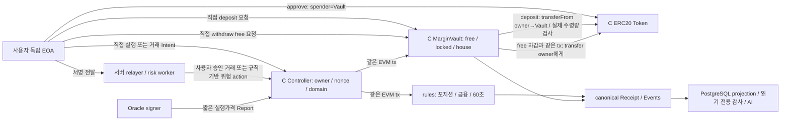
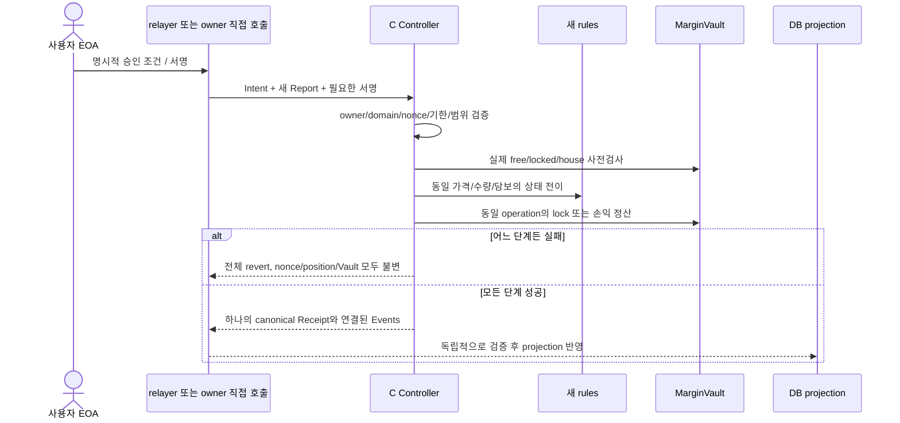

# C안 실제 자산 보관·정산 정책 설계 — 사용자 결정 대기

> 작성: 2026-10-22. 코드 읽기 전용 조사 및 설계 문서다. C안의 경제·자산 정책은 아직 확정하지 않았다. 이 문서는 계약 배포, 토큰 발행·이동, 기존 잔고 전환, DB/Anvil 변경 또는 유료 호출의 실행 승인이 아니다.

> 2026-10-23 상세화: §1~11의 당시 제안·승인 대기를 보존하고 §12 이후에 현재 소스 근거, 결정 ID별 질문, 원자성·복구·검증 계획을 추가했다. B-v2 최신 `0029d2a8…` 격리 Linux 감사 Gate PASS는 [기록 §14](dapp-b-v2-linux-audit-gate-2026-10-23.md)의 해당 소스/환경에만 귀속된다. C 계약·실자산 보관·정산·테스트는 여전히 **NOT_RUN**이다. 사용자 검토용 축약본은 [5개 정책 결정 요약](dapp-c-policy-decision-summary-2026-10-23.md)이다.

## 1. 비전공 평가자를 위한 요약

현재 B-v2는 사용자가 지갑으로 승인한 거래만 계약이 받아들이도록 만든 단계다. 그러나 거래에 쓰이는 담보는 아직 PostgreSQL의 모의 잔고이며, 계약에 실제 ERC-20 토큰이 예치되어 있다는 뜻은 아니다. C안은 실제 토큰을 사용자 지갑과 계약에 보관하고, 계약이 담보 잠금·손익 정산·인출까지 강제하는 다음 단계다.

예를 들어 사용자 지갑에서 100 mKRW를 예치하면 계약은 실제 전송된 100만 인정해야 한다. 포지션 담보로 80을 잠갔다면 남은 20만 사용자가 서버의 허락 없이 인출할 수 있다. 손실이 나면 잠긴 담보에서 차감하고, 수익은 별도로 실제 자본을 넣어 둔 손익 풀에서 지급해야 한다. 다른 사용자의 담보를 수익 재원으로 임의 사용해서는 안 된다.

가장 중요한 미결정은 **손익 풀의 돈이 모자랄 때 어떻게 할 것인가**다. 지금의 금융식은 사용자 손실을 담보로 제한하지만 미래의 모든 이익을 유한한 풀로 보장하지 않는다. 거래 전체를 되돌릴지, 포지션을 종료하고 미지급 채권을 남길지에 따라 사용자 권리와 청산 방식이 달라진다. 이 선택을 사용자 승인 없이 구현하면 안 된다.

서버가 중단되어도 미예약 잔고의 직접 인출은 설계할 수 있다. 하지만 활성 포지션은 정산 가격이 필요하며, 가격 제공자까지 중단되었을 때 원금을 무조건 전액 돌려주는 것은 안전한 인출과 다르다. C안도 실제 원화·주식 상환, 정확한 Oracle 가격, 무조건적인 지급능력 또는 로컬 Anvil 운영자로부터의 네트워크 독립성을 자동 보장하지 않는다.

## 2. 명칭과 기존 결정의 보존

- [`user-wallet-custody-architecture-review.md`](user-wallet-custody-architecture-review.md)의 2026-10-12 A/B/C는 당시 비교 모델이다. 당시 B는 위탁형 온체인 배분, C는 사용자 키 기반 소유권이었다.
- 현재 개발 단계의 **B-v2는 독립 사용자 승인 + 기존 DB 모의 담보**, **C안은 실제 ERC-20 소유·보관·정산**을 뜻한다. 과거 명칭이 같다는 이유로 구현 또는 승인 상태를 승계하지 않는다.
- 기존 A/legacy/B-v1/B-v2, DB 모의 장부, 성공·실패 fixture, 감사 baseline, 사용자 계정과 지갑 연결 이력은 보존한다. C 신규 모델의 시작이 기존 잔고의 토큰 전환 승인이 아니다.
- 현재 문서의 추천은 설계 제안이다. 아래 다섯 결정이 확정되기 전 C 자산 이동 코드를 구현하지 않는다.

## 3. 실제 소스 근거

| 소스 | 현재 확인한 책임과 한계 |
|---|---|
| [`UserAuthorizedFuturesEngineV2.sol`](../contracts/src/UserAuthorizedFuturesEngineV2.sol), constructor / `_authorize` / `_relayer` | 독립 EOA Intent, owner/nonce/deadline/domain 및 가격·수량 범위를 검증한다. immutable relayer를 사용하고 내부 rules를 새로 생성한다. ERC-20 보관·정산·직접 출금은 없다. 현재 `_relayer` 때문에 사용자가 서버 없이 일반 거래를 직접 호출하는 경로도 없다. |
| [`FuturesEngine.sol`](../contracts/src/FuturesEngine.sol), `_execute` / `_validate` | executor의 담보 수치를 신뢰하고 포지션 상태·서버 가격 서명·30초 Report·60초 유예를 검증한다. immutable executor는 controller다. 담보 존재·자산 이체는 검증하지 않는다. |
| [`FuturesMath.sol`](../contracts/src/FuturesMath.sol), `quantity` / `mark` / `atRisk` | 2/5/10배 수량, Long/Short 손익, 현재 명목가치의 유지증거금 5%, 손실상한과 badDebt를 정수로 계산한다. 토큰을 보유하거나 이전하지 않는다. |
| [`MockKRW.sol`](../contracts/src/MockKRW.sol), `faucet` / `setFaucetAmount` | 누구나 반복 mint하는 공개 faucet. owner가 지급량을 바꾼다. DB Faucet의 횟수·총예산 제한과 별개다. |
| [`SamsungPriceTrackingToken.sol`](../contracts/src/SamsungPriceTrackingToken.sol), `setMinter` / `mint` / `burn` | owner가 minter를 교체할 수 있고 minter는 `burn(from, amount)`를 allowance 없이 호출할 수 있다. 현재 ExchangeVault의 정상 SELL은 caller만 소각하지만 토큰 계약 자체의 권한은 더 강하다. |
| [`ExchangeVault.sol`](../contracts/src/ExchangeVault.sol), `buy` / `sell` | 실제 토큰 이동을 수행하지만 payer/수혜자는 `msg.sender`다. relayer가 호출하면 relayer 자산을 거래한다. 사용자 주소만 기록해도 사용자 자산 거래가 되는 것은 아니다. |
| [`FuturesLedger.java`](../backend/src/main/java/com/pricetrack/exchange/futures/ledger/FuturesLedger.java), `initializeEmptyFixture` / prepare / settle | `INITIAL_CAPITAL=10^25` 최소단위의 DB 모의 house, 담보 예약, 양의 실현손익 지급 예약 및 journal을 관리한다. 실제 house 토큰 예치 증거가 아니다. 부족하면 `POOL_INSUFFICIENT`로 차단한다. |

이는 소스 조사 결과다. 이 문서 작성 중 기존 DB/체인 잔고나 배포 권한을 실행 조회하지 않았으며, C 구현·테스트 PASS를 뜻하지 않는다.

## 4. 사용자 결정 1 — 자산 정본과 적용 범위

**추천:** C 전용 신규 계약·토큰·환경 identity를 사용한다. C 담보와 지급의 정본은 온체인 Vault 상태, PostgreSQL은 canonical 이벤트에 근거한 projection으로 둔다. JWT는 서비스 사용자 인증이며 자산 처분권의 대체 수단이 아니다.

| 선택 | 영향 / 위험 |
|---|---|
| 신규 C 사용자·신규 자본만 시작 — 추천 | 기존 B 모의 잔고와 섞이지 않는다. 기존 데이터 migration 없이 독립 검증 가능. C가 기존 현물·조건부 주문까지 모두 전환했다고 설명하면 안 된다. |
| 기존 DB 잔고를 실제 토큰으로 이전 | 승인된 공급 출처·분배량·소유 증명·미확정 주문 처리·cutover가 필요하다. DB 숫자 복사나 기준점 재설정으로 완료할 수 없다. 별도 승인 범위다. |
| DB와 체인을 동시에 잔고 정본으로 유지 | 장애 시 모순과 이중 지급 위험. C 신규 자산에는 추천하지 않는다. |

초기 C의 담보를 mKRW 단일 토큰으로 한정할지, 현물 mSEC의 사용자 소유권과 relayed BUY/SELL까지 같은 단계에서 구현할지는 **범위 결정 대기**다. 전자를 추천하더라도 후자의 최종 목표를 삭제하지 않는다.

필수 테스트: chain 성공/DB 반영 실패 후 projection 복구, reorg와 중복 이벤트, 외부 transfer의 식별, legacy/B/C 장부 혼용 차단, 동일 토큰의 이중 할당 방지.

## 5. 사용자 결정 2 — 토큰 공급과 특권 제한

**추천:** 기존 토큰·권한을 바꾸지 않고 C 전용 신규 토큰을 사용한다. 공급량·분배 대상·pool 출자량을 명시 승인한 초기 공급 모델을 우선 검토한다. 초기화 이후 무제한 mint와 타인 잔고 임의 burn 경로를 남기지 않는다.

토큰을 사용자 지갑에 보낸 뒤 운영자가 `burn(from)`으로 다시 소각할 수 있거나 minter를 임의 교체할 수 있다면, 독립 키가 있어도 강한 의미의 자산 통제권을 확보했다고 주장할 수 없다. 소각이 필요하면 본인 소각 또는 명시적 allowance/실제 이전을 거친 정산 경로로 제한한다. 현물 mint/burn 정책은 선물 담보 정책과 별도로 검토해야 한다.

승인할 선택:

- 최초 고정 공급과 일회 분배, 또는 계약이 강제하는 상한·기간이 있는 공개 Faucet 중 무엇을 택할지.
- 초기 공급량, 사용자 분배량, 운영·손익 풀 출자량 및 각 출처.
- 운영 권한을 완전히 고정할지, 제한된 변경 권한을 남길지. 변경 권한이 남으면 그 위협과 지연·통제를 별도 명시.

필수 테스트: 관리자·relayer의 타인 burn 거부, 재발행·minter 교체 우회 거부, 총공급 보존, 승인 범위 밖 transferFrom 거부, Faucet/분배 예산 초과 및 중복 수령 방어.

## 6. 사용자 결정 3 — 실제 MarginVault와 손익 풀의 경제 정책

### 6.1 자본과 회계

현재 DB 초기 house와 같은 **10,000,000 mKRW = 10^25 최소단위**를 신규 pool에 실제 예치하는 것은 한 가지 예시다. 이 금액의 mint·출자·배포는 승인되지 않았다. DB 초기값을 읽어 계약 숫자만 설정하는 것은 실제 자본 조달이 아니다.

추천 불변식:

- 실제 Vault 보유 토큰과 내부 free/locked/house 회계를 구분하고 중복 계산하지 않는다.
- 사용자 담보를 house 자본 또는 다른 사용자의 수익 재원으로 임의 전용하지 않는다.
- 예치 시 실제 수령량과 기록 증가가 일치한다. 초기 범위는 fee-on-transfer/rebase 토큰을 제외하는 고정 ERC-20 allowlist를 추천한다.
- 손익 풀 손실·지급은 실제 토큰으로 이루어지며 부족분 자동 mint·DB 임의 지급을 금지한다.
- 승인된 외부 직접 송금·기부와 정식 deposit/house 출자를 구분한다. 단순 잔액 증가가 사용자별 입금으로 자동 귀속되지는 않는다.

회계 개념상 `Vault 실제 보유량 = 사용자 free + 사용자 locked + house 귀속량`이 기본 보존식이다. 이는 정상적으로 인식된 토큰 흐름에 대한 식이며, 예상 밖 직접 송금은 별도 차이 항목이다. 미지급 수익 채권을 도입하면 채권은 현금이 아니므로 이 현금 합계에 더해 지급능력이 있는 것처럼 표시하면 안 된다.

### 6.2 손익과 badDebt

현재 산식 보존을 추천한다. 수량은 기존 `quantity`의 정수 나눗셈, 음수 손익은 기존 floor 규칙, 유지증거금은 현재 명목가치의 5% 올림을 따른다. 종료 실현손익은 `max(PnL, -collateral)`, `badDebt=max(-Equity,0)`다.

사용자 손실이 담보를 넘는 가격 급변에서도 다른 사용자 free 잔고를 가져오지 않는다. badDebt는 담보를 초과한 경제적 손실 기록이지 사용자에게 자동 청구할 금액이나 실제 토큰 자산이 아니다. 기존 계산 결과를 숨기거나 pool 현금과 상계해 없애지 않는다. pool과 위험 노출의 경제적 회계에서 어떻게 보고할지는 명시해야 한다.

### 6.3 지급 부족 시 두 대안 — 승인 필수

| 대안 | 장점 | 위험 / 새 책임 | 추천 판단 |
|---|---|---|---|
| 원자적 종료·지급, 부족 시 전체 revert | 상태 전이와 자산 정산이 모두 성공하거나 모두 되돌아간다. 중간 채권 정본이 없어 가장 작다. | 이익 포지션을 종료하지 못해 담보가 계속 잠길 수 있다. 특히 청산 liveness도 영향을 받으므로 “항상 출금 가능”이라 설명할 수 없다. | 첫 구현의 최소안으로 조건부 추천. 사용자가 이 잠금·지급불능 한계를 승인해야 한다. |
| 포지션 종료와 미지급 수익 채권 분리 | 위험 포지션을 종료하면서 실제 지급과 미지급을 정확히 분리할 수 있다. | 채권 우선순위·부분 지급·청구·중복 방지·지급 순서·pool 고갈·청산 자본귀속을 추가 설계해야 한다. 일반 잔고처럼 인출 가능하다고 표시하면 안 된다. | 서버 독립 종료를 더 강하게 요구하면 검토하되 자동 채택 금지. 개발·감사 범위가 크게 늘어난다. |

> 2026-10-23 정밀화: 위 표의 “특히 청산 liveness”는 당시 일반적인 자산 결제 위험 설명이었다. 현재 2/5/10배·담보 증액만·MM 5%의 유효 포지션에서는 위험청산의 realized가 양수가 될 수 없다는 §15.3의 산식 조건을 추가 확인했다. **현재 규칙에서 pool 현금 부족이 직접 막는 것은 이익 정상 CLOSE이며, 위험청산도 같은 이유로 막힌다고 일반화하지 않는다.** 청산은 가격 증거 부족이나 향후 Vault 전송 실패 등 다른 원인으로 막힐 수 있다. 당시 제안을 C 정책 확정이나 실제 청산 실패 증거로 해석하지 않는다.

유한 풀은 현재 산식의 모든 미래 이익을 보장하지 않는다. 수익 상한, 지급액 사전 상한 예약 또는 포지션 노출 제한을 추가하면 현재 경제 정책을 바꾸므로 별도 승인해야 한다. 특히 Long/Short에 같은 임의 수익 상한을 조용히 추가해서는 안 된다.

필수 테스트: 정상 손익 지급, 담보 한도 손실과 badDebt, 동시에 종료하는 여러 사용자, pool 부족 직전/직후, 중복 지급 거부, 토큰 전송 실패 시 rules/Vault 전체 rollback, 외부 송금, 보존식 및 실패 후 잠금 정책. 채권안을 택하면 별도 채권 감사·부분 지급·우선순위 테스트가 추가된다.

## 7. 사용자 결정 4 — 직접 출금과 서버/Oracle 중단

**추천 최소 보장:** 포지션에 예약되지 않은 free collateral은 owner가 계약을 직접 호출해 자신의 승인된 주소로 인출할 수 있게 한다. JWT·Spring Boot·relayer의 온라인 상태를 인출 조건으로 두지 않는다. 제3자 출금 주소를 서버가 임의 지정하지 못하게 한다.

구분해야 할 세 상황:

1. **포지션 없음 / free 잔고:** owner 직접 인출은 가격 증거 없이 가능하도록 설계 가능.
2. **활성 포지션 / 서버 중단 / 유효 Oracle Report 확보 가능:** owner 직접 CLOSE 경로와 적격 가격 Report가 있으면 종료·정산 후 인출 가능하도록 설계 가능.
3. **활성 포지션 / Oracle까지 중단:** 신선한 정산 가격을 확보할 수 없다. 담보 전액 인출, 오래된 가격 정산, 장시간 후 비상종료 중 어떤 것도 현재 정책에서 자동 허용되지 않는다. 별도 비상 경제 정책 승인 필요.

처음에는 1의 직접 출금을 필수로, 2의 직접 종료를 명시적 C 기능으로 추천한다. 3은 fail-closed 및 한계 표시를 기본 제안으로 남긴다. 사용자가 Oracle 중단 때도 탈출을 요구하면 결정 가능한 가격·대기시간·손익·pool 손실 분담을 먼저 정해야 한다. 서버가 잠금을 임의 해제하는 우회는 허용하지 않는다.

필수 테스트: 서버 프로세스 없이 직접 조회·출금, 타인 출금/재진입/서명 재사용 거부, locked collateral 출금 거부, token 전송 실패 rollback, 직접 CLOSE와 relayer 경합, stale Oracle 중단 및 잘못된 “출금 완료” 표시 방지.

## 8. 사용자 결정 5 — 실행 권한·Oracle·계약 변경 권한

**추천:** owner의 직접 호출과 사용자 승인에 제한된 relayer 경로를 함께 제공하는 C 신규 controller/Vault를 설계한다. 동일 operation과 nonce를 공유해 두 경로의 이중 실행을 막는다. owner 직접 호출에서도 동일 금융식·범위·Report·유예 검증을 적용한다. 자동청산은 기존 규칙 기반 action으로 사용자 일반 CLOSE와 분리한다.

현재 B-v2 controller의 immutable executor와 내부 rules 주소는 이미 배포된 채로 변경할 수 없다. C의 권한·담보 정본은 신규 배포 identity와 ABI/domain/policy가 필요할 수 있다. 기존 서명을 새 Vault 자산 처분에 재사용해서는 안 된다. 토큰과 Vault의 실제 주소·chainId·코드·정책을 포함하는 새 승인 경계를 검토해야 한다.

승인할 선택:

- Oracle 서명자 신뢰를 우선 유지할지, 교체/다중 검증으로 확대할지.
- 직접 실행·리레이·자동청산 호출 권한과 Gas 부담.
- pause/upgrade/sweep/Oracle 교체 등 관리자 권한을 남길지. 임의 사용자 잔고 보정·담보 인출은 금지하는 것을 추천한다.
- pause가 예치/신규 OPEN만 막는지, free 인출까지 막는지. “서버 독립 인출”과 관리자의 무기한 인출 중단 권한은 같은 보장이 아니다.

개발 Anvil은 운영자가 상태를 재설정할 수 있다. 계약 권한 분리와 네트워크 운영 독립성을 구분하며 퍼블릭 테스트넷 등 외부 검증은 별도 실행·비용 승인 대상으로 유지한다.

필수 테스트: 무서명 relayer 거래 거부, owner 직접 정상 실행, direct/relay nonce 경합, domain·체인·Vault 변조 거부, 관리자 자산 탈취 우회 거부, signer 오류·stale Report, 기존 자동청산 60초, pause 권한 경계, 허용하지 않은 업그레이드/출금 경로 부재.

## 9. 재사용할 것과 재설계할 것

| 재사용 후보 | 재설계 / 재검증 대상 |
|---|---|
| B-v2 사용자 승인 필드·owner/nonce/deadline·가격/수량 범위 검증 개념 | C 자산 identity·직접 호출·Vault 바인딩·사용자 승인 domain. 기존 서명 자동 승계 금지 |
| FuturesMath의 정수 산식과 기존 금융 테스트 vector | 실제 토큰을 이용한 결제와 풀 부족 상태 전이. 기존 금융 PASS만으로 C 지급 PASS 불가 |
| 30초 Report, 5초 서버 시장 검사, 60초 유예 개념 | owner 직접 경로에서 컨트랙트가 검증할 신선도와 서버 밖에서 입증 불가능한 provider/generation 경계. 기존 서버 검사가 온체인에 생겼다고 주장하지 않음 |
| operationId 멱등성·canonical Receipt·동일 raw 복구 원칙 | 사용자 직접 전송·외부 transfer·재조직·토큰/Vault 이벤트를 포함한 projection/감사 |
| 지갑 소유 증명과 명시적 승인 UI | 실제 예치/allowance/Gas/직접 인출/지급 채권이 있는 경우 그 별도 UI |

기존 내부 rules는 상태 규칙 모듈로 재사용할 여지가 있지만 “현재 배포 계약에 adapter만 붙이면 C가 된다”고 가정하지 않는다. 새 controller가 rules와 Vault를 같은 EVM 트랜잭션에서 호출하고 실패가 전체 revert되도록 검토해야 한다. 자산·상태 정본의 일관성을 위해 신규 rules 배포가 필요할 수 있다.

## 10. 권장 구현 순서 — 정책 승인 이후에만

1. 아래 승인 표를 확정하고 C 전용 ADR/domain/policy/자산 정본 계약을 작성한다.
2. 신규 토큰 공급·권한과 Vault 입출금만 Foundry로 검증한다. 실제 사용자 키는 서버에 두지 않는다.
3. 기존 승인/금융 규칙과 Vault의 원자적 OPEN/TOP_UP/CLOSE/청산을 연결한다. 부족·전송 실패·중복·재진입을 먼저 검증한다.
4. 신규 DB projection과 C 전용 감사 baseline을 구현한다. 기존 B 장부·baseline은 유지한다.
5. 새 격리 PG/Anvil에서 실제 토큰 입금·정산·출금·별도 JVM 복구를 검증한다.
6. MetaMask 직접 자산 보유·approve/deposit·거래 승인·직접 인출을 사용자와 인수한다.
7. 서버 중단 및 Oracle 중단을 구분해 실제 한계를 기록한다. 외부 네트워크 검증은 별도 승인 후 진행한다.

## 11. 승인 대기 및 현재 판정

| ID | 필요한 결정 | 현재 판정 |
|---|---|---|
| C-D01 | 신규 C만 시작할지, 기존 잔고 migration 포함 여부, mKRW 선물 우선/현물 mSEC 동시 범위 | 사용자 결정 대기 |
| C-D02 | 토큰 초기 공급·사용자 분배·출자량, Faucet/발행/소각·권한 제한 | 사용자 결정 대기 |
| C-D03 | 실제 pool 출자 재원·금액, 부족 시 전체 revert 또는 채권 분리, 수익 보장 한계 | 사용자 결정 대기 |
| C-D04 | free 직접 인출, active 직접 CLOSE, Oracle 중단 비상정책 범위 | 사용자 결정 대기 |
| C-D05 | owner/relayer/자동청산·Gas·Oracle·pause/upgrade 등 운영 권한 | 사용자 결정 대기 |

**현재 C 구현 NOT_RUN, 실제 토큰 보관/정산/직접 인출 NOT_RUN, C 테스트 NOT_RUN.** 이 문서는 기존 코드 조사에 근거한 후속 설계이며 B-v2 또는 기존 모의 거래의 PASS를 C의 자산 보장으로 바꾸지 않는다. 독립 설계 검토 결과는 총괄 개발 진행 문서에서 연결한다.

## 12. 2026-10-23 소스 재확인과 설계 경계

이번 추가는 문서 2개에만 한정한다. 기존 배포·사용자 계정·DB/Anvil·토큰 잔고·평가 증거를 조회하거나 변경하지 않았고, C 금융 코드·환경·테스트를 실행하지 않았다. 아래 계약명 `CController`, `CMarginVault`, `CToken`은 **설계 역할명**이며 현재 존재하는 구현이 아니다.

| 확인 위치 | 실제 B 동작 / C에서 달라져야 하는 것 |
|---|---|
| `UserAuthorizedFuturesEngineV2._authorize` | owner EOA·서명·nonce·120초 이내 window·Intent/Report 공통 필드·승인 가격/수량 범위를 검증한다. 사용자 서명이 실제 토큰 잔고/allowance/예치를 증명하지는 않는다. |
| 같은 계약 constructor / `_relayer` / `_automatic` | immutable executor인 relayer만 일반 거래와 자동 위험 action을 전달한다. owner 직접 호출을 추가하려면 새 권한 경로가 필요하다. `cancelNonce`만 사용자 직접 호출이며 담보 해제 기능이 아니다. |
| `FuturesEngine._execute` / `_validate` | rules의 executor는 controller다. OPEN/TOP_UP의 담보 숫자를 검증하지만 실제 전송이 없다. `collateralBefore/After`를 Vault의 실제 상태와 대조하는 C 연결이 필요하다. |
| `FuturesMath.quantity/mark/atRisk` | `q=floor(margin×leverage×10^8/entryPriceE8)`. Long PnL은 `floor(q×(mark-entry)/10^8)`, Short는 부호 반대이고 음수는 음의 무한대 방향 floor다. 유지증거금은 `ceil(q×markPriceE8/(20×10^8))`, 위험은 `equity<=maintenance`다. |
| `FuturesLedger.prepareInternal/settle` | 양의 실현손익만 DB house 지급 예약으로 잡는다. 확정 시 wallet에 실현손익을 더하고 house에서 같은 값을 뺀다. 담보는 wallet.amount 안의 locked 부분이며 별도 자산으로 중복 합산하면 안 된다. C에서는 DB 예약 성공을 실제 자산 확보로 사용할 수 없다. |
| 기존 토큰과 OpenZeppelin ERC20 | `transfer`는 caller 잔고, `transferFrom`은 allowance를 사용한다. `_burn` 자체는 allowance 검사를 하지 않는다. mSEC의 외부 minter 전용 `burn(from)`가 이를 직접 노출하므로 현재 특권을 그대로 두고 사용자 통제라고 주장할 수 없다. |

ERC20 기본 동작은 원본의 설치된 `contracts/lib/openzeppelin-contracts/contracts/token/ERC20/ERC20.sol`의 `transfer/approve/transferFrom/_update/_burn`을 읽어 확인했다. 해당 라이브러리는 이 worktree에 설치되어 있지 않으므로 C 구현 시 dependency 버전·해시를 새 실행 manifest에 고정해야 한다. 이번에 의존성을 설치하거나 변경하지 않았다.

### 12.1 유한 풀과 Long/Short의 정확한 구분

“Short 이익이 무한하다”는 설명은 현재 산식과 맞지 않는다. 양의 가격에서 Short 이익은 가격이 0에 가까워질 때 대략 `q×entryPrice`로 제한된다. 가격 상승 때 커지는 것은 Short 손실이고, 실제 실현손실은 담보까지만 제한된다. 반대로 경제적으로 가격 상승을 제한하지 않으면 Long 이익은 증가 한도가 없다. 현재 소스는 가격 `<10^20`, 수량 `<10^30`이라는 **기술적 입력 상한**을 두므로 코드상 허용 집합은 유한하지만, 이 상한이 유한 손익 풀의 지급 여력과 연결되거나 OPEN 때 최악 이익이 예약되는 것은 아니다.

따라서 Short도 여러 포지션의 이익 합계가 pool 자본을 넘을 수 있고 Long은 기술상 허용 최대 지급액이 초기 pool을 크게 넘을 수 있다. Long/Short 순액 상쇄, 미래 담보 유입, 수익 제한, 자본 증액을 임의로 전제하지 않는다. 이 문제는 pool을 만든 것만으로 해결되지 않으며 C-D03의 지급불능 정책 승인이 필요하다.

## 13. C-D01 — 자산 정본·초기 범위 결정 상세

**현재 B:** JWT 계정별 DB 모의 장부가 사용자 잔고 정본이다. 온체인은 승인과 포지션 전이를 검증하고 DB는 canonical Receipt 후 별도로 정산한다. 두 시스템을 하나의 원자적 커밋으로 만들지는 않는다.

**추천 후보:** 신규 C 담보 토큰과 선물만 먼저 시작하고, 기존 B 사용자·잔고·거래·baseline은 그대로 둔다. 사용자 지갑의 ERC20 잔고 및 Vault free/locked/house가 C 자산 정본, DB는 그 상태를 조회하기 위한 projection이다. 기존 현물 mSEC의 사용자별 소유와 relayed BUY/SELL은 별도 후속 범위로 명시한다.

| 대안 | 장점 | 실패·보안 위험 / 의존성 |
|---|---|---|
| 신규 C 선물만, 신규 자본 — 추천 후보 | 승인/담보/정산의 새 보장을 작은 단위로 입증, 기존 기능 보존 | 현물까지 완성한 비수탁 DApp이라고 말할 수 없음. C 전용 UI/도메인·DB projection이 필요 |
| 선물+현물 동시 전환 | 전체 사용자 토큰 통제라는 목표를 한 번에 다룸 | mSEC mint/burn, 매도 유동성, 현물 사용자 Intent까지 별도 재설계. 통합 범위·감사 위험 증가 |
| 기존 B 잔고를 C 토큰으로 이전 | 기존 사용자 경험 연속성 | 모의 잔고 전체의 발행 재원·배분·중복수령·미확정 거래·cutover 필요. 기존 DB 정본을 소급 체인 자산으로 바꿀 수 없음 |

**사용자 질문 C-D01:** “첫 C 인수는 **신규 C 토큰으로 시작하는 선물**로 한정하고, 기존 잔고 migration과 현물 사용자 소유권 전환은 별도 후속으로 둘까요?” 다른 선택이면 전환 범위와 기존 사용자별 배분 규칙을 추가 확정해야 한다.

**선행 결정:** 자산 범위가 C-D02 공급량과 C-D03 재원 규모를 결정한다. DB에 임의 정산 API를 남겨 C 자산을 늘리지 않는다. projection이 틀리면 체인에 맞춰 복구하고, 체인 자산을 DB에 맞춰 보정하지 않는다.

## 14. C-D02 — 공급·발행·소각 권한 상세

**현재 B/현물:** MockKRW는 누구나 반복 faucet mint, owner는 faucetAmount 변경 가능하다. mSEC owner는 minter 교체 가능하고 minter는 타인 burn이 가능하다. ERC20 표준이라는 사실만으로 공급·운영자 탈취 위험이 제거되지 않는다.

**추천 후보:** C 전용 신규 표준 ERC20을 고정 초기 공급으로 만들고 사용자 배분과 pool 자본을 같은 공급 예산 안에서 명시한다. 임의 재발행·타인 burn·minter 교체를 남기지 않는다. 기존 MockKRW/mSEC는 보존한다. 개발용 모의 토큰의 실제 온체인 소유권이지 실제 원화에 대한 청구권은 아니다.

| 대안 | 장점 | 위험 / 필요한 승인 |
|---|---|---|
| 고정 공급+고정 예산 분배 — 추천 후보 | 발행·소각 특권이 작고 공급 보존 검증이 쉬움 | 추가 참가자 재원·남은 분배 예산·초기 배분 owner 및 수령 방식 확정 필요 |
| 총상한·기간·수령한도 있는 Faucet | 발표·시험 참가자의 접근성 | 주소 변경에 의한 다중 수령과 분배 고갈. JWT 1명=온체인 1명 아님. 숫자·시작/종료·관리 권한 필요 |
| 운영자 무제한 발행 유지 | 테스트 재원 조달이 쉬움 | 유한 공급 및 pool 손실 통제 주장을 할 수 없음. 부족분 mint로 지급불능을 숨길 위험 |

표준 approve는 **예치용 토큰 이동 권한**이고 거래 Intent는 **예치된 자산 사용 승인**이다. 하나가 다른 하나를 대체하지 않는다. 초기 UI는 exact amount allowance를 우선 제안하며 무제한 allowance가 있다면 사용자가 명확히 선택해야 한다. 타인 지갑에서 임의 transferFrom하거나 allowance 없는 burn으로 담보를 조달하는 경로는 만들지 않는다.

**사용자 질문 C-D02:** “C 토큰을 신규 고정 공급으로 하고 임의 mint/타인 burn/발행권 교체를 없앨까요? 총공급 S, 사용자 배분 U, pool 출자 H, 미배분 예산 R 및 수령 방식은 무엇으로 할까요?” 숫자는 `S=U+H+R`로 모순 없이 확정해야 하며 여기서는 값을 확정하지 않는다.

## 15. C-D03 — Vault·손익 풀·지급불능 상세

### 15.1 책임 분리와 보존식

추천 후보는 **한 Vault 안에서 사용자 free/locked와 house 귀속 계정을 분리**하는 최소 구조다. 별도 pool 계약을 쓰는 대안은 토큰 전송과 호출 권한 경계가 하나 더 늘지만 물리적 자본 분리를 보여주기 쉽다. 어느 구조든 사용자의 free/locked를 house가 인출하거나 다른 사용자 수익에 임의 사용할 수 없어야 한다.

`인식한 Vault 자산 = Σfree + Σlocked + house`이며, 실제 ERC20 `balanceOf(Vault)`와의 차이는 미귀속 직접 송금 등 별도 항목으로 보고한다. houseReserved를 도입하면 house의 **부분집합**이지 위 합계에 더할 별도 자산이 아니다. free를 외부 지갑 잔고와도 중복 계산하지 않는다. Claims를 도입하면 `미지급채권`은 별도 부채이며 위의 현금 합계에 더해 “인출 가능 잔고”라고 표시하지 않는다.

예시로 기존 DB 초기자본과 같은 `H=10,000,000 × 10^18` C 토큰을 실제 출자할 수 있으나 **추천 규모 확정이나 발행 승인이 아니다**. 운영자가 가진 신규 토큰을 정식 출자 함수로 이전하고 같은 tx의 Transfer·Vault 출자 이벤트·house 증가를 대조해야 한다. DB `initial_capital`을 읽어 house 숫자만 설정해서는 안 된다. pool 수익의 재출금/추가 출자와 위험 노출 중 출자자 인출을 허용할지도 별도 숫자·규칙이 필요하며 최초 최소안에서는 **출자자 자동 인출을 제외**하는 후보를 제안한다.

### 15.2 실현손익·badDebt와 실제 자산

현재 계산을 유지하면 `realized=max(unrealized,-collateral)`, `badDebt=max(-equity,0)`다. 예시: 담보 100, 계산 손익 -130이면 사용자는 100만 잃고 badDebt는 30이다. pool이 받는 실제 토큰은 100이지 130이 아니며, 30을 사용자 지급채무·pool 현금·새로 발행할 자산으로 만들지 않는다. 현재 B house는 `houseAfter=house-realized`이므로 이 경우 100이 증가하며 badDebt 30은 journal에 별도 기록된다. C에서 badDebt를 추가 현금 차감이나 외부 채무로 재정의하면 새 경제 정책이다.

예시: 담보 100, 이익 40이면 locked 100은 free로 돌아오고 house에서 사용자 free로 40이 귀속된다. Vault가 모든 귀속을 내부 계정으로 관리하면 이 정산 순간에 외부 ERC20 transfer를 반드시 할 필요는 없으며, 이후 직접 withdraw가 실제 지갑 전송이다. “내부 귀속 확정”과 “지갑 수령” 상태를 구분해야 한다.

### 15.3 지급불능 선택과 추천의 조건

첫 최소 구현 후보는 **한 tx에서 포지션 전이와 Vault 정산을 함께 수행하고 지급 부족이면 전체 revert**다. 회계와 이벤트가 단순하고 기존 Solidity atomicity를 활용한다. 그러나 **이익 정상 CLOSE는 막힐 수 있다.** 현재 유효 포지션의 위험청산은 다음 불변식에서 양의 실현이익이 불가능하므로 pool 지급 부족과 일반적으로 묶지 않는다. 부족한 pool을 무시하고 이익 CLOSE의 terminal 상태만 확정하면 미지급 권리를 잃을 수 있다.

현재 금융 규칙의 검증 대상 불변식: `S=10^8`, 현재 담보 `C>=1`, OPEN 이후 담보는 증액만 가능하고 leverage<=10이므로 `q×entry<=10×C×S`다. 양의 정수 PnL을 `k>=1`이라 놓으면:

- Long: `q×mark/S < 10C+k+1 <= 20(C+k-1)`이므로 `MM<=C+k-1<equity=C+k`. 두 번째 부등식은 `10C+19k>=21`에서 성립한다.
- Short: 양의 PnL이면 mark<entry이고 `q×mark<q×entry<=10CS`, 따라서 `MM<=ceil(C/2)<=C<equity=C+k`다.

즉 현재 유효 상태에서 `equity<=MM`인 위험청산은 양의 PnL을 가질 수 없다. 이 불변식은 **2/5/10배, 현재 수량식, 담보 증액만, MM 5% 및 정수 반올림**에 의존하며 담보 인출·다른 레버리지·수량 변경·정책 변경 시 다시 검증해야 한다. 양의 PnL이 없다는 것이 자동청산의 가용성 전체 보장은 아니다. Oracle 중단, stale Report, 잘못된 version, 향후 Vault 오류·토큰 전송 실패·재진입 방어의 revert는 별도 실패 경계다.

총괄의 별도 무과금 설계 실험은 기존 Solidity의 floor/ceil을 재현한 Python 모델에서 small-grid 207,360 및 bounded-seed 20,000 position cases(각 Long/Short), 양의 PnL 부등식 9,801쌍을 포함한 **4개 검사 PASS**다. private 증거 `deployment/runtime/dapp-stage2-offline/c-design-math-runs/20261022T175602-6cdbecff/result.json`과 스크립트를 읽기 전용 대조했다. 이는 수학 설계의 보조 검증이며 이 문서 작성자가 재실행하지 않았고 Foundry/C Vault·자산 보관·배포 PASS 또는 정책 승인이 아니다.

Claims 대안은 terminal 포지션, 즉시 지급한 자산, 남은 지급채권을 원자적으로 나눠 기록한다. 이 경우에도 사용자 담보 원금과 이미 분리된 free를 pool 부족 때문에 임의로 전용해서는 안 된다. 지급 순서(선착순/비례), 청구 기간, 부분 지급·중복 청구, pool 재충전, 미지급채권 양도 여부, 관리자 우선 지급 여부를 추가 승인해야 한다. 원자적 revert보다 종료 liveness는 개선하지만 지급능력이 생기는 것은 아니다.

**사용자 질문 C-D03:** “실제 출자 H와 출처를 정하고, 최초 인수는 **pool 부족 시 종료·정산 전체 revert**로 제한할까요, 아니면 **종료+미지급채권**을 필수로 할까요?” 전자를 택하면 수익 종료/담보 해제의 liveness 한계를 명시적으로 수용해야 한다. 후자를 택하면 채권 우선순위와 부분 지급 규칙을 먼저 확정한다. 수익 상한·OPEN 노출 제한·최악 지급 예약은 이번 설계의 자동 기본값이 아니다.

## 16. C-D04 — 서버 독립 인출과 비상시 한계 상세

**현재 B:** 토큰 Vault가 없으므로 free 직접 인출도 없다. 서버가 없으면 일반 OPEN/TOP_UP/CLOSE를 현재 controller에 직접 제출할 수도 없다. nonce 취소 확정은 담보 반환이 아니다.

추천 후보는 owner 직접 free 인출을 JWT/relayer/Oracle와 독립시키고, 사용자 직접 CLOSE는 유효 Report와 동일 금융 규칙을 요구하는 것이다. 직접 경로에서 서버 전용 provider/generation 검사를 검증했다고 주장할 수 없다. Report 발급 서버가 유일한 Oracle 창구라면 서버 중단 시 owner의 직접 CLOSE도 실질적으로 중단될 수 있다. 가스/노드/RPC와 블록체인 자체 가용성도 필요하다.

| 상태 | 후보 보장 | 보장하지 못하는 것 |
|---|---|---|
| free, 계약·네트워크 정상 | owner가 직접 자신의 주소로 인출, Oracle 불필요 | 사용자 키/가스/RPC가 없는 상황의 실행 |
| locked, 유효 Oracle Report 확보·정산 자본 충분 | owner 직접 CLOSE 후 free 인출 | 사용자에게 불리한 가격을 서버가 반드시 발급한다는 서비스 가용성 |
| locked, Oracle 중단/Report 만료 | 거래를 fail-closed하고 잠금 원인을 표시 | 정해지지 않은 가격으로 언제나 탈출·원금 전액 반환 |
| free, 인출까지 막는 관리자 pause 또는 토큰 동결 | 별도 설계라면 중단됨 | “운영자가 출금을 막을 수 없다”는 보장 |

최초 제안은 pause가 신규 위험 확대(OPEN 등)만 막고 free 인출은 막지 않는 범위다. 하지만 Vault 취약점 자체로 출금 중단이 필요할 때 이 선택은 손실 차단 수단을 줄인다. 전면 pause를 남기는 대안은 응급 대응성이 높지만 관리자의 사용자 출금 통제가 남는다. 두 보장을 동시에 무조건 약속하지 않는다. pause 중 TOP_UP/위험회복/정상 CLOSE/청산은 각 action 허용 표로 확정해야 한다.

Oracle 장애 비상정산(최근가격/고정가격/대기 후 정산/관리자 판정)은 모두 사용자 손익과 pool에 영향을 주는 추가 경제 정책이다. **현재는 locked 담보의 Oracle 없는 탈출을 보장하지 않는다.** 합의 전에는 stale 검사를 없애거나 임의 가격·관리자 unlock을 도입하지 않는다.

**사용자 질문 C-D04:** “free 직접 인출은 pause에서도 열어 두고, active 직접 CLOSE는 신선한 Report가 있을 때만 허용하며, Oracle 중단 시 locked 담보는 fail-closed라는 최초 범위를 수용할까요?” Oracle 없는 탈출이 필수라면 가격·대기시간·손실 분담을 별도 확정해야 한다.

## 17. C-D05 — 호출·운영·Oracle 권한 상세

| 역할 | 추천 후보 책임 | 금지 / 남은 신뢰 |
|---|---|---|
| 사용자 EOA | approve/deposit, 직접 free 인출, 직접/서명된 거래, nonce 취소 | 타인 담보 처분 금지. 키 분실·탈취 위험은 남음 |
| relayer | 서명 범위 안 사용자 거래 전달, 기존 위험 자동화 호출 | 무서명 일반 거래·범위 확대·SIGNED raw 교체·임의 잔고보정 금지 |
| CController | 사용자 승인/domain/nonce/owner 및 rules↔Vault 원자성 | 독립 금융 장부를 임의 만드는 권한 없음 |
| rules | 가격 서명/TTL, 버전·위험·60초 유예, 계산 | Vault 담보 정본과 분리된 거짓 collateral 수용 금지 |
| MarginVault | 실제 수령·free/locked·손익 귀속·직접 인출 | 임의 사용자 burn·관리자 사용자담보 sweep 금지 |
| Oracle signer | 실행가격 Report 제공 | 서명은 시세의 객관적 진실 증명이 아님. 악의적 가격·서비스 중단 위험 |
| 관리자 | 승인된 제한적 운영 설정만 | 사용자 잔고 수정·사용자담보 출금·숨은 upgrade로 제약 제거 금지 |

추천 후보는 초기 C 비업그레이드 배포, immutable 자산/Controller 연결, owner 직접+승인 relayer 이중 경로다. 기존 B-v2 `i.relayer==executor`와 `_relayer()`를 그대로 둔 채 owner 직접경로가 된다고 볼 수 없다. 직접 owner 경로의 서명 필요 여부(예: msg.sender=owner로 동일 명시조건 승인)와 relayed EIP712 경로의 동일 nonce/version 경쟁을 새 ABI에서 구체화해야 한다. 초기 범위는 EOA만 유지하고 ERC1271/스마트계정은 자동 추가하지 않는다.

자동청산 호출은 서명된 정상 CLOSE와 구분하여 60초·새 적격가격·위험 지속 조건을 지켜야 한다. permissionless keeper를 허용하는 대안은 실행 가용성을 높이지만 가격 Report 확보·선점·가스·허위 action 검증을 추가한다. 첫 C에서 기존 relayer keeper를 유지할지 공개 keeper로 넓힐지는 승인 대상이다. 스마트 컨트랙트가 스스로 스케줄링하는 것으로 설명하지 않는다.

Oracle를 immutable single signer로 두면 특권은 작지만 키 분실·장애 복구가 어렵다. 관리자 교체권을 남기면 장애복구는 쉽지만 악의적 signer 교체 위험이 생긴다. 다중 signer/시간지연 교체는 새 권한·신선도·운영 절차가 필요하다. 기존 단일 signer 신뢰를 유지하는 최소안도 독립 Oracle 보장은 아니다.

**사용자 질문 C-D05:** “owner 직접+서명 relayer, 자동청산은 기존 규칙 기반 keeper, 사용자담보 sweep·임의 보정·upgrade 없는 신규 계약을 기본으로 할까요? Oracle는 고정 signer와 제한적 교체 중 무엇을 택하고, pause가 막을 action과 가스 부담은 어떻게 할까요?” immutable 고정 후 변경은 새 배포/사용자 승인 이관이 필요하다.

추가 확정 질문은 signer 키를 누가 보유하며 relayer/관리자와 어떤 방식으로 분리할지, 교체 권한이 누구에게 있는지다. 일반 OPEN/TOP_UP/CLOSE의 요청별 사용자 승인·직접 owner 검증과 **사전 승인한 정책에 따른 무서명 자동청산**을 구분한다. price signer가 악의적 가격에 유효 서명하고 허용 keeper가 전달하면 계약 검증을 통과하는 위험청산도 경제적 손실을 유발할 수 있다. 사용자 free 자산 임의 인출·일반 거래 우회를 차단한다는 보장은 Oracle 공모 공격에 대한 경제적 손실 방어와 다르다. 위 역할 분리를 이미 구현·승인한 것으로 취급하지 않는다.

## 18. 후보 계약 구조·자산 흐름 — 아직 구현하지 않음

Controller는 하나의 진입점에서 rules와 Vault를 호출해야 한다. Vault를 외부 임의 caller가 직접 lock/settle할 수 없어야 하며 rules를 우회해 자산이 정산되거나 반대로 Vault를 우회해 포지션만 terminal이 되는 경로를 금지한다. deposit/withdraw는 별도 owner 직접 경로이고 잠금된 담보 처분은 아니다. 모든 토큰 외부 호출에는 재진입·실수령량·실패 rollback을 검증한다. 비표준 fee/rebase 토큰은 초기 범위에서 제외하는 후보다.

위 그림에서 `approve`의 수신 계약은 Vault가 아닌 **ERC20 Token**이고 spender가 Vault다. 이후 별도의 `Vault.deposit`이 `Token.transferFrom(owner,Vault,amount)`를 호출해 실제 Token 잔고를 owner에서 Vault로 이동시키고 수령량과 free 증가를 대조한다. 직접 withdraw는 Vault free 차감과 `Token.transfer(owner,amount)`가 같은 tx에서 모두 성공해야 하며, approve 자체는 예치·잠금·거래 실행이 아니다.

이 도식의 순서는 개념적이며 checks-effects-interactions와 reentrancy를 고려한 실제 함수 순서는 별도 구현 검토 대상이다. EVM 원자성은 같은 체인 tx에만 적용되고, DB commit 또는 relayer 응답까지 원자화하지 않는다.

### 18.1 action별 원자성 인수 조건

| action | 같은 tx에서 성공해야 할 것 | 실패 시 반드시 보존할 것 |
|---|---|---|
| OPEN | 승인 nonce, 수량 산식, rules ACTIVE, 실제 사용자 free→locked | free 부족/Report 오류/서명 오류면 nonce·owner·operation·잠금 전부 rollback |
| TOP_UP | 본인 기존 position/version, 승인 증액, free→locked, 위험회복 판정 | 다른 사용자 자산 사용 금지. 전송/잠금 실패 시 담보·risk·nonce 불변 |
| CLOSE | 사용자 승인/직접 owner, 새 가격, realized/badDebt, locked 해제·house↔free 귀속·terminal | pool 부족의 승인된 정책 적용. revert안이면 terminal·잠금·nonce 전체 불변 |
| LIQUIDATE | 규칙 기반 호출, 온체인 60초 이후의 새 가격·위험 지속, 동일 손익 귀속·terminal | 사용자 승인 CLOSE로 우회 금지. Vault 실패 시 terminal만 먼저 확정 금지 |
| START/CLEAR_CALL | 기존 금융·시간·상태 규칙과 owner 연결 | 담보 자산 이동이 없다면 임의 lock/house 변경 금지 |

직접 withdraw는 free 감소와 ERC20 전송이 한 tx에서 일치해야 한다. 토큰 전송 실패 시 free 감소도 rollback한다. 재진입·직접/relayed 중복·nonce 취소 경합은 동일 규칙으로 한 번만 성공해야 한다.

## 19. DB projection·복구·감사 계획

1. C 자산은 chainId/token/Vault/controller/rules/codeHash/domain/policy/version의 **새 identity**로 분리한다. JWT userId↔owner 연결은 조회 권한 정보이며 온체인 소유권을 덮어쓸 수 없다.
2. canonical blockHash+txHash+logIndex 단위로 이벤트를 idempotent 반영한다. 거래 Intent/Report/Vault 자산 이동·position 결과를 함께 검증하고 이벤트 하나만 보고 지급 완료로 승격하지 않는다.
3. chain 성공/DB 장애는 projection 지연이다. 재시작 후 동일 범위를 다시 읽어 중복 없이 복원하고 온체인 거래를 다시 실행하지 않는다. relayer SIGNED 이후 동일 raw/hash/nonce 원칙은 유지한다.
4. owner 직접 거래는 서버 raw가 없을 수 있으므로 전부 오류로 취급하지 않는다. signed envelope/Receipt·canonical 범위와 Vault 이벤트로 반영하는 별도 수집 경계가 필요하다. 서명·키·raw를 공개 로그로 내보내지 않는다.
5. reorg 시 기존 관측 이력은 보존하고 projection의 canonical 상태를 되돌려 새 chain 상태로 재구성한다. 사용자에게 미확정/확정/재조직 검토 중을 구분한다. 확정 깊이·재조직 처리 한도는 실행 네트워크와 함께 추후 결정한다.
6. 미귀속 token transfer·미확정 tx·누락 event·부족한 historical RPC·unsupported calldata는 INCONCLUSIVE다. DB 수치 보정이나 감사 baseline 재설정으로 MATCH를 만들지 않는다.
7. C 감사는 실제 Vault 토큰량·소유귀속·pool·지급채권(선택 시)을 검증한다. 기존 B 감사 MATCH는 DB 모의담보 범위이고 C 지급능력·준비금 검증을 대체하지 않는다.

### 19.1 배포·전환·실패 복구

현재 B-v2 controller의 executor/rules와 rules의 executor/priceSigner/symbol/policy는 immutable이고 Vault hook도 없다. 따라서 **현재 배포된 B를 수정 없이 C로 전환할 수 없다.** 새 C controller와 그 권한에 맞는 새 rules/Vault/토큰 identity를 검토한다. 라이브러리·검증 개념 재사용과 기존 배포 상태 재사용은 다르다.

최초 C 신규 계정·자본만 시작하면 실패 시 C 신규 주문을 중지하고 기존 B를 그대로 사용할 수 있다. 그러나 이미 예치한 C 자산을 DB snapshot 복원이나 체인 초기화로 되돌리는 것은 복구가 아니다. 승인된 free 직접 인출과 canonical state를 보존해야 한다. 새 코드로 문제를 해결하려면 새 배포 및 사용자별 명시적 이관이 필요하고 운영자가 allowance/예치를 강제 이동하지 못하게 한다.

## 20. 단계별 Gate와 회귀·복구 성공 기준

| 단계 | 다음 단계 전 필수 성공 | 실패 시 조치 / 미완료 표시 |
|---|---|---|
| C0 정책 | C-D01~05의 선택·미정 숫자·제한 표현을 사용자 확정 | 설계 문서만 유지, 자산 이동 코드 시작 금지 |
| C1 토큰/금고 | Foundry 공급 보존·권한 거부·approve/deposit/free withdraw·반복/재진입·전송 실패 atomicity | 신규 미배포 후보 수정. 실제 예치/웹 PASS로 주장 금지 |
| C2 금융 연결 | B-v2 정상/우회거부 회귀, 기존 quantity/rounding/5%/60초, OPEN/TOP_UP/CLOSE/LIQUIDATE 자산 원자성 | 금융정책 변경 없이 원인 수정. 부족 정책 검증 실패 시 배포 금지 |
| C3 경제 고갈 | 여러 사용자 동시 수익/손실, 고갈 직전/직후, badDebt, 현재 규칙에서 양의 PnL 위험청산 불가 불변식, pool 출자/인출 경계 | 사용자 free 전용/mint로 통과 금지. Claims 선택 시 별도 부채 인수 필수 |
| C4 projection | chain성공/DB실패·중복·응답유실·별도 JVM·직접 owner·reorg 모사 및 감사 | 기존 B DB와 baseline 손대지 않고 신규 C 자료 보존 |
| C5 새 PG/Anvil | 새 token/Vault 실제 예치·직접 인출·canonical 자산이동·최소 두 사용자·실제 60초 | Mock/Foundry를 실환경으로 대체하지 않음. 실패 fixture 초기화 금지 |
| C6 실제 지갑 | 사용자 독립 MetaMask의 approve/deposit/OPEN/TOP_UP/CLOSE/withdraw, relayer 무단 시도 거부 | 사용자가 직접 승인. 공개 Anvil 기본키를 독립 사용자키 증거로 쓰지 않음 |
| C7 중단 한계 | 서버 없는 free 인출, 유효 Report 직접 CLOSE, Oracle 중단 locked fail-closed·pause 행위 확인 | “언제나 탈출” 허위 표현 금지. 외부 네트워크/비용은 별도 승인 |

관련 전체 회귀는 legacy/B-v1/B-v2의 ABI/domain·예산/Worker·동일 raw 복구·canonical 정산·기존 감사·현물·인증·WS·AI 읽기 경계를 포함한다. 새 C 모듈을 opt-in OFF로 유지하는 후보를 제안하며 기존 성공 fixture를 C 증거로 재사용하지 않는다. 각 금융·권한 단위의 독립 검토와 실제 수정 후 재검증을 거친다.

## 21. 사용자 확정 입력표 — 모두 미정

| ID | 구현 전 확정할 정책 | 추가 숫자/세부 입력 |
|---|---|---|
| C-D01 | 신규 선물 우선 / 현물 동시 / 기존 잔고 migration 여부 | 대상 자산·체인·단계 범위, migration이면 cutoff·배분 근거 |
| C-D02 | 고정 공급 또는 bounded Faucet, 발행/소각/권한 | 총공급 S, 사용자 U, pool H, 미배분 R; Faucet이면 총예산·1회/주소한도·기간 |
| C-D03 | 실제 pool 재원·원자 revert 또는 Claims, 출자자 인출 | H 및 출처, Claims 선택 시 지급순서/부분지급/청구; 경제적 노출 제한을 원하면 별도 수치 |
| C-D04 | free 인출과 pause, active 직접 CLOSE, Oracle 없는 비상정산 여부 | 비상정산 요구 시 가격 근거·대기시간·손실 분담. 미채택 시 수치 임의 생성 없음 |
| C-D05 | 직접/relay/keeper·Gas·Oracle·upgrade/sweep/pause 권한 | 역할 주소는 나중 새 배포에서, signer 교체 시 지연/승인주체, pause action matrix |

**상태:** 문서 설계와 아래 독립 검토를 완료했다. C 구현·배포·실제 자산 인수는 NOT_RUN이고 위 추천은 승인이 아니다. 순수 수학 설계 실험과 계약·실자산 검증은 구분한다.

### 21.1 독립 설계 검토 결과 — 2026-10-23

별도 `review_bv2_rpc_recovery`가 실제 계약/장부·추가 설계/요약 문서와 수학 스크립트·보존4PASS 결과를 읽기 전용 대조했다. 최초 지적은 자산 흐름도에서 Token의 approve와 Vault의 deposit 호출을 분리할 것이었으며 Token 노드/transferFrom/실수령 검사/withdraw 전송을 명확히 보완했다. 최종 재검토는 **발견된 필수 수정 없음**이다. 수학 부등식의 현재 금융식 의존 조건과 이익 CLOSE/위험청산의 현금 방향 구분도 확인했다. 검토자는 테스트 재실행·DB/RPC·환경 조작·자산 이동을 하지 않았다.

이는 정책 선택 승인 또는 구현 안전성 보증이 아니다. C-D01~05와 추가 숫자/action matrix는 여전히 사용자 결정 대기이며 C 코드/실제 자산 인수는 NOT_RUN이다. 사용자 검토용 짧은 [결정 요약](dapp-c-policy-decision-summary-2026-10-23.md)에서 선택할 수 있다.

추가 대표 보장 검토에서는 요청별 일반 거래 승인과 사전 위험 정책에 따른 자동청산을 구분하고, Oracle/keeper 공모의 경제 손실 위험을 두 문서에 명시하도록 보완했다. 두 번째 최종 재검토에서 추가 필수 수정은 발견되지 않았다. 이는 Oracle 진실성이나 정책 승인을 새로 확보한 결과가 아니다.
