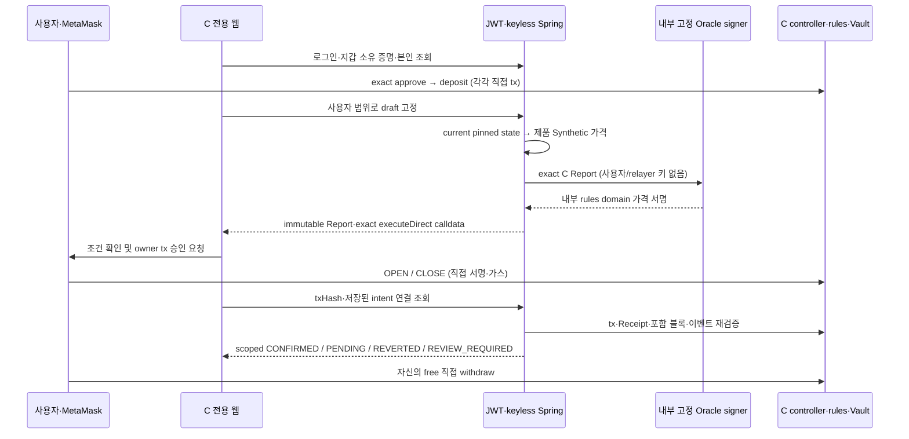

# C 발표 최소 실행본 — owner 직접 승인 경로

## 현재 사용 가능 범위

**전용 화면·서버 구현 및 시험 EOA의 실제 로그인→지갑소유증명→approve→deposit→OPEN→CLOSE→free withdraw PASS / 실제 Chrome·사용자 MetaMask NOT_RUN.** 아직 접속 가능한 신규 브라우저용 URL을 제공한 단계가 아니다. 사용자의 최신 우선순위에 따라 최소흐름을 먼저 인수한다. 청산·AI는 그다음이며 전체감사/광범위 복구는 삭제하지 않고 후순위로 보존한다.

기존 C 계약의 `executeDirect`가 가장 작다. relayer는 추가로 EIP-712 동의 수명·revision·relayer nonce/raw 전송/복구 연결이 필요하지만, 직접 경로는 이미 검증된 계약과 MetaMask owner 트랜잭션 승인을 사용한다. 사용자 개인키를 서버에 제공하지 않는다. owner 직접 tx 서명과 별도 EIP-712 메시지 서명을 검증한 relay를 혼동하지 않는다. 계약의 owner/EOA/nonce/금융 조건/Report 서명 검사는 유지한다.

## 최신 실제 실행 체크포인트

### 실제 사용자 MetaMask 최소 흐름 완료 — APPROVE→DEPOSIT→OPEN→CLOSE→WITHDRAW

현재복원자손135ae9a8에서사용자가독립MetaMask로직접승인한5개거래를각각기존서버canonicalReceipt/calldata API로CONFIRMED확인했다. 시험EOA나Mock결과를사용하지않았다. 초기로그인/지갑소유증명은보존DB의기존연결을유지하고이번새JWT/지갑/account조회로확인했다.

|동작|실제 txHash|블록|서버 판정|
|---|---|---|---|
|APPROVE3000|`0xc29a422979416503ce6023ff34b6257b1969e43f008cc4748036a45ade63a74f`|4160|CONFIRMED|
|DEPOSIT3000|`0x95f7f936a9f9401d4e0d679396508a3de3bae93d1df201e26acd1e1658aaa8b5`|4182|CONFIRMED|
|OPEN Long10/담보1000|`0xc3bfb46aeb66eee5498ac80ac7671ee683d453c3d150a1ac73fab14e9c36d60d`|4567|CONFIRMED/4events|
|CLOSE|`0x0675c5679e94deee25660fa390e1d04b48a7453823266b3b9afd2956b33a90ae`|4765|CONFIRMED/4events|
|WITHDRAW3003.066148919985598442|`0xfa5bb44e5c7b82fcad3395137e4224ee1983052e7978e6f7e2e082d195fa4496`|4957|CONFIRMED|

최종인출blockHash `0xc63c3d97e02a45b6df5be34fc800292f3c7089affcdaa698d5e29089c305d270`/timestamp1792776075와Vault Withdrawn(owner,3003066148919985598442)/tokenTransfer를서버Receipt로검증했다. 실제최종account/position을같은block4989/hash`0xb51c9e47825497965e0518482008062f0ff60bc95a6b00f82d876421051fc4f5`에서확인했다. **wallet1000003.066148919985598442/free0/locked0/allowance0/unpaid0/unassigned0 cMKRW, positionCLOSED/version2/lockTerminal=true, userNonce2, EOAnonce8, pending[]**다. house9999996.933851080014401558=실제Vault토큰=recognizedAssets이며 wallet+house 합계는 기존11000000cMKRW로 보존된다. 실현이익3.066148919985598442를실제수량·가격차산식/Receipt/house감소/최종지갑증가로대조했다. ETH가스와cMKRW손익은별개다.

실제PG읽기확인: drafts3/directExecutionClaims3/directExecutions2/본인지갑연결1. 첫Report미생성·만료draft와claim은삭제하지않고보존했다. 그실패의정확한API원인은관측부족으로미확정이며, 버튼비활성화를단순미체크로단정하지않는다. 성공OPEN/CLOSE는별도사용자새draft이며이전실패를소급PASS하지않았다. 사용자키접근/대리서명/자동재전송0, 기존금융·기한검사변경0이다.

완료범위는로컬3초제품Synthetic·실제Chrome/MetaMask owner직접거래·새격리PG metadata·실제Anvil/Vault자산흐름이다. relayerEIP712/C relayerrevision·SIGNED복구/전체감사/자동청산/Claims/AI/외부네트워크는이번수동시연으로완료처리하지않는다. 현재서비스는03:00KST이전자동종료예정이며아직상시서버가아니다. 내일같은자산상태재개는 **현재135ae9a8의최신DB/정상종료snapshot**을이어야한다. 최초e0/미거래5e4조상snapshot이나이전hardcoded미거래전용resume검사를그대로재사용하면안된다. 종료후snapshot SHA/owner/계약/5Receipt/nonce8·2/최종잔고를검증해재개할조건은남은작업이다.

### 복원 자손 실제 사용자 MetaMask CLOSE CONFIRMED — 인출 대기

사용자직접CLOSE tx `0x0675c5679e94deee25660fa390e1d04b48a7453823266b3b9afd2956b33a90ae`를 실제controller로그와저장Intent/서버ReceiptAPI로검증해 **CLOSE CONFIRMED/4events**를확인했다. operation `0x8f998d844e86c16c99fa1413926076af2a3face840cfa19d34357ad81fc8f9a8`,block4765/hash`0xf60ec5b59f17cb27229a99bbc4b85de6f175c2d71d6fd166ccbad2c07383e473`/timestamp1792775883다. 동일position a0413425…는CLOSED/version2/locked0/lockTerminal=true/userNonce2/pending0이다.

원본Report quantity133644072353551894,entryPriceE8 7482561571115,closePriceE8 7484855835923에서정수기존Long식으로계산한실현손익E18 `3066148919985598442`가Receipt realizedPnl/paidProfit와정확히일치한다. free **3003.066148919985598442cMKRW**,house **9999996.933851080014401558cMKRW**,unpaidProfit0/badDebt0이다. free+house=실제Vault토큰10003000cMKRW로일치하고unassigned0이다. Report관측→채굴16초이며기한완화없다. 아직이CLOSE수익포함최종free인출은미실행이므로사용자직접인출을안내한다. 이정산은실제온체인Vault기준이며DBfinancialjournal작성이나전체감사완료로표현하지않는다.

### 복원 자손 실제 사용자 MetaMask OPEN CONFIRMED

사용자가직접OPEN거래와기존조회완료를알렸다. 실제controller로그에서tx `0xc3bfb46aeb66eee5498ac80ac7671ee683d453c3d150a1ac73fab14e9c36d60d`를확인하고, 서버ReceiptAPI에저장intentId `0xe703247655f0840752ae096b22e66e34eeda9a7be68c7ddef98be653dedf528a`를연결해 **OPEN CONFIRMED/verifiedEvents4**를검증했다. block4567/hash`0xc8fb3c51b3c2d6a818411e8e46c6e37bf19735ca087fc2237ed6a095a316a806`/timestamp1792775685다. 실제본인position `0xa0413425c806f7decd8575fc1b5492020cfac6c0a509064abbbf40302fbd765a`는ACTIVE/Long10/version1/quantity0.133644072353551894mSEC/entry74825.61571115/locked1000cMKRW다. account free2000/locked1000/userNonce1/house10000000/unpaid0/pending[]를확인했다. Report 관측1792775668에서실제채굴까지17초이며3초내사용자서명이필수였다고주장하지않는다. owner직접트랜잭션·단일RPCReceipt/calldata/4event검증이지relayerEIP712나전체감사completePASS는아니다. 실제사용자CLOSE·현재포지션해제후인출은아직NOT_RUN이며다음직접CLOSE안내로이어간다. 과거시험EOA결과와별개의최신사용자실행이다.

### 복원 자손에서 사용자 MetaMask 재예치 실제 CONFIRMED

사용자연결확인후 wallet1000000/free0/locked0/pending0을실제API로확인했다. 이어사용자가approve/deposit완료를알렸고, 현재자손135ae9a8의Vault실제Deposited로그와서버기존Receipt검증API에서 **DEPOSIT CONFIRMED**를확인했다. tx `0x95f7f936a9f9401d4e0d679396508a3de3bae93d1df201e26acd1e1658aaa8b5`, block4182/hash`0xf056e6131ab27e71cdd55da82fd5da18f1d359778381a5587456afce553c9146`/timestamp1792775299다. 실제account block4217에서wallet997000/free3000/locked0/allowance0/userNonce0/unpaid0/house10000000cMKRW, pending=[]를확인했다. Synthetic현재참조74842.97096464는실제제품SIMULATED응답이다. 이검증은SINGLE_RPC_RECEIPT_AND_CALLDATA_NOT_FULL_AUDIT_OR_FINALITY 범위다. 실제MetaMask OPEN/CLOSE는아직NOT_RUN이며다음사용자직접OPEN을안내한다. 소스/금융정책/기존증거수정0이다.

### 2026-10-24 02:01 같은 계정·DB·체인 복원 웹 READY

새복원자손 `cdemo-135ae9a88bb244c6` / recovery source `16c3d610c84c1c1687f43c4f65fef2acc6c9d354c18873a6ec4c539b4c0a0acd`는실제서비스READY다. 순수11PASS/독립재검토1/2필수없음/동결supervisor592d23aa…로기동했다. 기존DB·지갑연결·4계약codeHash·genesis·세과거Receipt·잔고·nonce를유지했고, 사용자승인한새블록실제시각동기화는비공개exec에서1회뿐이었다. 실제JWT/본인/지갑/account/Synthetic/세ReceiptAPI CONFIRMED를확인했다. 원본·실패fixture/claim은보존했고현재새4컨테이너만실행중이다. 자세한실패·수정·복원증거는 `c-same-state-resume-preparation-2026-10-24.md`최상단과runtime `c-direct-resume/cdemo-135ae9a88bb244c6`이다.

현재사용자wallet1000000/free0/locked0/EOAnonce3/Cnonce0. 웹32171/c-demo.html·RPC32172/chain31337이며기존계정으로새로그인하면지갑연결이남아있다. 사용자실제MetaMaskOPEN/CLOSE는아직NOT_RUN이다. 이번세션은 **10/24 03:00KST 이전**에종료되므로시험을완료하고포지션/자산을확인해야한다. 원본조상으로되돌려재개하지않으며이자손의최신상태만다음후보가된다. 감독session3052/개별소유STOP을보존한다.

### 2026-10-24 사용자 승인 — 복제 체인 현재시각 1회 동기화 및 같은 사용자 환경 재개 준비

사용자가 복제본 새 블록 시각을 실제 현재 벽시계로 한 번 동기화하고 테스트를 재개하도록 명시적으로 승인했다. 원본 snapshot·DB·과거 블록·Receipt는 그대로 보존한다. 새 복제본에서 locked0/미확정0/사용자nonce3 등 조건을 확인한 뒤 비공개 내부 RPC로 1회만 시각 동기화하고, 자연 채굴 이후 과거 증거·잔고·nonce 및 실제시각2초 이내를 재검증한다. 이 동기화를 60초 실제 유예 검증의 증거로 사용하지 않는다. Report30초/시장5초/Intent120초·서명·금융 정책은 그대로다.

복원 서비스는 새 소유 PG cold copy와 Anvil 자손만 사용하고, 원래 DB identity·계정·지갑 연결·계약을 유지한다. 원본 all-stopped 및 snapshot별 exclusive live successor claim을 통해 동일 nonce의 이중 live fork를 차단한다. 과거 STOP/claim을 지우거나 준비 도구의 신규 배포·초기 자금 분배 경로를 호출하지 않는다. 준비·회귀·독립검토·실제HTTP/RPC 확인 전에는 READY나 접속 URL을 발표하지 않는다. 실행 전 읽기 관측 RAM2185MiB/disk25.99GiB/실행컨테이너0/기존32171·32172 listener없음이며 실제 기동 직전에 재검사한다.

### 2026-10-24 복원 probe — 자산·과거 Receipt 일치 / 체인 시각 BLOCKED

재시도 시 RAM2544MiB/disk25.98GiB와 원본PG·Anvil 정지를 재확인했다. 새 복원 단위 최초 독립 검토 `review_c_report_candidate`는 필수 지적 없음, 무소켓8 PASS 및 원본 provenance 읽기 검증 PASS다. 검토 script SHA는 `70925acdb91f6bde10a2906888a2e3ad0d3820a1ce6738bb90a942288a106c75`다.

신규 `cclone-0c6fd9a9ec3b458f`에서 원본 snapshot RO/동일 pinned Anvil1.8.1/network-none/host port 없음/계정0으로 1회 실행했다. genesis·4계약codeHash·EOA nonce3/Cnonce0·token1000000/free0/locked0/totalLocked0/house10000000 및 기존 APPROVE/DEPOSIT/WITHDRAW canonical Receipt·블록·이벤트는 모두 일치했다. 그러나 `NATURAL_WALL_CLOCK`에서 최신timestamp1792771369(2026-10-24 01:02:49KST)가 실제보다1463.107초 뒤처져 `C_CLONE_WALL_CLOCK_OFFSET`로 **BLOCKED**다. 원본snapshot timestamp1792771361에서 새 블록은8초 진행했다. 따라서 단순히 더 기다리면 해결된다고 가정하지 않는다.

clone은10.812초에 정상종료·원본anchor/snapshot SHA불변이다. 신규dump·result·claim은 `deployment/runtime/c-anvil-snapshot-clone/cclone-0c6fd9a9ec3b458f/`에 보존했다. 원본container/volume/DB/key/STOP변경0, 새 서명·거래·배포0, 시간조작0이다. PG cold copy와 서비스 재개는 미실행이며 현재 웹 URL은 열리지 않았다. 기존5초/30초 검사를 완화하지 않는다. 기존 체인의 새 블록 시각을 실제 벽시계로 복구하려면 시간조작 금지와의 경계를 먼저 승인받고, 과거 블록·Receipt·nonce·자산 보존 및 만료된 draft 재사용 금지를 재검증해야 한다. MetaMask OPEN/CLOSE는 여전히 NOT_RUN이다.

### 동일 논리 환경 재개 — RAM 조건 충족 / 원본 보존 복원 검증 준비

사용자재시도요청에01:15:47KST재확인한가용RAM3045MiB/disk25.99GiB/Docker28.4/running0으로기존1920MiB/2GiB조건을충족했다. 이전1681MiB자원BLOCKED는과거관측으로보존한다. 새계약배포/잔고초기배분을하지않고원본e0e5a246snapshot을RO로연결한동일Linux이미지의독립Anvil에서genesis·4계약codeHash·이전3Receipt·EOA/Cnonce·실제자산잔고·현재정상시간연속성을먼저검증하는작은복원Gate를준비중이다. 원본컨테이너/volume/DB/keyfiles는시작·수정하지않는다.

이검증은새로운복원작업단위로소스·무소켓회귀·독립검토후실행한다. 통과전같은환경복구완료/MetaMaskOPEN가능을보장하지않는다. Anvil의기본실제mining시간을검증할뿐evm_increaseTime/수동timestamp조작으로프로토콜기한검사를우회하지않는다. 통과하면PG콜드복제와같은사용자·계약identity의서비스연결을이어간다. hostAnvil1.5.1대신원래image1.8.1을사용한다.

### 2026-10-24 동일 논리 환경 재개 요청 / 자원 부족으로 복원 실행 보류

사용자가같은환경에서이어서진행하도록요청했다. 목표는기존계정/지갑연결/DB/동일genesis·계약·잔고·nonce·과거Receipt를유지하는재개이며새체인초기화나새잔고배분으로대체하지않는다. 읽기확인에서e0e5a246PG/Anvil은exit0정지·정확한owner라벨/원래namedvolume·기존이미지를보존했다. 보존snapshotSHA/최종wallet1000000/free0/locked0·nonce3·세거래증거는그대로있다. 현재는접속환경이열려있지않다.

실행전가용RAM **1681MiB < 승인기준1920MiB**(239MiB부족),disk25.92GiB,Docker28.4/running0이라복원용DB/Anvil도시작하지않았다. 사용자앱종료/전역재시작/기존volume변경0이다. 메모리확보후에도보존자료의복제본에서동일Linux이미지로restore/chainidentity·기존Receipt·잔고연속성을먼저검증해야한다. 호스트Anvil은1.5.1이고원본Docker이미지표시는1.8.1이어서호스트바이너리로복원해동일성검증을대체하지않는다. 실제복원은NOT_RUN이므로같은환경복구PASS를아직보장하지않는다. 원본보존·새key/계약/자금배분없는재개경로를우선한다.

### 2026-10-24 실제 사용자 직접 인출 확인 / 현재 환경 정상 종료

사용자가free인출완료를알린시점01:02:49에는e0e5a246환경이이미정상종료돼freshRPC재검증을수행하지않았다. 기존환경/volume/체인을재시작하지않고보존된 `anvil-state.private.json`을읽기검증했다. 파일SHA는종료result의 **`e015e7c508653f2d47b0d5e1c4bfcada7b5acbef1f360ab5ce6e6ebc92a7a9e8`**와일치했다.

저장된사용자세번째거래 **`0xce1ea49c2f8d87f9f61f62c35a167f7be21375b0fd7d9d1b315d0ca18adaa07e`**, block3654/hash`0x5a1a8062d7517bbdd9b7c78f94ac2af33dbdc39336dfb606d36600adc34e3601`,owner→현재Vault·receipt.status0x1을확인했다. 두로그는현재token의Transfer(Vault→owner,3000E18)와현재Vault의Withdrawn(owner,3000E18)이다. `cast keccak Withdrawn(address,uint256)`가저장topic7084f547…과일치하며같은블록번호저장record도있다. 금액은3000000000000000000000(E18)=3000cMKRW다.

기존ERC20/Vault저장배치와`cast index address`를이용한종료스냅샷storage조회에서 **사용자token1000000cMKRW/free0/locked0**을확인했다. 실제저장token/Vault바이트코드keccak도초기identity.codeHash와일치했다. 사용자EOAnonce3이며이run의사용자세거래는approve/deposit/withdraw뿐이다. 이로써실제사용자로그인·지갑증명·exactapprove·실제예치·본인free직접인출까지의연결증거를확보했다. **인출검증은보존스냅샷기준**이며새RPCcanonical/finality/서버중단UI인출/C7전체를검증했다고표현하지않는다.

launcher결과 `READY_USER_ACCEPTANCE_NOT_RUN`은자동harness가사용자인수를판정하지않는범위표시로원문보존하고이번수동결과로덮어쓰지않았다. App143/Oracle·bootstrap·Anvil·PG0/OOMfalse,network/PG·Anvilvolume보존으로종료했다. OPEN/CLOSE실제MetaMask는 **NOT_RUN**이며시험EOAPASS를승계하지않는다. 현재활성URL없음·자동재시작/재전송0이다. 다음실제인수는충분한실행시간의새환경에서OPEN→CLOSE이며이전실패·계약·자산·사용자증거를모두유지한다.

### 사용자 DEPOSIT 실제 CONFIRMED / 자동 종료 임박으로 새 OPEN 보류

사용자가deposit완료를알린후현재e0e5a246자산및기존ReceiptAPI를읽어 **DEPOSIT/CONFIRMED**를확인했다. tx `0xcf0695f0a12f2f379e9541891e802715220e79f74c2eb239ba52f42b9f2d744b`, block3026/hash`0x964de8f562604e69d44ea1917ede7059b2530fb53effe20e8de1b75ba2388356`다. 실제wallet997000/free3000/locked0/allowance0cMKRW,CuserNonce0이며사용자자산은free에예치됐고OPEN은없다.

00:55:43KST확인시가장이른서비스종료01:01:57까지약6분만남아빠른시험EOA서명을사용자의전체OPEN→CLOSE→withdraw완료시간보장으로취급하지않는다. 서비스종료직전새locked포지션을만들지않도록우선free3000직접인출을안내하고,실제MetaMask OPEN/CLOSE인수는NOT_RUN유지후충분한시간에완료한다. 최종목표를축소하거나과거PASS를대신쓰지않는다. 대리서명/자동거래/종료시간·금융정책변경은하지않는다.

### 사용자 MetaMask exact APPROVE 실제 CONFIRMED

사용자가approve확인을전달했다. 현재e0e5a246환경에서실제owner토큰이벤트를읽고JWT기존Receipt API로검증해 `APPROVE/CONFIRMED`를확인했다. tx `0x7e81bf8d8205c9721b879e34c50987f2aa5756dfe3a6d00fa10168ed196ac8a8`,block2554/hash`0x426a51a641b162e55948ef11fbdc5134954a246691ac981b39e297b6a6145d31`다. 현재wallet token1000000/free0/locked0/allowance3000cMKRW,ownerEOApendingnonce1/CuserNonce0을읽기확인했다. MetaMask승인으로ERC20허용량만증가한단계며deposit/OPEN/CLOSE인수로확대하지않는다. 다음사용자조작은브라우저confirmed기록정리후3000deposit직접승인/Receipt확인이다. 환경01:01종료예정을계속안내하고만료후새거래를만들지않는다. 전체감사completeCoverage=false/단일RPC해당거래검증경계를유지한다.

### 실제 사용자 로그인·MetaMask 연결·소유 증명 확인 완료

사용자제공Chrome캡처에서로그인c-demo-user/EOA0x6642…c18a/chain31337을확인했다. 캡처의genesis952c7b1a…/controller7a5bcc51…/Vaultd13957c4…는현재e0e5a246환경의identity파일과정확히일치했다. 실제PG wallet_links에user_id1/동일EOA1행이등록됐음을읽기확인했다. 로그인폼은로그인후숨기지않는현재UI이므로미로그인처럼보였지만로그인·wallet연결·소유증명등록은완료다. 이시점현재API의walletBalance=1000000cMKRW/free0/locked0/allowance0/userNonce0을읽기확인했다. 사용자개인키접근/자동거래0,MetaMask OPEN/CLOSE인수는아직미실행이다. 다음사용자조작은3000cMKRW exactapprove→canonical조회이며이후deposit을안내한다. 현재실행소스는변경하지않는다.

### 2026-10-24 현재 활성 READY — 간단한 로그인 실제 성공 / 사용자 소유 증명 대기

한정추가검토필수지적없음후승인된새1회 `c-direct-browser/cdemo-e0e5a24638b0416f` / runtime source **`2ed9c86b83163a5741b0718c99f90e3442618ca49d22052e557d42795cb82fb5`**를기동해 **READY_AWAITING_USER_WALLET_NOT_ACCEPTED**를확보했다. 준비145120/source855bcc24…와wrapper c06d1e8… hash/RUN_CLAIM조건통과,해당새claim을사용했다. 현재host session3264에서1시간bounded실행중이며이소스는실행중수정하지않는다.

실제bootstrap/PG·Oracle/Appready/loopback정적파일·RPCchain/genesis/EOA·JWT/me/config/제품Synthetic읽기probesPASS후,사용자안내값 **`c-demo-user / <LOCAL_ONLY_PASSWORD_REDACTED>`를명시입력한실제HTTP로그인과본인조회도PASS**했다. JWT원문출력없이exp-iat3600초확인했다. 신규미확정사용자거래를생성하지않았으며사용자MetaMask서명/거래인수는아직NOT_RUN이다.

- 활성웹 `http://127.0.0.1:32171/c-demo.html`
- RPC `http://127.0.0.1:32172`,chain31337/테스트ETH,같은공개EOA사용.
- 가장이른서비스종료예상 **2026-10-24 01:01:57 KST**(사용자안내는01:01분까지).
- 다음사용자조작: 기존탭새로고침·이전자동완성비밀번호삭제→위시험계정로그인→MetaMask연결→EIP191소유증명. 완료후서버확인하고approve/deposit/OPEN으로진행한다. 개인키요청/자동서명/자동사용자거래0.
- 이번성공은준비JSON보완본의실제기동·로그인성공이며지난실패원인의사후확정/거래정산PASS/1시간지속운영완료/실제MetaMask인수로확대하지않는다. 아래BLOCKED/옛URL·시간은해당과거run만의기록이다.

### 2026-10-24 준비 JSON 보완 한정 승인 사용 — 새 환경 기동 중

사용자가준비JSON읽기/안전진단보완추가독립검토1회와통과후새격리기동1회를승인했다. `review_c_direct_web`의이번한정추가검토는 **발견된 필수 수정 없음**이다. 검토자가pure19/launcher-selftest를직접실행하고149source불일치0/미사용claim/prepare855bcc24… 및wrapper c06d1e8…을대조했다. 이전실제오류원본이ready인지inspect인지미확정이라는경계도유지했다. RAM2803MiB/disk26.2GiB/Docker28.4/기존실행0/원본dirty10불변확인후준비145120Z-58f159a7로새1회기동을시작했다. 과거예외나cap을재사용하지않으며결과확인전READY/PASS로표시하지않는다. 사용자자동거래/유료호출/기존DB변경0이다.

### 현재 BLOCKED — 간단한 로그인 설정 완료 / 준비 JSON 관측 보완 추가 검토 필요

로컬로그인 `c-demo-user / <LOCAL_ONLY_PASSWORD_REDACTED>` 설정과최종재검토2/2(필수없음)후새 `cdemo-a7b0ccdf4f624ece`를1회실행했으나 **BLOCKED C_BROWSER_SAFE_JSONDecodeError / START_ORACLE_APP**에서중단했다. 사용자서명/자동사용자거래/host relay READY0이다. bootstrap은성공했고App/Oracle readiness파일은종료후유효한JSON으로존재했다(App545byte,Oracle218byte). 기록에는JSONDecodeError원본/개별행이없어Docker inspect인지readyfile인지실제최초원인을확정하지않는다. 준비파일생성직후내용미완성시is_file만으로json.loads하는기존코드는별도fixture에서실제재현했다. 이것은확인된코드취약경계이며실제최초실패의확정원인으로과장하지않는다.

실행82.031초후App143/기타4역할0·OOMfalse·source/artifact불변,새network/PG/Anvilvolume·state를보존했다. 실패한fixture/claim은재사용하지않는다. 현재서버는정지상태며이전URL을활성으로안내하지않는다.

최소보완은wrapper의16KiB제한published_ready(reader)와무완성JSON의기존90초readiness대기내처리,완전한objectJSON/기존identity검사전성공금지,영구미완성시명시코드로중단이다. Dockerinspect의JSON/shape실패도역할별안전코드로구분한다. 거래/Oracle/서명/HTTP재전송을반복하지않고,서비스인증·금융·기한·권한은변경없다. 부재/빈파일/부분JSON→완성JSON과잘못된형태/초과크기무과금회귀포함 **순수19PASS·runner selftestPASS**다.

새오프라인준비 `145120Z-58f159a7` / source **`855bcc24f6f9d32bafef5e72b1b87dee1454174daa999c1cb42364739c207e46`**는compile2/selftest2/순수19PASS·base/source불변·RUN_CLAIM미사용이다. 최종wrapper SHA **`c06d1e8b12a45031ae45ed7c9c427792d92beaf52d35370388d3bb872c6a01e4`**다. 기존브라우저하네스initial1+rereview2를사용했으므로 **이준비JSON읽기/안전진단보완에한한추가독립검토1회와통과후새격리기동1회**의예외승인전실행금지다. 기존예외/다른단위검토한도를재사용하지않는다.

### 로컬 시험 로그인 간소화 요청 — 새 환경 준비 중

최신후속: wrapper로그인생성/selftest및새prepareID결합의브라우저최종재검토2/2는필수지적없음이다. 새준비 `144408Z-02f0c600`/source`dbd62ede6da1561a8e6cbc4a6c0aca6bd77bef4a9a5a945794cb8cf20a870418`는149소스/컴파일바이트동일·selftests/Python18PASS·미사용claim,wrapper SHA`4eb590c1dbd8a18bc1009e8e66594a1b435f17fe63007f1be62e56ddf85462c4`를확인했다. RAM2813MiB/disk26.42GiB에서새1시간환경1회를기동중이며실제READY전활성으로표시하지않는다.

기존7200351c환경은소유STOP후App143/다른4역할0·OOMfalse,volume/network/state보존으로정지했다. 종합결과는 **BLOCKED C_BROWSER_END_IDENTITY**로보존한다. 새로그인wrapper수정을진행중인기존launcher가종료검사에서발견했기때문이다. execution-identity와현재소스를실제로대조한변경목록은 `deployment/c-direct-browser-run.py`1개뿐이며제품App/Oracle/금융바이트는바꾸지않았다. 이를과거PASS로수정하거나guard를우회하지않는다. 종료직전확인한실제사용자기록/chainnonce는0이었다.

사용자가테스트비밀번호통일을명시요청했다. 신규loopback C fixture의로그인만 `c-demo-user / <LOCAL_ONLY_PASSWORD_REDACTED>`로고정한다(공개편의용모의계정이며실제계정비밀번호가아님). DBowner/API/JWT/Oracle4개비밀은계속독립무작위64hex다. BCrypt/JWT/권한검사는변경하지않으며일반TMS/Google/KRX계정에적용하지않는다. `!`는기존하네스secret허용문자밖이므로검사를넓히지않고기존허용범위의8글자를선택했다.

현재7200351c환경의실제PGwallet_links/drafts/claims/executions=0/0/0/0,EOApending txcount=0을읽기확인했다. 기존users읽기전용trigger/UPDATE권한을우회해비밀번호를덮지않는다. 기존환경은소유STOP으로정상정지후그대로보존하고새fixture를준비한다. wrapper의로그인자격생성만수정했고동일로그인/무작위운영secret분리selftest·순수18PASS를확인했다. 독립검토후새prepare/claim으로1회기동하며자동사용자거래는없다.

### 현재 활성 환경 — 약1시간 READY / 사용자 연결 대기

신규 `c-direct-browser/cdemo-7200351c85f5491b`/runtime source **`ab2e8b6c90fd841f78c8b98352e973373cda1e9dba76b9dfa826b8a3a2619d7c`**는 **READY_AWAITING_USER_WALLET_NOT_ACCEPTED**다. 새준비140729/source dbd62ede…·운영시간단위독립최초검토필수없음후RAM2670MiB/disk26.67GiB·원본dirty10/기존실행0확인후1회생성했다. 현재host session70705에서bounded실행중이다. 실제bootstrap/JDBC/SCRAM·Oracle/App동일identity·loopback정적웹/RPCchain/genesis/EOA·HTTP로그인/me/config/Synthetic probes를통과했다.

AppSession3600/OracleSession3600/JWT설정3600000ms를actualready에서확인했고,별도읽기진단HTTP로그인의 **실제JWT exp-iat=3600초**도원문비밀출력없이확인했다. 가장이른서비스종료예상은 **2026-10-24 00:16:38 KST**(안내는00:16분까지로보수적으로표시)다. 종료전에사용자거래를확정해보이고,시간초과면새거래자동생성/재전송하지않는다. 장시간전체지속운영/실제MetaMask인수는아직PASS가아니다.

- 활성웹 `http://127.0.0.1:32171/c-demo.html`, RPC `http://127.0.0.1:32172`, chainId31337/테스트ETH.
- 같은공개EOA만새시험가스/모의토큰공급. 사용자개인키생성/보관/서명대행/자동사용자거래0.
- 로그인아이디 `c-demo-user`, 새비밀번호는해당신규runtime의 `browser-login.private.json`만참조. 이전종료환경비밀번호를재사용하지않는다.
- 현재조작: 웹새로고침→새로그인→같은MetaMask연결→EIP191소유증명후서버확인. 이후approve/deposit/OPEN/CLOSE/withdraw는사용자직접서명을기다린다.
- 이전15분환경과성공/실패모든fixture는정지보존. 아래이전URL·종료시각·실행중기록은해당과거run에만귀속한다.

### 수동 인수 세션 1시간 연장 — 새 준비/검토 중

최신후속: 새browserprepare `140729Z-6551457a`/source`dbd62ede6da1561a8e6cbc4a6c0aca6bd77bef4a9a5a945794cb8cf20a870418`의compile/selftest2·순수18·runner정책selftestPASS와149source/산출물hash/미사용claim을확인했다. `review_c_report_candidate`의이번운영시간단위최초독립검토는필수지적없음이며검토자가compiledApp/Oracle/Pipe/Bootstrap selftest·pure18을직접실행했다. RAM2670MiB/disk26.67GiB/Docker28.4/기존실행0/원본dirty10불변확인후같은공개EOA·32171/32172·3600초로새환경기동을시작했다. 실제READY전URL활성으로표시하지않는다. 구성요소가서로다른시각에시작하므로종료안내는가장먼저만료하는Oracle/App/Relay기준으로한다.

사용자가15분종료후시험시간확보를요청했고,운영시간을약1시간으로맞추는안을수락했다. 지난`cdemo-0ab9122db70e487f`는READY_USER_ACCEPTANCE_NOT_RUN/오류없음/5역할exit0/OOMfalse/소스불변/DB·체인volume·network보존으로종료했다. 기존환경을재시작하거나그claim을재사용하지않는다.

변경은local수동운영시간뿐이다. App은기존기본1800초상한을유지하고명시적extended-user-session=true에서만3600초를허용한다. 별도내부Oracle및browserrelay/launcher최대3600초,브라우저전용JWT는해당세션초×1000ms로생성한다. 실제App/Oracle ready값도동일세션/JWT기한과대조한다. Oracle1요청Report30초/시장5초/Intent120초/nonce/owner/가격·수량·금융/권한·키분리는변경없다. relay동시helper는APP2/RPC2그대로이며연결총량만900초당512(3600초최대2048)로유한비례상향해15분용총량이시간연장을무력화하지않도록했다. perconnection30초idle/120초상한과STOP은그대로다.

직접JUnit122PASS `c-direct-offline/20261023T140445Z-b6dbd9a1`/source`ba48e225…`,새baseprepare `140536Z-654b77de`/source`9224bb174ea2cfd8eca0f558c76e71dc45e815669ee5442152a4d97a8e2cdd0e` 역할별compile/selftest·SQLresource·웹build·Python17PASS를확인했다. 새browserprepare/운영시간단위독립검토후한번기동하며필수지적/자원실패시열지않는다. 과거15분검토PASS를수정본PASS로승계하지않는다. 기존금융·컨트랙트실환경PASS는해당과거source에만귀속한다.

### 사용자용 신규 환경 READY — 지갑 소유 증명 대기(거래 미실행)

같은공개EOA사용확인후 신규 `c-direct-browser/cdemo-0ab9122db70e487f`를기동했다. runtime source **`44f0db9a95c9ec9bf003077b0c27d8b24ccc2194db311f761b2756fce1701476`**, prepared `132549Z-79940b60`/wrapper검토SHA일치,149source불일치0·미사용claim확인후해당신규claim을사용했다. 현재host session38626에서900초bounded실행중이다. 사용자개인키생성/서명/자동거래0이며실제MetaMask인수는NOT_RUN이다.

실제bootstrap(EOAcode0x·고정공급자금배분·신규PG/SCRAM/schema/leastprivilege)PASS, Oracle/Appreadyidentity 및actual3초설정확인, IPv4loopbackrelay의정적html exact바이트·실제RPCchain/genesis/EOA·HTTP로그인/JWT/me/config/SIMULATED시세probes가모두통과해 **READY_AWAITING_USER_WALLET_NOT_ACCEPTED**를확보했다. 기존환경재시작/삭제0이다.

- 웹: `http://127.0.0.1:32171/c-demo.html`
- RPC: `http://127.0.0.1:32172`, chainId31337, local테스트ETH
- genesis: `0x6923c7b0ebefb4d1ff09025ff358dbb8a3838327a2826d717c9ce3b60f222dbe`
- controller: `0x99cf9a2a12ce07e6b13a2e3d6cbde9106963fb1b`
- rules: `0x5efec6beece0ba53451a2bd6cb79a7d795365ccb`
- token: `0xc8564920875dc2a41fce7fb4cf2289ca614329d5`
- Vault: `0x7f74b4a78897ae70eb71c43bee7b80570ca1e2f0`
- 로그인아이디 c-demo-user, 비밀번호는신규owned runtime `browser-login.private.json`에만보존(이문서에원문없음).
- App안전종료예상 **2026-10-23 22:50:21 KST**. 만료후새거래를만들지않고상태부터확인한다. READY는현재연결준비일뿐종료·거래인수완료가아니다.

다음사용자조작: MetaMask의기존테스트네트워크RPC를새32172로설정→새웹로그인→같은EOA연결→EIP191소유증명. 그결과를서버에서확인후approve/deposit/OPEN을안내한다. 사용자서명필요지점에서대기하며OPEN/TOPUP/CLOSE를자동실행하지않는다. 기존성공시험Gate/옛사용자OPEN은별도보존한다. bounded종료및내부helper잔류확인은아직실행중이므로완료로기록하지않는다.

### 정확한 다음 작업 — 공개 테스트 EOA 확인 후 사용자용 새 환경 기동

사용자후속확인: 같은공개주소 `0x6642e33b1cb538b66fb14cf60862f0622147c18a` 사용을확정했다. 실행직전149source불일치0/새RUN_CLAIM미사용/launcherSHA검토본일치·RAM2637MiB/disk27.36GiB/Docker28.4/기존실행0·원본dirty10유지를확인했다. 검토된browserlauncher를32171/32172고정포트·900초로1회시작했다. 실제READY/HTTP/RPC검사통과전접속가능으로표시하지않으며사용자거래/서명은자동수행하지않는다. 아래주소확인대기는과거기록이다.

실제 OPEN/CLOSE/free withdraw는아래시험EOAGate에서PASS했다. 사용자브라우저준비 `132549Z-79940b60` / source `df496353860f3e52340852b9c301d3a5c4eabc2f04d7688be87bfa0091232661`와새launcher SHA `f72f4756c067bf5fec352ae9ce93cfc28073175d7d94e035e7478c378bcbdeff`의독립재검토1/2는 **발견된 필수 수정 없음**이다. 검토자가pure15PASS/launcher무소켓selftestPASS/149개source불일치0/RUN_CLAIM미사용을직접확인했다. 최초지적APP기아는role2slot씩분리해해결했다. 신규브라우저작업단위는initial1+rereview1사용,재검토1회가남는다. 이번3초하네스의한정추가검토예외와는별도단위이며그예외는이미Gate1회와함께소비했다.

남은필수입력은사용자의공개MetaMask테스트EOA확인이다. 이전공개주소 `0x6642e33b1cb538b66fb14cf60862f0622147c18a`를계속쓰는지비차단질문으로확인요청했고아직답변이없다. 공개주소를추정해가스/토큰을공급하지않는다. 답변후현재source/artifact/RUN_CLAIM·RAM1920MiB/disk2GiB/images/포트소유권을다시확인하고,`c-direct-browser-run.py 20261023T132549Z-79940b60 <PUBLIC_EOA> --app-port 32171 --rpc-port 32172 --seconds 900`으로신규환경을준비한다. 두포트는아직미할당후보이며실패시임의의다른포트로반복하지않는다. launcher의실제loopback HTTP/RPC/JWT/시세probes와READY파일확인후에만실제URL·RPC·chainId·새계약·로그인private파일경로를안내한다. 그뒤EIP191/approve/deposit/OPEN/CLOSE/withdraw는사용자MetaMask직접승인을기다린다.

현재browserDocker기동0/실제host listener0/Chrome0/MetaMask0이며유료/commit/merge/push/삭제/전역재시작0이다. 실제relay I/O와hostCLI종료후컨테이너내부helper잔류확인은live인수에서별도관측한다. 기존fixture를재사용하지않는다. 웹기능구현/오프라인준비PASS를실제사용자거래PASS로승격하지않는다.

### 신규 실제 Gate PASS — 시험 EOA, local3초, owner직접 호출 범위

`c-direct-demo/cdemo-a3b7bc88e4e8482e/result.json` / source **`e3266434f4b4d55672b2f0be3d8e93536f0e79baed5d1163e051c02516caad86`**는 **C_DIRECT_ACTUAL_HTTP_SYNTHETIC_PG_ANVIL_PASS_NOT_METAMASK_OR_FULL_AUDIT**다. 이번 추가검토1회와 신규Gate1회 승인만 사용했다. 이전실패는그대로보존했다.

실제 도달순서: BCrypt/JWT로그인·무인증401·본인조회 → 독립시험EOA2명EIP-191연결 → 실제제품Synthetic3초tick/PGcommit → exactapprove → deposit3000cMKRW → OPEN(Long10배·담보1000) → 본인position/타인404 → CLOSE → free3000.326146301086616446cMKRW 직접전액인출. 모든자산거래와OPEN/CLOSE를서버조회경로의canonicalTx/Receipt/이벤트에대조했다. DB에는draft/claim/execution각2개와wallet2개,사용자2명·sentinel보존/생성시장step진행을확인했으며DB돈장부로자산을만들지않았다.

| 거래 | txHash | 기준 블록 |
|---|---|---|
| APPROVE | `0x9b689d755f5268e010665cbebfa1d867504af04fbaa6349583c9eca2833a1fae` |67|
| DEPOSIT | `0xba71da37adc21ec7f2ba2e1bf728118b10769ba1796423e4ad51e634f08fe45b` |68|
| OPEN | `0x24dbcd39bdf1a79a4a69d21c34bf3ec12dde88967ad9b5c94013d4eba1621c12` |74|
| CLOSE | `0x071b4727c451ac23ded4e9b1ef6c1547d81caef61a87c436c0e5a1068d87a680` |76|
| WITHDRAW | `0xd7dfb260c64b6d66a3c919f56df93e796e9d782360bda8246c23064ef1f73205` |78|

position `0x621ca6b2bd1aab89c9a37edd2d10a894de458f0f62d8792200f258c1a00bccb8`의 entry75021.19269322 / close75023.63948167cMKRW/mSEC, quantity0.133295668077318432mSEC,실현이익0.326146301086616446cMKRW를원본E8/E18과기존수식으로대조했다. 최종사용자token1000000.326146301086616446, Vaultfree/locked/unpaid각0, house9999999.673853698913383554다. Receipt coverage는단일RPC·해당거래calldata/이벤트범위이며completeCoverage=false,전체감사/finality주장이아니다.

전부90.484초내종료,6역할정상exit0/OOMfalse,source/prepared/runtime불변이다. 새PG/Anvilvolume·network·571144byte stoppedstate(`d83c90409abce939e541b1f48edb5fc1d55bf10600f03c3b75b365ad7f82db3a`)를보존했다. 유료0/삭제0/기존환경재시작0이다. 이성공은WindowsRPC장애해결·1초tick안정화·별도EIP712사용자메시지/relayer실행·실제MetaMask·C7 UI·자동청산Worker·AI·전체감사완료가아니다.

다음: 새identity의사용자브라우저환경을준비중이다. 실제MetaMask의확인시간을포함한Report30초거래/만료거부는해당사용자인수에서검증한다. 3초내지갑승인을요구하지않는다. 별도공개EOA확인후테스트가스/토큰만공급하고키는요청/보관하지않는다. 내부망/고정목적지loopbackbridge/수명·정지/인증/nonce를유지한다.

브라우저 후속 오프라인 준비: 신규6파일(공개EOA전용Bootstrap,고정목적지Pipe,loopbackRelay,prepare 및순수회귀2개)을추가했고, 기존성공143소스를바꾸지않았다. `c-direct-browser-prepare/20261023T131634Z-2fb358fb` / source `c1c61958b76964cdd33e8dbbe5904230fd8608da8c162cad7e069701a581568d`는 **PREPARED_NOT_LIVE_BROWSER_OR_METAMASK**, Javahelper/bootstrapcompile0·무소켓selftest0·Python15PASS/base·source불변이다. base의사용된claim은읽기전용보존/새claim0이며네트워크/Docker/RPC/paid0이다. 다른지갑의개인키를만들지않는bootstrap과독립내부망의App/RPC2목적지만열도록준비한다. 초기독립검토를요청했으며신규환경실제기동·WindowsTCP연결·Chrome·MetaMask·수동확인지연은아직미검증이다. 사용자공개주소확인답변과얇은bounded실행/정지연결이남았다.

브라우저 후속 최신(재검토1/2 요청중): 최초독립검토가APP/RPC의공유2slot에따른웹기아가능성을발견했다. 실제Anvil장애관측이아니라RPCkeepalive2개가30초idle/120초수명동안APP10초대기를차단하는소스조건이다. 역할별2slot(총4helper)로분리하고RPC포화때도APP2개사용/역할별3번째차단의순수회귀를추가했다. 신규browserApp은768MiB로한정한다. bootstrap256은App보다먼저종료하고verifyDriver는기동하지않으므로동시최대PG256+Anvil192+Oracle192+App768=1408MiB,호스트512여유포함1920MiB조건을유지한다. 기존GateApp512/143소스는바꾸지않는다.

새 browserprepare `132549Z-79940b60` / source `df496353860f3e52340852b9c301d3a5c4eabc2f04d7688be87bfa0091232661`는compile2/selftest2·Python15PASS/base·source불변이며RUN_CLAIM미사용이다. `132448Z-c9fdd811`의비상승JAR접근거부컴파일실패는보존했고제품오류로분류하지않았다. 별도신규7번째 `c-direct-browser-run.py`는이준비본과wrapper SHA를결합해새identity를만든다. 기존상태를재사용하지않고공개EOA만받아새체인/DB/bootstrap/Oracle/App/loopback만기동,실제HTTP/RPC/genesis/시세/JWT와정적파일바이트를읽기검사한뒤에만READY를내보내도록구현했다. password는private파일경로로만안내하며거래/서명은자동실행하지않는다. wrapper무소켓selftest와순수15PASS를확인하고독립재검토1/2를요청했다.

아직실제browserlauncher/Docker/Windowslistener/Chrome/MetaMask는실행하지않았다. 공개EOA확인답변도대기중이다. 종료시host exec CLI와컨테이너내부helper 종료는별개이며실환경에서잔류관측이필요하다. Javahelper의30초idle/120초상한은있지만그자체로실제종료관측PASS가아니다. 기존성공Gate는정지보존했고재시작하지않는다.

사용자확인시간경계: 웹 `validateExecution()`/`sendDirect()`는Report의관측+30초와Intent최대120초를검사하며tick3000ms를지갑서명기한으로사용하지않는다. MetaMask창에서확인하는동안만료되면계약이거부할수있고,이경우기존tx/Receipt를먼저확인한다. 현재자동시험의빠른서명성공은수동확인지연인수로대체되지않는다. 최종개발에는1초tick안정화/C relayer revision·SIGNED복구/전체감사/최종통합/AI검증을유지한다. 이로컬발표이정표는범위삭제가아니다.

### 2026-10-23 추가 검토 예외 승인 사용 — 신규 Gate 실행 중

사용자가 local3초 cadence 정합성/self-test에 한한 추가독립검토1회와 통과후 신규Gate1회를 승인했다. 기준 `125034Z-0ddc0050` source143 mismatch0/RUN_CLAIM미사용을 확인했다. 이후 이번 manifest 요구를 충족하기 위해 새 실행 manifest에 `presentationLocalOnly=true/syntheticTickMs=3000`을 고정하고 Driver가 exact값을 검사해 실제 설정으로 전달하도록 연결했다. Appready의 actual설정값과manifest도 비교한다. 기존준비본은 미실행보존하며 source가바뀐새준비본을 사용한다.

새 `130219Z-9b82332b` / source `e3266434f4b4d55672b2f0be3d8e93536f0e79baed5d1163e051c02516caad86`는143source/snapshot·역할파일일치, compile/selftest0·webbuild0·Python17PASS·소스/JAR불변·RUN_CLAIM미사용이다. `review_c_report_candidate`의 이번 한정 추가검토는 **발견된 필수 수정 없음**이며 이 예외1회를 사용했다. 설정key가 실제Synthetic @Scheduled와 일치하며1000/3000만허용,5초/30초/120초/금융·권한·키분리검사를 유지했다. RAM2535MiB/disk27.93GiB·Docker28.4.0·기존실행컨테이너0·원본HEAD/dirty10불변확인후 이 준비본의 신규Gate1회를 시작했다. 실제결과확인전PASS가아니다. 추가실패시tick을계속늘리거나검사를완화하지 않는다.

### 현재 재개 지점 — 하네스 좁은 추가 검토 필요, 새 실환경 실행 금지

최종 보완 준비본 `c-direct-demo-prepare/20261023T125034Z-0ddc0050` / source **`ee9d3e36bfb33b63966b40890b3c6818c3e3c2df6d12b1e315567a9d949e5ca3`**는 역할별 compile/self-test0·실제 App verifyConfig의1000/3000ms정상·잘못된cadence거부·SQL ClassLoader·웹build0·Python17PASS·source/deps불변이다. **RUN_CLAIM 미사용**, Docker/유료요청0이다. 다음 실행후보는 이 준비본만이며 추가검토예외 없이는 실행하지 않는다. 최종Docker running0·원본dirty10불변·기존AI보호156개 changed0/missing0을 재확인했다. 신규컴파일/시험은 종료됐다.

수정 후 새 `cdemo-26694c18020248ac` / source `f1d98ce018899c35e4805f480bdf1a08ea14162f3d380216c21b5fa7645fc964`는 **BLOCKED**다. 앞선 claim 권한 오류는 재발하지 않았으나 OPEN execution의409 `C_DIRECT_PRICE_CHANGED`에서 중단했다. HTTP18(시세)12:44:21.432Z →19(draft)21.936Z →20(execution거부)22.531Z이며1초 제품Synthetic tick 조건이다. Oracle evidence에는ready만 있고 이 operation의 signer claim은 없다. build/revalidate 중 어느 개별 검사인지 단계 로그가 없어 더 세분한 원인을 확정하지 않는다. OPEN tx는 전송하지 않았다. 이 실패를 금융 계산 실패나1초tick 안정성 해결로 표시하지 않는다.

해당환경도81.5초에 verify시험실패exit1/기타5역할exit0/OOMfalse로 정지했다. 신규 volume/network·493415byte state(`2242cc253c1860e5f94caf054fda1cbe815c7b240a366bff8081703cad56ba07`)를 보존하고 source/prepared/runtime불변·유료0·삭제0을 확인했다. 기존환경은 재시작하지 않았다.

발표용 local selectedApp에만 Synthetic cadence3000ms를 명시하고, Driver는 draft/claim 전에 최대40×100ms 읽기 전용 새tick 관측 후 각 거래를1회 수행하도록 보완했다. 가격 수치 주입·Report 교체·자동 거래 재시도는 없다. 제품5초 신선도/Report30초/Intent120초/승인범위/Oracle/계약은 그대로다. 그 하네스 최종재검토2/2는 **필수수정 있음**: Driver3000ms와 App시작guard1000ms 불일치였다. 준비본 `124805Z-83e8576b` / source `e1eb7051…`은 compile/selftest/build/Python17을 통과했지만 이 지적 때문에 **RUN_CLAIM 미사용·실행금지**로 보존한다.

App guard를 로컬 허용 cadence1000/3000으로 맞추고 compiled App self-test에 실제 verifyConfig 정상2종/거부0·100·5000·30000ms를 추가했다. backend권한·금융·SQL·키분리는 변경하지 않았다. 현재 하네스 검토한도(initial1+rereview2)를 모두 사용했으므로 이 **설정 정합성·compiled config self-test 보완에 한한 추가 독립검토1회**, 통과 후 **새 PG/Anvil/HTTP Gate1회**의 좁은 예외가 필요하다. 검토 없이 실행하지 않는다. 과거 E1a/C서비스 예외를 재사용하지 않는다.

브라우저 실행은 아직 NOT_RUN이다. 다음에는 새 identity와 실제 사용자 공개주소만 받아 trial Driver키 생성/자동거래를 제외하고 EIP-191 재증명 후 사용자 직접 승인한다. 과거 Docker internal network의 host publishing 장애 때문에 단순 `-p`나 기본 bridge로 격리를 완화하지 않는다. 기존 내부망을 유지하고 App/RPC 두 고정 목적지만 loopback으로 연결하는 bounded relay가 남은 실행 의존성이다. C7 서버독립 UI인출·자동청산 Worker·AI·전체감사는 별도 미완료다.

후속: 수정된 Direct 오프라인 `123932Z-a662d782` / `d6f4e2e7b90159cc06c0ee6dc1d4d21150a37f4f2307c922edab30f998596a48`는122PASS, backend최종재검토2/2 필수 지적 없음이다. 사용자 행 잠금2회·claim UPDATE권한 없음·기존 Worker경합/commitunknown 시험을 유지했다. 이 backend 검토한도는 사용 완료다. 새 `124035Z-2d654048` 준비는 Windows sandbox의 esbuild 상위 디렉터리 접근 거부로 실패(실환경0)했고 보존했다. 같은 소스의 권한 승인 실행 `124217Z-506b547f` / source `f1d98ce018899c35e4805f480bdf1a08ea14162f3d380216c21b5fa7645fc964`는 역할별compile/self-test·웹build·Python16을 통과했다. 실행직전 RAM2336MiB/disk28.51GiB로 새 Gate1회를 시작했으며 최종 결과 확인 전 성공으로 기록하지 않는다. 원본 HEAD f9353c3/dirty10·보호파일156개 changed0/missing0을 재확인했다.

신규 `c-direct-demo/cdemo-8910bf8bacf54eaa/result.json` / source `034799dca43fbcd3764847f4250a7a4ca1729aa3aebf4a6ee5b074c8e8f140ce`는 **BLOCKED / C_DIRECT_DEMO_VERIFY_FAILED / DRIVER_ACTUAL_HTTP_VERIFY**다. 준비본 `122621Z-c33e282c`의 RUN_CLAIM은 사용됐으며 재사용하지 않는다. 하네스 재검토1/2는 필수 지적 없음이었다.

실제 로그인·JWT 차단·본인 조회·EIP-191 지갑 연결2명·제품 Synthetic tick·시험 EOA의 approve/deposit 및 서버의 각 canonical Receipt 확인·Vault free 조회·OPEN draft까지 성공했다. OPEN 실행 준비 POST는503 `C_DIRECT_STORAGE`였다. Oracle 요청 claim/응답은 보존됐고 **OPEN tx 전송 전** 중단했다. 실제 MetaMask/Chrome·OPEN/CLOSE/withdraw 전체 성공이 아니다.

소유 PostgreSQL 로그에서 실패 SQL `SELECT user_id,owner,intent_digest FROM tms_c_execution.direct_execution_claims ... FOR UPDATE`의 `permission denied for table direct_execution_claims`를 확인했다. 기존 API 역할에는 이 append-only 테이블의 SELECT/INSERT만 있다. UPDATE 권한을 늘리지 않고, save가 이미 먼저 취득하는 사용자 행 FOR UPDATE 직렬화 아래 불변 claim을 일반 SELECT로 읽도록 최소 수정했다. claim/save 모두 같은 사용자 잠금을 유지하고 FK/PK/append-only 정의는 변경하지 않는다. 무과금 회귀 및 backend 마지막 재검토2/2를 진행하며 통과 전 새 실환경 실행은 하지 않는다.

실패 환경은83.578초에 정상 종료됐다(verify는시험실패 exit1, 나머지역할exit0/OOMfalse). 신규 network/PG·Anvil volume·495447byte Anvil state(`c11d4cda50d4fdfc4e6d7dccac91dffc16bca010f18ad73da849eaa7be2f273d`)를 보존했고 source/prepared/runtime hash는 유지됐다. 유료0·삭제0이다.

## 구현 경계

- 신규 opt-in `c-demo.html` 및 `c-demo.js/c-demo.css/c-direct-wallet.js/c-direct-intent.js`. 원래 index·B/UI/AI worktree는 유지한다. 기존 `vite.config.js`는 multipage 입력만 추가했다.
- 기존 JWT 및 EIP-191 지갑 연결 API를 사용한다. 로컬 selected demo login은 실제 사용자 repository·BCrypt·기존 JWT를 사용하며 인증을 전역 해제하지 않는다.
- 직접 Intent/실행 API는 JWT 본인 wallet과 exact 범위를 검증한다. E1a drafts를 재사용하고 새 append-only execution claim 및 immutable signed-price Report를 저장한다. claim 불확실/미완료는 자동 재서명하지 않는다. DB는 자산 예약·현금 장부를 만들지 않는다.
- Spring은 사용자·Oracle·relayer 키를 갖지 않는다. 별도 내부 Oracle 역할은 고정 identity/Report만 서명한다. 외부 임의 hash 서명, relayer 송신 및 사용자 자산 이동을 제공하지 않는다. role별 파일·classpath·mount를 분리한다.
- 서버 응답 직전 기존 5초/미래2초/provider·generation/exact-price 정책을 다시 검사한다. owner 직접 tx는 이후 지갑 승인·채굴까지 관측부터30초 Report 유효성을 계약에서 검증한다. 브라우저의 raw 서명 직전에 서버의 동일5초 검사가 강제됐다고 표현하지 않는다. 자동 TTL 연장·재가격·재전송은 없다.
- token approve/Vault deposit·withdraw는 각 owner tx다. 무한 approve를 기본값으로 만들지 않는다. E18/E8는 decimal 문자열·BigInt로 표시/인코딩한다.
- 브라우저는 wallet 호출 전에 pending을 저장하며 계정/체인 변경·늦은 응답·timeout에도 미확정 상태를 보존한다. 실제 tx/Receipt를 확인하지 않은 신규 거래 자동 생성이나 성공/실패 확정은 금지한다.
- Receipt 조회는 고정 배포·실제 owner/from/to/value/calldata·정확한 Report·Oracle 서명·포함 블록 transaction index·이벤트 주소/순서/값·재조회 일치를 확인한다. 단일 RPC의 해당 tx 관측이며 전역 scanner/finality/전체감사 MATCH가 아니다. PnL과 실제 paidProfit/미지급 Claims를 구별한다.

## 현재 검증

- 최신 후속: Direct backend 최초검토에서 실제 RPC client의 tx/Receipt 매개변수 switch 누락을 발견했다. 실제 injected client positive/negative2개를 추가하고 기존 client18개를 Direct suite에 포함했다. 최종 `c-direct-offline/20261023T115432Z-ae170aba` / `569b29c1dc1b67d2a31d5575b181ef50cf522d9b92de2b25430db014c91de018`는121PASS이며 backend 재검토1/2는 필수 지적 없음이다. read core는 `115200Z-d5586600` / `0bce4c2a…`의55PASS다. E1c Oracle 후 revalidate도 재검토1/2 필수없음이다.
- 웹 최초검토의 `/api/me` 누락과 malformed pending fail-open을 수정했다. local selectedApp 본인 JWT/JPA 조회 추가, 브라우저 저장값 null/false/0/array/알수없는 phase/필수값 누락은 거래 요청 전에 차단한다. 만료된 정상 이력은 조회할 수 있다. 웹재검토1/2 필수없음, 검토자 직접25PASS, main 전체웹152PASS다. 이 UI는 아직 서버/JWT 조회에 의존하므로 C7 서버중단 UI인출 성공으로 표현하지 않는다.
- 새 오프라인 준비 `c-direct-demo-prepare/20261023T121444Z-7fd17ce1` / source `87977d1704096b63ee1bdcc476160895bc0b83861f086cff2619d95ff5c716a6`는 **PREPARED_NOT_ACTUAL_PG_ANVIL_HTTP_OR_METAMASK**다. 서버/Oracle/Driver 역할별 compile0·compiled self-test0, SQL4개의 root/classpath hash일치, 실제 -parameters·static JWT route/managed entities/role 분리 검사, 새 owned web build0·Python16PASS·source/JAR불변이다. RUN_CLAIM은 미사용이며 Docker/RPC/유료0이다. 신규 actual Gate 하네스의 독립검토를 요청한 뒤 RAM1920MiB/disk2GiB/image/ownership을 확인하고 새 내부 fixture1회만 실행한다.
- 준비 실패 두 건은 보존했다. `115658Z-62f43453`은 Lombok을 processorpath에만 넣어 source annotation classpath 해석이 실패했다. 컴파일 classpath에만 같은 캐시 Lombok을 추가하고 Oracle/Driver/runtime에는 넣지 않았다. `115912Z-723d4dc2`는 unittest fixture의 `run` 문자열이 TestCase.run을 가려 본시험 전 실패했다. `run_id`로 바꾸고 순수16개가 실제 실행된 최종 준비본을 생성했다. 두 실패 모두 실제 Docker/PG/Anvil0이다.

## 신규 실제 Gate 범위와 실행 조건

최신 후보는 `c-direct-demo-prepare/20261023T122621Z-c33e282c` / source `034799dca43fbcd3764847f4250a7a4ca1729aa3aebf4a6ee5b074c8e8f140ce`다. 이전 준비본의 하네스 최초검토는 필수 지적 없음으로 완료됐다. 이후 웹이 각 자산 거래를 진행하려면 서버 CONFIRMED가 반드시 필요하다는 점을 실제 Gate에도 반영해, 신규 Driver의 deposit helper 직후 실제 APPROVE·DEPOSIT Receipt2개와 withdraw 후 WITHDRAW Receipt를 같은 JWT/API 경로로 확인하도록 보완했다. 기존 helper·계약·금융·키 분리는 바꾸지 않았다. 새 역할별 compile/self-test0·web build0·Python16PASS·source/deps불변을 확인했고 이 Driver 보완의 재검토1/2를 요청한다. **실제 Gate/RUN_CLAIM은 아직 미사용**이며 이전 준비본을 실행하지 않는다. 다음 명령은 검토·자원통과 후 `run 20261023T122621Z-c33e282c`다.

`deployment/c-direct-demo-check.py run 20261023T121444Z-7fd17ce1`은 하네스 최초독립검토와 자원 조건을 통과한 뒤에만 허용한다. 신규 내부 전용 network, PG·Anvil volume, bootstrap/Oracle/App/verify 역할만 생성한다. host port는 게시하지 않는다. 같은 소스의 web-fixture를 준비 때 새로 빌드해 source 전후 hash와 연결했다. 기존 C5 artifact는 원본 source-map/current contract/library SHA를 대조한 후 복사했으며 새 배포 identity와 역할 키를 사용한다.

실제 목표는 시험 EOA의 exact approve/deposit, 실제 BCrypt/JWT 로그인과 본인정보·지갑 소유 증명, 실제 제품 Synthetic commit·시세 advancing, HTTP OPEN·CLOSE Report→내부Oracle 서명→owner raw 전송→동일canonical Receipt와 Vault free 읽기→직접 인출이다. PostgreSQL에는 user/wallet/draft/claim/execution metadata와 Synthetic 상태만 쓰며 DB 돈을 만들지 않는다. root/JWT/관리 권한을 없애지 않는다. Spring에는 사용자·relayer·Oracle 키를 마운트하지 않는다. Oracle에는 Oracle 운영키만 마운트한다.

작업330초/전체390초로 제한하고 현재 최초 원인을 cleanup 오류가 덮지 않게 기록한다. 생성 시도한 정확한 role 이름의 소유권을 재확인한 뒤 정상 정지하고 새 DB/Anvil volume·network·evidence·stopped Anvil state를 보존한다. 성공해도 실제 사용자 MetaMask/Chrome/Windows port publishing·자동청산 Worker·STOMP·전체감사/C7 완료가 아니다. browser 환경은 다음 새 로컬 실행 identity로 별도 준비한다.

- 최종 직접 경로 Mock/H2 `c-direct-offline/20261023T113440Z-abc84838/result.json` / source `752947a4fc59be1fe5c9eae16d8859fba00e8a0ec69d693cbd1c3a8e878a9e91`는 **C_DIRECT_OFFLINE_PASS_NOT_HTTP_PG_OR_WALLET**다. compile/test0·고정103PASS/FAIL·SKIP·ABORT0, source/JAR/SQL 자원불변이며 실제 소켓·PostgreSQL·체인·사용자 지갑은 실행하지 않았다. Oracle client6/Receipt9/role-validator3/직접 API·store16과 기존69개를 포함한다. `revalidate(candidate)`의 Oracle 응답 후 기존 시장 검사도 검증했으며 기존 E1c 검토 뒤 추가된 이 변경은 재검토 범위다.

- 신규 웹22개와 C worktree 전체 웹149개 PASS, `npm run build` PASS. 최초 전체 실행은 이 worktree에 node_modules가 없어 websocket test의 패키지 누락과 Vite 부재로 실패했다. 존재하지 않음을 확인한 뒤 기존 lockfile·로컬 npm cache만으로 `npm ci --offline --ignore-scripts --no-audit --fund=false`를 수행했다. lock SHA `cfc3eeae5203cf105f8999f5048c7649e97bf96001f8c2d4a15051d11d8a256b`는 유지했다. 기존 다른 worktree 의존성은 변경하지 않았다.
- 신규 직접 경로 Java 시험은 Mock/H2 및 시험 Oracle/Receipt fixture이며 실제 HTTP/PG/체인 성공과 구분한다. 최초 import 이름충돌 compile 실패와 잘못된 IERC-5267 domain Mock의94PASS/9FAIL을 보존했다. 실제 `eip712Domain()`은 domain separator가 아닌7필드 ABI tuple이므로 fixture만 수정했고 제품 검사를 약화하지 않았다. 최종 실행·검토 결과는 이후 누적한다.
- 조회 core 최신53PASS는 `c-service-read/20261023T112821Z-f831e13c` / `40c20585417606e799612b2848df406fcba83689f7f0d8886e81078ee084a8d8`다. 직접 Receipt 관측을 위한 transaction/Receipt 읽기2개만 허용 목록에 추가했으며 송신 RPC는 허용하지 않는다.

## 남은 필수 인수

1. 최종 소스·웹 산출물 준비/compiled metadata 및 SQL classloader 검사, 독립검토.
2. 신규 내부 Linux PG/Anvil/Spring/Oracle에서 제품 Synthetic commit → 시험 EOA HTTP 승인 준비 → 실제 OPEN/CLOSE → canonical Receipt·Vault free → 직접 인출.
3. 실제 Chrome 화면·권한·오류 표시. Mock 지갑은 실제 사용자 승인으로 기록하지 않음.
4. 별도의 새 로컬 browser run에서 loopback RPC/웹 URL 안내 후 사용자 MetaMask 승인을 기다림. 기존 Google/KRX/AI/B와 과거 fixture를 재시작하거나 재사용하지 않음.

필수 실패는 그 실행에서 중단·보존한다. commit/merge/push/유료 API/전역 재시작/보존 데이터 삭제는 없다. 이 문서는 미완료를 완료로 바꾸는 발표 설명이 아니다.
