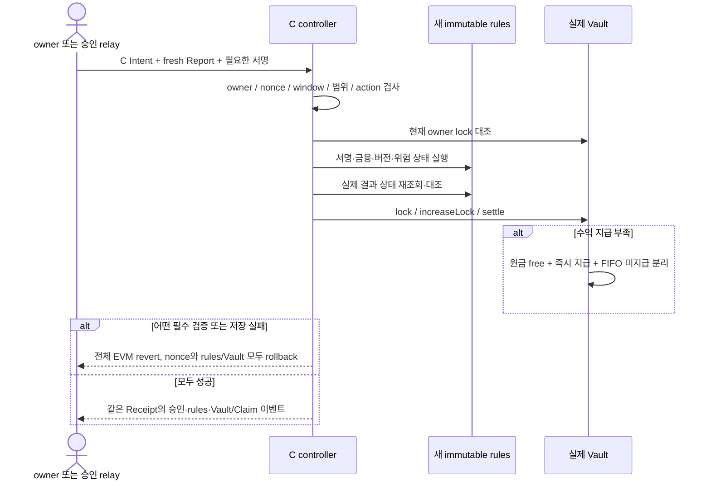

# C2 — 사용자 승인·실제 담보·종료/FIFO Claims 원자 연결

2026-10-23. C worktree HEAD `f9353c33244565b30fb130dfb6159eab441a3523`, 미커밋 후보. [승인 ADR](dapp-c-policy-adr-2026-10-23.md), [구현 계획](dapp-c2-implementation-plan.md), [보존된 C1 결과](dapp-c1-token-vault-2026-10-23.md).

## 구현

- `CFuturesIntentTypes.sol`: C 전용22필드 TYPE_HASH, C controller의 EIP-712 `TokenizedMarketCFuturesUserIntent`/`1`. 기존 B 서명은 사용하지 않는다.
- `CCollateralizedFuturesController.sol`: owner 직접 및 고정 relay 경로의 동일 nonce/version/경제조건 검증, owner nonce 직접 취소, keeper 전용 위험 action, 고정 관리자 OPEN-only pause. 관리자/relay/Oracle는 서로 다른 주소이며 setter/upgrade/generic call 없음.
- controller constructor가 새 rules와 새 Vault를 직접 생성한다. rules.executor와 Vault.controller는 controller 주소로 고정된다. 가격 domain 이름/schema는 재사용 rules의 `TokenizedMarketFutures`/`1`이지만 새 verifyingContract/Oracle/C policy/executor로 구분한다. 사용자 domain과 가격 domain은 다른 승인 근거다.
- Report를 검증한 rules 상태와 controller가 동일 수학으로 산출한 mark를 대조하고 같은 EVM tx에서 lock/top-up/settle한다. Vault 실패 시 rules·owner·nonce·operation·이벤트 모두 rollback한다. 임의 PnL을 입력받는 controller API는 없다.
- `CMarginVault.sol`: position별 고정 owner/lock/terminal, operation 중복 방지, immutable controller+runtime code 검사. 실제 free→locked, 담보 한도 손실만 house 귀속, badDebt는 별도 정보다.
- 수익 CLOSE는 house 부족이어도 포지션을 종료하고 원금을 free로 반환한다. 지급 가능한 수익만 house→free, 나머지는 고정 owner/op/position의 FIFO Claim이다. 선행 미지급이 있으면 새 수익의 즉시 지급은0이며 후순위 append다. processNextClaim은 누구나 호출하되 선두 한 건만 부분/전액 지급하며 지급 완료 기록도 보존한다. 무현금/빈 queue는 이벤트 없는 무변경이다.
- 미지급이 있으면 controller OPEN을 차단한다. 기존 TOP_UP/CLOSE/risk/free withdraw/fundHouse/process/cancel은 OPEN pause나 미지급 때문에 차단하지 않는다. 사용자 자산 전용/house 인출/미귀속 sweep/mint 구제 없음.

## 실제 검증

계약 src/test/script/foundry.toml aggregate sourceHash:
`fa398990fe955281e16043c82965b72d1c86d1f0ca0cbd612f3ff1fd59557406`.

| 실행 | 결과 |
|---|---|
| c2 `20261022T200420Z-6f53fbb2` |76 PASS /0 FAIL /0 SKIP; C131 + controller16 + Vault26 + 수학3 |
| all `20261022T200447Z-eb969ded` |128 PASS /0 FAIL /0 SKIP; 위76 + 기존 현물/가격/선물52 |
| build `20261022T200453Z-a5f1173a` |exit0, 전체 script 포함 build PASS |

실제 runner exit0/source 불변, 로그·해시·수정 전 소스 snapshot은 각 `deployment/runtime/c-foundry/<run>`에 보존했다. fuzz는 각256회다. C1 코드가 C2에서 변경되었으므로 C1 31개를 다시 실행한 결과이며 이전 C1 PASS의 단순 승계가 아니다.

검증은 직접/relay OPEN→TOP_UP→CLOSE, Long/Short·2/5/10 수량과 손익, 서명/owner/domain/chain/nonce/범위/만료·무서명 우회 거부, 후단 실패 원자 rollback, nonce 취소와 직접/relay 순서, START/CLEAR/추가담보 회복, 59초 거부/60초 새 Report 청산과 badDebt, 고갈 CLOSE·원금 반환·OPEN 차단, FIFO 부분·1wei·반복·원래 owner·두 사용자 자산 격리·부채/현금 보존을 포함한다. 세 수학 테스트는 C에서 재사용한 quantity/음수 내림/유지증거금 올림/손실한도/양의 PnL 위험 불가를 새로 실행했다.

## 독립 검토 / 현재 경계

### 최초 지적 후 보완 실행

**최종 첫 재검토:** `review_c_boundaries`가 실제 보완 코드4개, 독립 generator와132PASS/build 원본 로그·해시를 대조한 결과 **발견된 필수 수정 없음**이다. 최초 두 검증 누락은 해결됐으며 제품 controller/Vault/Intent 계약은 최초 검토와 동일하다. 검토자는 파일 수정/재실행/서비스/Git 작업을 하지 않았다. C3의 실제 여러 사전 개설 C 포지션 경제 시퀀스로 진행한다.

금융/권한 제품 코드는 변경하지 않고 controller 테스트4개를 추가했다. 공개 고정 vector와 독립22word/type/domain 인코딩을 제품 digest와 대조하고, 원본 relay 서명/Report를 유지한22필드 개별 변조(매번 새 구조체 복사)의 거부와 상태 불변, 유효한 타인 owner 승인으로 기존 TOP_UP/CLOSE 거부, OPEN 후 cancel이 START/CLEAR/60초 청산을 막지 않고 nonce/담보를 임의 변경하지 않음을 검증한다. C1의 오래된 unscoped lock/settle selector 테스트는 현재 의미에 맞게 이름만 바꾸었고 실제 C2 ABI 거부 검증은 Vault 테스트에서 유지한다.

보완 sourceHash `1d4365a0bc1a27c83cf564fe6a85baec4b77f7b9baf35f78df8602b43bddf64f`, `all` 실행 `20261022T201803Z-b9ea67c7`: **132 PASS /0 FAIL /0 SKIP**, wrapper exit0/source 불변. C1 31 + controller20 + Vault26 + 수학3 + 기존52이며 실제 DB/RPC/지갑 실행은 없다. 독립 첫 재검토에 이 최종 변경과 실행 증거를 제출한다.

동일 source의 전체 build도 `20261022T201914Z-704cd3de`에서 exit0이다. 최초 C2 artifact 크기는 token init/runtime 2,882/1,814bytes, Vault7,538/7,190bytes, controller29,896/11,931bytes였다. 이는 컴파일 artifact의 길이 관측이며 실제 배포 codeHash/identity 인수 결과는 아니다.

C2 최초 독립 검토 `review_c_boundaries`는 **보통 중요도 필수 보완 있음**이다. 재현 가능한 계약 결함을 발견한 것은 아니지만 독립22필드 digest/golden, 원본 relay 서명을 유지한 전체 필드 변조, 타인 기존 포지션의 유효한 다른 owner 서명 거부, OPEN 후 nonce 취소와 자동 위험 처리의 독립성 회귀가 부족했다. 해당 제한된 테스트를 보강하고 재실행·재검토하기 전까지 C2 완료로 승격하지 않는다. 위128PASS는 보완 전 소스의 실제 실행 결과로 보존한다.

독립 고정 vector는 `deployment/c-intent-golden.py`의 명시적32바이트 필드 배열과 로컬 `cast keccak`으로 계산했다. 제품 ABI encoder/TYPE_HASH/서명 endpoint를 사용하지 않는다. 공개 가상 owner `0x11…11`, relay `0x22…22`, verifyingContract `0x33…33`, chain31337의 비거래 정적 입력이다. structHash `08379fb7f965c1760c22f2c0ce8cec533b216d3fb5622bfc38f71c686e68b10f`, domainHash `a81cf76c7e65e2d4a39e6d9637dcf2f104fb9d94d819bdddfab0f733f3bc2c5a`, 최종 digest `b81cb4bf2b9bad10a2613da0ec1df89549be8aaf991f3cf4149ef39ca02a3e67`이다. 실제 owner/서명 승인/자본 분배 증거가 아니다.

- 실제 PG/Anvil·제품 Synthetic·MetaMask·실제60초 경과·Java projection·C 전체 감사는 NOT_RUN이다. Foundry vm.warp를 실제60초로 표시하지 않는다.
- 현재 세부 고갈/순위 시험에는 Vault 전용 시험 controller도 사용한다. 이는 실제 C controller의 거래·권한 경로 시험과 구분한다. C3에서 여러 사용자가 고갈 전에 개설한 실제 C 포지션을 통한 전체 경제 시퀀스를 보강한다.
- 직접 경로는 Report30초/미래오차/사용자120초·범위를 계약에서 강제하지만 서버 5초/provider-generation 검사까지 수행한 것은 아니다.
- Claims는 지급 보증이 아니다. Oracle/keeper 공모, 고정 signer 장애, 계약 버그·가스/RPC 및 자유 인출의 네트워크 의존성이 남는다. 기존 AI는 아직 C 증거를 해석하지 않는다.
- 기존 Engine/Math/Report는 바꾸지 않았다. 기존 사용자OPEN·DB/Anvil·UI/AI/B/감사 worktree·ledger/STOP/claim 및 실패 증거는 사용/변경하지 않았다. commit/merge/push/배포/유료 요청 없음.
