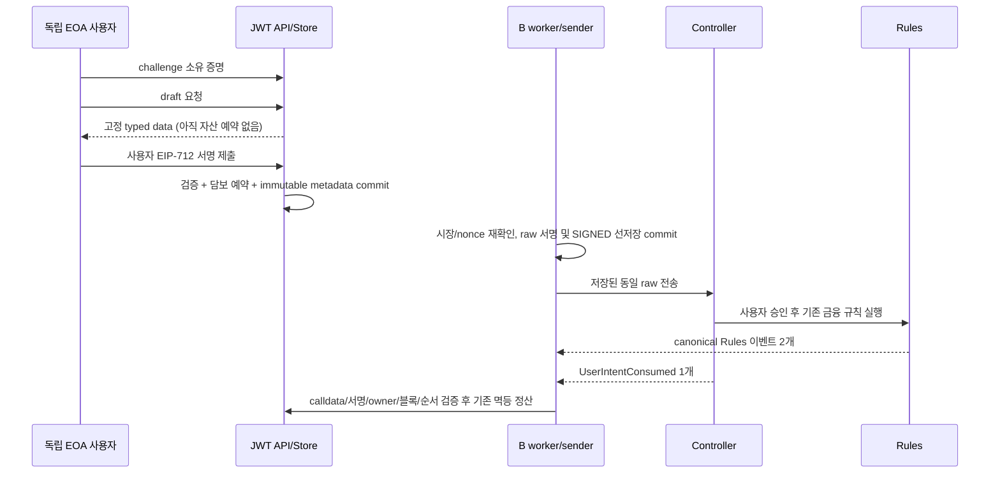

# DApp B안 2단계 — Spring Boot/DB 사용자 승인 경로

작성: 2026-10-22. 작업 브랜치 `feat/dapp-user-authorization`, 기준 HEAD `f9353c33244565b30fb130dfb6159eab441a3523` + 미커밋 변경. **실환경 인수/배포 완료가 아니다.**

## 범위와 보존

- [1단계](dapp-user-authorization-stage1-2026-10-22.md)의 계약 3개 파일은 변경하지 않는다. 이번에는 Java, additive schema, Java 테스트 및 기록만 추가한다.
- 원본/UI/AI worktree, 보존 DB/Anvil/평가 ledger/STOP/claim에는 쓰지 않는다. 기존 환경 기동, PG/Anvil E2E, 웹 구현, 계약 배포, 커밋/병합/push, 외부 API 호출은 하지 않는다.
- EOA만 지원한다. 사용자 키를 서버에서 생성·보관하거나 거래 만료 후 자동 재승인하지 않는다.

## 저장 모델과 API

새 `futures/authorization` 패키지: `UserIntentCodec`, `AuthorizedFuturesStore`, `AuthorizedFuturesService`, `AuthorizedIntentStore`, `AuthorizedFuturesConfig`, `AuthorizedFuturesController`.

`/api/futures/authorized` 아래 JWT 인증이 필요하다. body의 userId를 신뢰하지 않고 기존 내부 JWT subject로 귀속한다.

| API | 역할 |
|---|---|
| POST `/wallet/challenges` | Origin + EOA 확인, 120초 일회 challenge |
| POST `/wallet/link` | 동일 Origin, EIP-191 소유 증명, 원자적 소비/중복 연결 거절 |
| GET `/wallet` | 본인 연결 주소 |
| POST `/drafts` | Idempotency-Key, OPEN/TOP_UP/CLOSE typed data 생성; 담보 예약 없음 |
| POST `/drafts/{id}/submit` | 동일 key와 사용자 EIP-712 서명 검증 후 기존 장부 예약, 202 operation |
| GET `/positions/{id}` | 본인 포지션과 USER_AUTHORIZED_V1/owner/controller/rules 식별 |

추가 테이블: `futures_wallet_links`, `futures_wallet_challenges`, `futures_authorized_positions`, `futures_authorized_drafts`, `futures_authorized_operations`. 기존 테이블을 초기화하지 않는다. 실제 PG additive 적용/트리거/경합은 이번 단계 NOT_RUN이다.

- 연결 주소는 user/wallet 양쪽 UNIQUE이며 교체/해제 API는 없다. challenge에는 목적/Origin/user/chain/random/expiry를 바인딩한다.
- draft는 positionId/operationId/report/가격 서명/사용자 nonce/deadline/연결 identity/market generation을 고정한다. 동일 사용자에 진행 중인 draft/operation을 직렬화한다.
- 승인 이후 report, price signature, user signature, owner, controller/rules identity를 저장한다. 서명 원문은 DB private 영역이며 공개 DTO/toString에는 포함하지 않는다. 암호화 저장/DB ACL/백업 보안의 실환경 검증을 완료했다고 주장하지 않는다.
- 서명 수락과 기존 담보·house 예약 및 immutable metadata 저장은 같은 DB 트랜잭션이다. 실패하면 rollback한다. RPC는 DB 잠금을 보유한 구간 밖에서 수행한다.

## 계약 identity와 실행

| 값 | B안 |
|---|---|
| tx.from | 전용 relayer |
| tx.to | controller |
| report.executor | controller |
| 가격 domain/verifyingContract | TokenizedMarketFutures/1, rules |
| 사용자 domain/verifyingContract | TokenizedMarketFuturesUserIntent/1, controller |

`UserIntentCodec`는 계약과 동일한 nested Report 18필드 및 Approval을 사용한다. 주소/low-S/v/서명자/accountRef/nonce/deadline/relayer를 검증한다. typed data 정수는 문자열로 전달한다. owner와 DB userId는 별개이며 서명된 wallet accountRef와 DB 귀속 metadata로 연결한다.

전송/복구는 기존 `FuturesTransactionSender/Store`, `FuturesExecution`, `FuturesReconciler`, `FuturesLedger`, Worker를 재사용한다. legacy worker는 B operation/position을 제외하고 B worker는 해당 controller의 것만 처리한다. legacy 사용자 API로 B position을 무서명 prepare할 수 없다.

사용자 action은 rules 2개 + controller `UserIntentConsumed` 1개를 동일 tx/정확한 emitter·순서·digest·owner·pid·action·nonce로 연결한다. 전체 calldata와 두 서명을 검증하고 fresh 명시 블록의 controller owner/rules position 및 canonical blockHash를 확인한다. 자동 START_CALL/CLEAR_CALL/LIQUIDATE는 rules 2개 경로이며 새 사용자 서명/nonce를 요구하지 않는다. 모순은 REVIEW_REQUIRED, RPC 불능은 미확정/예약 보존 원칙을 따른다.

## opt-in 설정

세 flag `app.futures.enabled`, `app.futures.runtime-enabled`, `app.futures.user-authorization.enabled`가 모두 true여야 신규 API/runtime을 생성한다. 기본 OFF이고 이번 작업 중 실행하지 않았다.

추가 prefix `app.futures.user-authorization.` 아래 `chain-id`, `controller-address`, `rules-address`, `controller-code-hash`, `rules-code-hash`, `rpc-url`, `executor-private-key`, `signer-private-key`, `wallet-origin`, 선택 `confirmations`가 필요하다. 사용자 키가 아닌 서버 relayer/가격 signer만 설정한다. legacy/spot executor와 nonce 공간을 공유하지 않도록 전용 relayer를 요구한다. 두 코드 hash와 controller/rules의 immutable executor/signer/symbol/policy를 검증한다. 실제 값은 이 문서에 기록하지 않는다.

## 감사 경계와 30초 위험

- 기존 감사는 legacy ABI 기준이므로 B position이 존재하면 `AUTHORIZED_CONTRACT_COVERAGE_REQUIRED`, INCONCLUSIVE/coverage false로 차단한다. 기존 자산 대사도 같은 이유를 표시한다. 이는 B 전체 감사 구현이 아니며 MATCH로 승격하지 않는다. B/legacy 혼합 환경에서 이 차단의 운영 영향 및 version별 coverage 확장은 다음 실환경 단계 전 해결해야 한다.
- 계약 report TTL은 30초 그대로다. 그러나 **기존 시장 gate는 고정 관측값 과거 5초/미래 2초, 동일 가격/provider/generation을 요구**하므로 실제 지갑 팝업 UX는 30초보다 훨씬 짧을 수 있다. draft/submit/전송 직전 같은 gate를 유지한다. 만료 시 새 draft와 새 사용자 서명이 필요하다. 자동 가격 갱신/서명 재사용/TTL 연장은 없다. 현재 경로가 일반 사용자에게 충분히 사용 가능하다고 판단하지 않는다. 사용자 승인과 가격 보고서를 분리하는 후속 설계는 별도 보안 검토/승인 대상이다.
- B안은 DB 모의 담보 사용 승인만 검증한다. 토큰 예치, 온체인 지급능력, 서버 독립 인출은 보장하지 않는다. C안은 별도 Vault/토큰 권한/자산 정본/풀 설계와 신규 배포가 필요하다.

## 검증 및 독립 검토

초기 테스트로 H2 TIMESTAMPTZ의 OffsetDateTime 캐스팅 결함을 발견해 ResultSet 기반 읽기로 수정했다. 이후 테스트 fake broadcast의 Mockito varargs 캐스팅도 수정했다. 원본 실패 실행은 보존했다.

Windows Gradle daemon/test-worker의 `Bad address: bind/listen`이 별도로 재현됐다. 금융 테스트 실패로 혼동하지 않는다. 동일 JDK21 및 프로젝트 runtime classpath를 사용해 서버 소켓을 만들지 않는 직접 JUnit Launcher로 검증한다. 이는 정상 Gradle `test` PASS와 구분한다. private 진단 도구/로그는 해당 worktree의 ignored `deployment/runtime/dapp-stage2-offline/`에 있다.

초기 선택 검증: Java/Solidity nested digest golden vector, typedData 독립 Web3j encoder, challenge/재사용/중복 주소/동시 수락, durable raw/전송 응답 유실, H2 정산, 변조 receipt/owner 검증 총 11 PASS. 초기 선물 package 직접 JUnit 회귀 104 PASS/11 SKIP/0 FAIL. 아래 최종 결과는 후속 기록으로 추가하며 이전 실행과 합산하지 않는다.

최종 선물 패키지 직접 JUnit: **113 PASS / 11 SKIP / 0 FAIL**, 124 discovered. 신규 테스트 20개(Codec 2, Receipt 2, RPC identity 2, Store 11, JWT/MVC 3)를 포함한다. 로그 `futures-20261021T174557622802.log`. 컴파일 `classpath-20261021T174509228135.log`: Gradle 오프라인 `testClasses` BUILD SUCCESSFUL. JVM21, 기존 금융 산식/리스크 검증은 재사용하며 자동 action 테스트의 새 체인 실제 실행을 주장하지 않는다.

전체 직접 JUnit 첫 실행: **665 PASS / 51 SKIP / 1 FAIL**. 기존 `EvaluationIndexCopyTest`의 경로형 opt-in `matches=".+"`에 private runner가 넣은 문자열 `false`도 일치해, `backend/false` 경로에서 NoSuchFileException이 났다. DB 연결 이전 실패이며 B 제품 결함이 아니다. 최초 로그 `all-20261021T174732451141.log` 보존. 제품/AI 테스트/공통 Phase-A 도구를 수정하지 않고 **자체 ignored 실행기에서 모든 opt-in 변수를 아예 unset**하도록 수정했다. 수정 후 전체 실행 결과는 아래에 별도 기록한다.

수정 후 전체 직접 JUnit: **660 PASS / 52 SKIP / 5 FAIL**, 717 discovered, 665 started, aborted 0。 로그 `all-20261021T174952888785.log`。 신규 B안 20개는 모두 PASS다. 5개 실패는 기존 `FuturesRpcGatewayTest` 4개(`wrongChainCodeAndImmutableSignerFailClosed`, `validDeploymentAndMissingReceiptOrTransactionAreNotRpcErrors`, `providerErrorBodyIsNotExposed`, `gasEstimateUsesPendingAndOnlyKnownRevertIsExposed`)와 `AuditBudgetTest.callsAndDeadlinePreventFurtherRpc`다. 모두 `HttpServer.create` → `ServerSocketChannelImpl.netBind` → `sun.nio.ch.Net.listen`의 **Windows native `SocketException: Bad address: listen`**으로 실제 요청/제품 검증 이전에 실패했다. 최초 실행에서 이 5개가 통과했더라도 두 결과를 합쳐 최종 전체 PASS로 계산하지 않는다. 전체 회귀 판정은 **BLOCKED(환경)**이고 원인은 Windows socket 경계까지 확인했을 뿐 근본 원인은 확정하지 못했다. 추가 자동 반복/전역 네트워크 변경/재시작은 하지 않았다.

| 검증 | 판정 |
|---|---|
| Java/Test 컴파일 | PASS |
| 신규 B안 Java 20개 | PASS (crypto/H2/Mock RPC/MVC) |
| 선물 패키지 단독 실행 | 113 PASS / 11 SKIP / 0 FAIL |
| 최종 전체 직접 JUnit 실행 | 660 PASS / 52 SKIP / 5 환경 FAIL → 전체 BLOCKED |
| 정상 Gradle test 실행 | BLOCKED (native daemon/test-worker socket) |
| 실제 PG/Anvil/웹 지갑/배포 | NOT_RUN |

독립 `review_dapp_stage2`: **발견된 필수 수정 없음**. 신규 6개 클래스, 기존 연동 diff, 신규 Java 테스트 5개 파일과 문서를 소스로 검토했다. 직접 테스트 재실행은 하지 않았다. 실제 PG 잠금/트리거, 배포 계약/RPC, 수동 지갑 UX, B 전체 감사는 미검증이다. H2/Mock receipt 결과를 실제 canonical RPC 인수로 표현하지 않는다.
동일 검토자의 추가 보완 검토도 필수 수정 없음: 경로형 opt-in의 unset 수정 및 최초 실패/후속 실행을 분리하는 기록이 타당하며, SKIP을 실환경 PASS로 합산하지 않아야 함을 확인했다. 최종 전체 실행 수치는 이후 관측 결과의 기록이며 독립 재실행을 의미하지 않는다.

### 변경 파일 묶음

- 신규 제품: `backend/src/main/java/com/pricetrack/exchange/futures/authorization/`의 위 6개 클래스.
- 기존 chain: `FuturesChainIdentity`, `FuturesTransactionStore`, `FuturesTransactionSender`, `FuturesRpcGateway`, `FuturesReceiptVerifier`, `FuturesReconciler`.
- 기존 ledger/runtime: `FuturesLedger`, `FuturesSchema`, `FuturesIntentStore`, `FuturesExecution`, `FuturesWorker`, `backend/src/main/resources/futures-schema.sql`.
- 감사 fail-closed: `FuturesAuditSnapshot`, `FuturesAuditService`, `reserve/ReserveService`.
- 신규 테스트: `futures/chain/UserIntentCodecTest`, `AuthorizedRpcIdentityTest`, `AuthorizedReceiptVerifierTest`; `futures/ledger/AuthorizedFuturesStoreTest`; `futures/authorization/AuthorizedApiSecurityTest`.
- 문서: 본 보고서 및 해당 worktree의 `implementation-log.md` 누적. 실행 보조 파일과 원본 로그는 ignored runtime에만 두고 기능 배포물/테스트 원본 증거를 Git에 포함하지 않는다.

### 보존 및 다음 단계

- 이번 productHash(`deployment/phase-a.py::product_hash`, backend main+계약 등 기존 정의)는 `da8db664f50c92461e6950c7f7bb08b3f8bd5f8729287bcf331ce659548b208c`이다. source 코드 변경 시 이전 실행과 동일하다고 가정하지 않는다.
- 보호 baseline 156개 파일 SHA-256 일치(변경 0), 1단계 계약/Foundry 테스트 3개 SHA-256 일치. 원본 melon-init HEAD/10 dirty entries 유지. 해당 보존 검사는 DB/체인 내용을 새로 RPC/SQL 검증했다는 뜻이 아니다. 이번에는 DB/Anvil을 조작하지 않았다.
- 실제 PostgreSQL additive 적용/append-only trigger/동시 challenge 및 operation rollback, 신규 두 계약 배포 identity와 canonical RPC 검증, 별도 JVM same-raw 복구, 실 지갑 UX, B 감사 coverage는 **NOT_RUN**이다. 신규 opt-in 격리 환경에서만 후속 승인 범위로 검증해야 한다.
- Spring runtime 구성의 실제 두 엔진 동시 기동, 설정 값/로그 접근 제어, wallet 주소 재연결·회수 정책도 후속 인수 대상이다. legacy 코드를 지우거나 기존 배포를 신규 B안으로 자동 전환하지 않는다.
