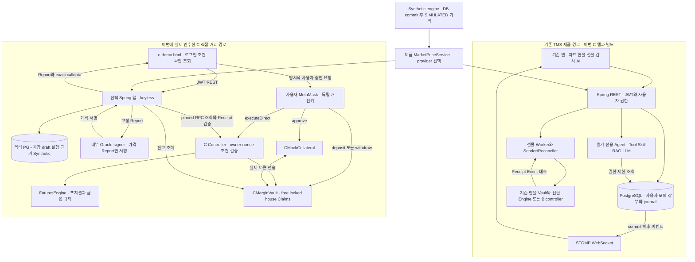
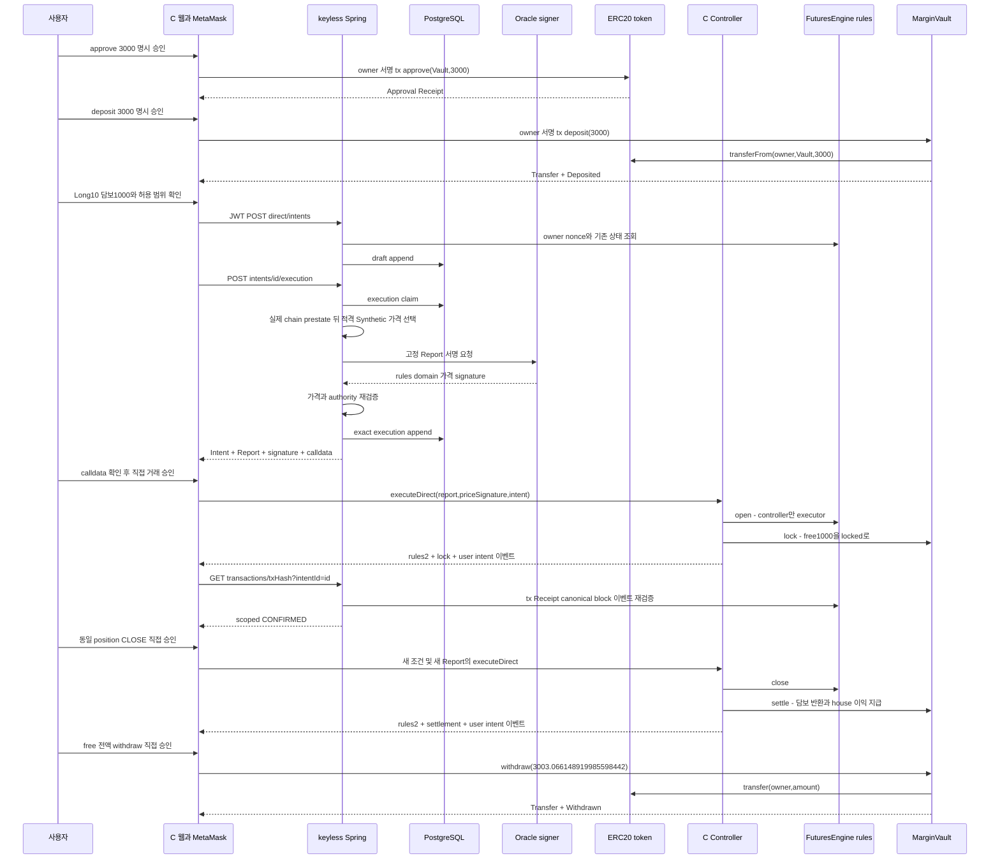

# TMS 실제 구현 기술 인수인계

> 작성: 2026-10-24 KST. 대상: 개발 구조를 이해하고 직접 발표할 프로젝트 개발자.
> 기존 소스·설계 기록·보존된 실거래 증거를 읽어 작성했다. 이번 문서 작업으로 서비스 기동/종료, 거래, 테스트, 하위 에이전트 검토를 실행하지 않았다. 신규 기능 구현이나 기존 문서·실행 증거의 덮어쓰기도 없다.

## 먼저: 오전 3시 종료와 다음 재개의 보존 경계

**최신 후속(읽기 전용 복원 Gate 완료):** 실제 거래가 발생한135…의 최종 상태를 새 `cdemo-8d5fd2ff832345bb`에서 실제 PG/JWT/RPC/API로 재검증하고 추가 거래 없이 정상 종료·보존했다. 이제 다음 재개 부모는 **8d…**다. snapshot SHA `71192dd8e8cdbb58e78d6463efea3cb0d793964c9c1ccb71fae6b7ea123f6b19` / 14,800,699 bytes / head7438이며 다섯 사용자 Receipt·최종 자산·CLOSED·nonce8/2가 유지된다. 아래135… 설명은 거래 당시 보존 이력이지 다음 재개 부모 지시가 아니다. [최신 실행 근거](c-post-trade-checkpoint-resume-2026-10-24.md)를 따른다. 새로운 사용자 거래나 전체 감사 완료를 뜻하지 않는다.

**후속 확인(03시 이후):** 감독 종료result와14,591,003bytes snapshot(SHA `eb9f99b9e305507d820f35b0e2c839b35877de91247c86ca98702b5e84fb50e6`)을확인했다. PG/Anvil exit0/App143/OOMfalse·원본해시와volume보존이확인됐고최종자산·nonce·CLOSED storage/5Receipt를읽기검증했다. 아래02:42 result미생성은작성당시관측으로유지한다. 새복원canonical검증및genesis선택·pending관측범위는 [최신checkpoint기록](c-post-trade-checkpoint-resume-2026-10-24.md)을따른다. 이추기는신규거래/초기화를뜻하지않는다.

현재 C 서비스는 **상시 서버가 아니라 2026-10-24 약 03:00 KST까지의 제한된 로컬 실행**이다. 문서 작성은 감독 프로세스나 STOP 파일, 서비스 설정, 소스 해시 검사에 손대지 않는다.

- 현재 최신 자손: `cdemo-135ae9a88bb244c6`. 감독 세션은 `3052`다.
- 최종 데이터 정본은 이 자손의 PostgreSQL volume과 Anvil 상태다. **거래 전 조상 `cdemo-e0e5a24638b0416f`나 실패한 `cdemo-5e4bd3b1140f4e63`로 되돌려 재개하면 안 된다.** 그러면 이번 다섯 거래와 nonce/수익을 잃는다.
- 보존 위치: `deployment/runtime/c-direct-resume/cdemo-135ae9a88bb244c6/`. 수동 인수 증거는 `manual-user-acceptance-2026-10-24.json`, 실행 계보는 `recovery-lineage.json`, 감독 종료 결과는 생성 후의 `result.json`, 체인 종료 사본은 생성 후의 `anvil-state.private.json`이다. 실제 PG volume 이름은 `cdemo-135ae9a88bb244c6-pg-data`, Anvil volume은 `cdemo-135ae9a88bb244c6-state`다.
- 감독 코드 [c-direct-same-state-resume.py](../deployment/c-direct-same-state-resume.py)의 `finally`는 자기 소유 서비스만 정지하고 Anvil dump 사본·해시 및 보존 결과를 기록하도록 되어 있다. **종료 예정과 실제 정상 종료·dump 검증 완료는 다르다.** 작성 중 02:42 KST 파일 확인에서는 최종 `result.json`이 아직 없었다. 정상 종료와 최종 snapshot의 성공을 이 문서에서 선행 선언하지 않는다.
- 다음 실행은 최신 snapshot의 SHA, DB system identity와 지갑 연결, 아래 계약 identity, 다섯 Receipt, 최종 잔고, **EOA nonce=8 / controller nonce=2**를 함께 검증해야 한다. 지금의 미거래 실패 자손을 대상으로 고정된 복원 스크립트를 그대로 실행하는 것은 다음 재개 절차가 아니다.
- Anvil 복원은 저장 head 기준 시간 offset을 유지하는 문제가 실제 관측됐다. 이번 공개 전 복제본에서만 사용자 승인으로 실제 시각에 1회 동기화했다. 이것은 거래의 TTL 완화나 60초 청산 유예 시험 성공이 아니다. 앞으로도 시각 차이를 조용히 무시하면 안 된다.

자세한 계보·실패 보존은 [복원 기록](c-same-state-resume-preparation-2026-10-24.md), 실거래 증거는 [C 인수 누적 보고서](dapp-c-direct-demo-2026-10-23.md)를 따른다. 이 문서는 재시작 실행 지시서가 아니다.

## 1. 5분 요약 — 내가 만든 것은 무엇인가?

### 한 문장으로 설명하기

**TMS는 중앙 서버가 시세·인증·거래 준비·조회 서비스를 제공하고, 스마트 컨트랙트가 거래 규칙을 검증하는 모의 거래 시스템이다. 신규 C 선물 경로에서는 사용자 지갑이 직접 거래를 승인하며, 실제 모의 ERC-20 담보를 Vault 계약에 보관하고 정산한다.**

여기서 ‘실제 토큰’은 Anvil 위 ERC-20 잔고가 정말 이동했다는 뜻이다. 원화나 실제 주식이 아니다. `cMKRW`에는 원화 상환권이 없고, 이번 가격도 실제 삼성전자 시세가 아닌 `SIMULATED` 가격이다.

### 쉬운 비유

1. **브라우저는 신청서와 장부를 보여주는 창구**다. 버튼을 누른 것만으로 돈이 움직이지 않는다.
2. **Spring Boot는 신청서 작성·확인 담당자**다. 로그인한 사람과 지갑의 관계, 거래 조건, 시세와 계약 상태를 확인한다.
3. **MetaMask는 사용자의 도장과 거래 제출 도구**다. 개인키는 사용자가 보유한다. 이번 서버는 사용자 대신 서명하지 않았다.
4. **Controller와 FuturesEngine은 규칙을 집행하는 심사기**다. owner·nonce·가격 범위·담보·버전·손익식·만료 조건이 틀리면 거래를 거절한다.
5. **MarginVault는 토큰 금고이면서 금고 내부의 귀속 장부**다. 인출 가능한 free, 포지션에 묶인 locked, 수익 지급 재원 house를 분리한다.
6. **PostgreSQL은 이력을 연결하는 기록실**이다. C 전용 화면에서는 지갑 연결과 승인 조건·실행 Report를 저장한다. C의 토큰 잔고를 DB에서 임의로 만들어 계약 잔고로 인정하지 않는다.

### 이번에 사용자가 실제로 한 일

`approve`는 Vault의 토큰 사용 허용, `deposit`은 지갑→Vault 실제 전송, `OPEN`은 Vault 내부 free→locked, `CLOSE`는 locked 해제와 손익 귀속, `withdraw`는 Vault→본인 지갑 실제 전송이다.

**이번 MetaMask는 별도 EIP-712 사용자 메시지에 서명한 것이 아니다.** `eth_sendTransaction`으로 정확한 calldata가 들어 있는 owner 직접 Ethereum 거래에 서명했다. 별도 EIP-712 사용자 서명과 운영자 relayer가 필요한 `executeRelayed`와 구분해야 한다. Oracle의 가격 Report 서명은 별도로 사용했다.

결과는 초기 지갑 **1,000,000 → 최종 1,000,003.066148919985598442 cMKRW**다. 실현·지급 이익은 **3.066148919985598442**, 포지션은 `CLOSED`, free·locked·미지급 이익은 0이다. ETH 가스비는 이 cMKRW 계산과 별개다.

### 발표에서 바로 사용할 설명

> “서버는 사용자가 승인할 거래 조건과 서명된 가격 보고서를 준비합니다. 사용자가 MetaMask에서 직접 승인하면 컨트랙트가 소유자와 nonce, 허용 가격, 포지션 상태, 금융 계산을 검증합니다. 담보는 온체인 Vault에서 잠기며, 종료 시 수익은 실제 house 자금에서 지급됩니다. 이후 사용자는 자신의 free 잔고를 직접 인출할 수 있습니다. 다만 가격 Oracle과 실행 인프라는 여전히 신뢰해야 하고, 현재는 로컬 모의 네트워크입니다.”

‘서버가 없어도 모든 거래가 가능’, ‘가격 진실을 블록체인이 증명’, ‘완전히 탈중앙화’, ‘실제 주식 거래’, ‘모든 기능이 C로 통합 완료’라고 말하면 현재 구현보다 과장이다.

## 2. 전체 서비스와 세 가지 자산 모델

### 2.1 전체 TMS 구성

| 기능 | 실제 컴포넌트 | 책임과 정본 |
|---|---|---|
| 시장·차트 | `MarketPriceService`, `MarketPriceProvider`, `SimulatedPriceProvider`, `SyntheticMarketEngine`, `SimulatedCandleProvider`, `MarketCandleRepository`; Kiwoom/Toss 계열 provider | 가격 공급자를 도메인에서 분리. Synthetic은 DB 상태·캔들을 commit한 뒤 가격을 공개한다. provider별 지원·실인수는 별도다. |
| 현물 | `PriceQuoteService`, `OrderService`, `OnchainOrderService`, `OnchainOrderPreparationService` | 견적을 사용자에게 귀속시키고 만료·일회 소비·주문·DB 잠금을 관리한다. 온체인 모드의 실제 실행은 운영자 지갑을 거친다. |
| 현물 체인 | `ExchangeVault`, `PriceOracle`, `MockKRW`, `SamsungPriceTrackingToken` | 서명 가격·최소수령·소비 여부를 확인하고 mKRW/mSEC를 교환한다. 사용자 앱 계정별 표시 잔고와 운영자 온체인 자산을 구분한다. |
| 기존 선물 | `FuturesService`, `FuturesIntentStore`, `FuturesExecution`, `FuturesWorker`, `FuturesTransactionSender`, `FuturesReconciler`, `FuturesLedger` | DB 모의 담보 예약, 포지션·house·journal, 서버 제출·복구와 canonical Receipt 정산. |
| 기존 선물 계약 | `FuturesEngine`, `FuturesMath` | 포지션 수학·버전·Report·위험·60초 유예를 강제한다. **Engine 자체에는 ERC-20 담보 보관 기능이 없다.** |
| 사용자 서명 B | `UserAuthorizedFuturesEngine[V2]`, `AuthorizedV2*` 계열 | 사용자 EIP-712 승인과 서버 가격 Report를 계약에서 연결한다. B-v2는 가격·수량 범위를 승인한다. 담보 자산은 여전히 DB 모의 장부다. |
| C 자산·거래 | `CMockCollateral`, `CMarginVault`, `CCollateralizedFuturesController`, 새 내부 `FuturesEngine` | 사용자별 실제 토큰, 실제 예치·잠금·house 정산·Claims. 온체인이 자산 정본이다. |
| 자산 화면 | 기존 `PortfolioService`; C의 `CCustodyRpcReader.account/position` | 기존 포트폴리오는 DB 사용자 장부. C 화면은 특정 실제 블록의 계약 상태를 조회한다. 서로 같은 잔고가 아니다. |
| 실시간 알림 | `WebSocketConfig`, `MarketWebSocketPublisher`, `WebSocketDeliveryListener`, `UserWebSocketPublisher`, `FuturesPersonalEvents` | 가격 토픽·개인 주문/포트폴리오 알림. commit 이후 알리고 클라이언트는 REST로 재동기화한다. |
| 감사 | 현물 `tradeaudit/AuditService`, reserve 대사, `FuturesAuditService/Verifier/Accounting` 및 B-v2 감사 확장 | DB·실행 증거·체인·coverage를 비교. `MATCH`, `MISMATCH`, `INCONCLUSIVE`를 구분한다. |
| AI | `AgentService`, `ToolDispatcher`, `ToolReadFacade`, `FuturesToolReader`, `SkillRegistry/SkillRunner`, `AuthorizedKnowledgeRetrieval`, `RagService` | 권한이 있는 사실 조회와 승인된 정책 검색을 합성한다. AI는 거래·청산을 실행하지 않는다. |

주요 코드: [시장 진입점](../backend/src/main/java/com/pricetrack/exchange/market/MarketPriceService.java), [Synthetic provider](../backend/src/main/java/com/pricetrack/exchange/market/provider/simulated/SimulatedPriceProvider.java), [현물 제출](../backend/src/main/java/com/pricetrack/exchange/order/OnchainOrderService.java), [선물 Worker](../backend/src/main/java/com/pricetrack/exchange/futures/runtime/FuturesWorker.java), [WS 설정](../backend/src/main/java/com/pricetrack/exchange/websocket/config/WebSocketConfig.java), [Agent](../backend/src/main/java/com/pricetrack/exchange/ai/agent/AgentService.java).

### 2.2 기존 현물·legacy 선물·B·C는 같은 신뢰 모델이 아니다

| 구분 | 사용자 거래 승인 | 실제 자산 보관 | DB 역할 | 현재 통합 경계 |
|---|---|---|---|---|
| 기존 온체인 현물 | JWT 요청을 받은 서버의 운영자 거래 | 운영자 지갑/ExchangeVault의 모의 토큰 | 사용자별 잔고·주문 정산의 핵심 | 기존 제품 경로. 이번 C 인수로 다시 검증한 것은 아님 |
| legacy 선물 | 서버 executor + 가격 서명 | 담보는 PostgreSQL 모의 장부 | 담보·house·journal 정본 | 기존 제품 Worker·WebSocket·감사·AI와 연결된 경로 |
| B-v1 | 전체 가격 Report를 포함한 사용자 EIP-712 승인 | 담보는 DB | 기존 금융 장부 + 사용자 승인 metadata | 독립 개발 경로. 사용자 확인 동안 tick이 변하는 시간 제약이 문제 |
| B-v2 | 안정된 사용자 Intent와 별도 실행 Report; 승인 범위 계약 검증 | 담보는 DB | revision0/1·예약·SIGNED raw·정산·승인 감사 | 별도 opt-in. unsigned 최대1회 재가격; 실제 MetaMask TOP_UP/CLOSE 전체 인수는 별도 미완료 |
| C 이번 직접 경로 | owner가 직접 Ethereum tx 서명 | 사용자 지갑 및 실제 MarginVault | 계정 연결·draft·실행 Report·시세, 자산 조회는 RPC | 별도 C 앱·웹. 이번 다섯 거래 실제 인수 완료 |
| C relayer 목표 | 사용자 EIP-712 메시지 + 지정 relayer tx | 실제 MarginVault | 승인·전송·복구·projection | 계약 경로는 존재하지만 이번 웹 흐름/서비스 복구 완료가 아님 |

기존 자산을 C로 자동 이전하지 않았다. `mKRW`와 `cMKRW`는 서로 다른 계약·공급·장부다. B의 담보 숫자를 C Vault 예치 증거로 쓰지 않는다. B의 revision/복구·감사 PASS도 C에 자동 승계하지 않는다.

설계 변화 근거: [C 정책 ADR](dapp-c-policy-adr-2026-10-23.md), [B-v2 재가격 기록](../../dapp-user-authorization-worktree/claude-docs/dapp-b-v2-single-repricing-implementation-2026-10-22.md). ADR 아래쪽의 초기 NOT_RUN 표는 당시 이력이며 최신 단계별 인수 기록을 우선한다.

### 2.3 아키텍처도 — 전체 제품과 이번 실행을 구분



이 도식이 기존 웹과 C 앱이 이미 하나의 배포로 합쳐졌다는 뜻은 아니다. 현재 C 앱은 전체 제품 자동청산 Worker·AI·개인 WS broker를 모두 띄운 앱이 아니다.

## 3. 실제 C 실행 구성과 키·권한

### 3.1 이번 실제 배포 identity

chainId는 `31337`, genesis는 `0x952c7b1af7512626b5d52df3137e00c6506e974fc529f499008b4f1ea468a978`다. 같은 chainId만으로 같은 체인을 식별하지 않는다.

| 역할 | 실제 주소 |
|---|---|
| 사용자 EOA | `0x6642e33b1cb538b66fb14cf60862f0622147c18a` |
| C token | `0x0c29599cf98ad50cf96cad71b9e98a09159810f5` |
| C controller | `0x7a5bcc5163cd2cad93f3b801a47f6b10d2ba8a25` |
| 내부 rules | `0x34912650129b8a9bbf165b515d644a05e5bb5a53` |
| MarginVault | `0xd13957c4b27a554945bd574144300c0b1c3b50fa` |
| 지정 relayer/keeper | `0xd2c588b882b90f2cc81b1c37f03d7986f914ab09` |
| 고정 Oracle signer | `0x83239e886be9e50362985cfc15f7cc2af19ba68a` |
| OPEN pause 관리자 | `0xf535a01fa05bc7f8ff44c3db893accbef66d0805` |

코드 identity는 각각 token `0xc34b763f68ce641c9060256cc989ae5dfd7564b7fc14f0e3845620a13b38bddd`, controller `0xb1449c57e2b965be94eec8ebf0da8f0bfb6e095fa128d2099593d0f55082ec0b`, rules `0x111505745a71f9c8ae52512cb8d25af72d808354d49653358d2600741f6dc3fb`, Vault `0x72bf18b833d2becd40873f06230e0e94aaaa83fde6abdf832839978ab7cc246b`다. 주소·codeHash·상호 getter·symbol/policy·genesis를 함께 묶어 검증한다.

원래 실행 source identity는 `2ed9c86b83163a5741b0718c99f90e3442618ca49d22052e557d42795cb82fb5`, 이번 복원 감독 identity는 `16c3d610c84c1c1687f43c4f65fef2acc6c9d354c18873a6ec4c539b4c0a0acd`다. Git HEAD `f9353c33244565b30fb130dfb6159eab441a3523`만으로 미커밋 C 코드를 재현할 수 없으므로 source·산출물·계약 identity도 보존한다.

### 3.2 실제 프로세스

- **Spring:** [CDirectDemoApplication](../deployment/CDirectDemoApplication.java). 기존 JWT/filter/PasswordEncoder/JPA 사용자 조회를 쓰되 필요한 C controller와 Synthetic만 명시 import한다. `MANAGED_TYPES`도 User·Candle·SyntheticState로 제한한다. 전체 금융 앱을 켠 것으로 오인하면 안 된다.
- **PG:** 원래 논리 DB와 계정·marker를 유지한 cold copy. 앱 role은 superuser/createdb/createrole 권한이 없는지 시작 시 검사한다.
- **Oracle:** [CDirectOracleServer](../deployment/CDirectOracleServer.java). 내부 전용 고정 signer가 Report digest에 서명한다. 사용자 키나 relayer 키를 사용하지 않는다. 같은 operation에 다른 Report를 조용히 서명하는 경로를 막는다.
- **Anvil:** 실제 EVM 트랜잭션을 채굴하는 로컬 개발 체인이다. 여기서 ‘확정’은 단일 로컬 RPC에서 현재 canonical inclusion을 검증했다는 의미이지 퍼블릭 체인의 경제적 finality가 아니다.
- **웹 연결:** host 포트 게시 대신 [BrowserRelay](../deployment/c_direct_browser_relay.py)와 [CDirectBrowserPipe](../deployment/CDirectBrowserPipe.java)가 loopback 웹/RPC를 고정된 내부 목적지로 연결한다. 금융 정책이 아니라 Windows Docker 포트 게시 문제를 피한 로컬 실행 방식이다.

### 3.3 무엇에 누가 서명하는가?

| 서명 | 주체와 대상 | 의미 |
|---|---|---|
| JWT | 서버가 로그인 계정에 발급 | REST 호출자의 계정·권한. ERC-20 이동 권한 자체가 아님 |
| EIP-191 소유 증명 | 사용자 MetaMask가 일회 challenge 메시지에 `personal_sign` | JWT 계정과 지갑 연결. 거래·토큰 사용 허용이 아님 |
| Oracle EIP-712 Report | 내부 가격 signer, rules domain `TokenizedMarketFutures/1` | 해당 실행 조건·가격·시각을 지정 signer가 승인했다는 증거 |
| 이번 owner 직접 tx | 사용자 MetaMask, token/Vault/controller로 보낼 exact calldata와 Ethereum tx | 실제 호출자 `msg.sender=owner`를 만들고 거래 내용을 서명. 별도 사용자 EIP-712 signature 인자는 없음 |
| C relay 사용자 Intent | 향후/별도 `executeRelayed`의 owner EIP-712 서명, controller domain `TokenizedMarketCFuturesUserIntent/1` | 지정 relayer가 전달해도 사용자가 동의한 조건만 실행하도록 함. 이번 성공의 서명 방식은 아님 |

[CWalletProofService.challenge/link](../backend/src/main/java/com/pricetrack/exchange/custody/auth/CWalletProofService.java)는 origin·userId·wallet·chain·controller·deployment·일회 nonce·만료를 묶고 EOA를 확인한다. [CWalletLinkStore](../backend/src/main/java/com/pricetrack/exchange/custody/auth/CWalletLinkStore.java)는 소비·유일성·서명 귀속을 저장한다. 사용자 개인키는 브라우저/서버에 입력하지 않았다.

## 4. MetaMask 다섯 거래를 코드로 따라가기

공통 웹 코드: [c-demo.js](../tools/websocket-test-client/src/c-demo.js), [CDirectWallet](../tools/websocket-test-client/src/c-direct-wallet.js), [정수 단위·calldata 검증](../tools/websocket-test-client/src/c-direct-intent.js).

### 4.1 APPROVE — ‘내 토큰을 이 금고가 이 금액만큼 가져갈 수 있다’

1. 사용자는 금액 3000을 입력하고 「이 금액만 Vault 허용」을 눌렀다.
2. `CDirectWallet.sendAsset('APPROVE', amount)`는 JWT로 `GET /api/c-futures/account`를 읽어 본인 wallet·잔고·허용 범위를 확인한다. **거래를 대신 보내는 approve REST API는 없다.**
3. `vaultTransaction`이 **token 주소**로 `approve(vault, 3000×10^18)` calldata를 만든다. MetaMask가 `eth_sendTransaction` 요청을 표시하고 사용자가 직접 서명한다.
4. [CMockCollateral](../contracts/src/CMockCollateral.sol)이 상속한 OpenZeppelin ERC20은 caller의 allowance를 설정한다. 이 단계에서 토큰은 이동하지 않는다.
5. Event는 token의 `Approval(owner,Vault,amount)`다. `CDirectWallet.resolve()`가 지갑 RPC tx/Receipt/calldata를 대조한 뒤, `GET /api/c-futures/direct/transactions/{txHash}`를 조회한다.
6. [CDirectReceiptReader.verifyEvents](../backend/src/main/java/com/pricetrack/exchange/custody/direct/CDirectReceiptReader.java)는 정확한 token·spender·amount와 단 하나의 Approval 이벤트를 확인한다.

**DB:** 이 동작이 C 자산 잔고를 DB에 적립하지 않는다. 지갑 연결은 이미 PG에 있고, 이 거래 대기 기록은 브라우저 localStorage에 남는다. 현재 최소 Receipt 조회도 projection을 쓰지 않는 읽기 경로다.

**실패·중복:** 지갑 거절은 `USER_REJECTED`, 전송 결과 불명은 `UNKNOWN`으로 보존한다. 같은 raw tx는 EOA nonce로 중복 채굴되지 않지만, 사용자가 새 Ethereum nonce로 다시 approve하면 표준 ERC20의 새 허용 거래가 될 수 있다. ‘계약이 모든 중복 클릭을 자동 무시’한다고 설명하지 않는다.

### 4.2 DEPOSIT — 허용량을 실제 예치 잔고로 바꾸기

1. `sendAsset('DEPOSIT')`는 `GET /account`로 wallet과 allowance가 모두 충분한지 확인한다.
2. MetaMask는 **Vault 주소**의 `deposit(3000×10^18)` 거래에 서명한다.
3. [CMarginVault.deposit → _pullOwnTokens](../contracts/src/CMarginVault.sol)는 `safeTransferFrom(msg.sender, Vault, amount)`로 **사용자 token 지갑→Vault**로 전송한다. approve의 spender가 Vault였던 이유가 여기 있다.
4. 실제 전후 잔고 차이가 정확히 amount인지 검증한 뒤 `freeBalance[msg.sender]`와 `totalFree`를 늘린다. 잘못된 전송·부족 allowance·재진입 등은 같은 EVM tx 전체를 revert시킨다.
5. Receipt에는 **token Transfer(owner→Vault)** 다음 **Vault Deposited(owner,amount)**가 있어야 한다. 서버가 두 이벤트의 주소·순서·수량을 확인했다.

approve와 deposit은 분리돼야 한다. approve는 ERC20의 권한 변경이고 deposit은 Vault의 자산 수령 및 귀속 처리다. **approve만 하고 deposit하지 않으면 free는 0**이다. token을 Vault 주소에 임의 Transfer하는 것 역시 `deposit`과 다르며, 그런 직접 송금은 자동으로 본인 free에 귀속되지 않는다.

**DB:** 사용자별 free 장부를 쓰지 않는다. 실제 예치 정본은 token 잔고와 Vault storage다. **재차 deposit을 별도 tx로 승인하면 추가 예치가 될 수 있으므로** 웹은 이전 전송을 확인하기 전 새 자산 거래를 차단한다.

### 4.3 OPEN — 실제 금고 안에서 1000을 포지션 담보로 묶기

사용자가 확인한 조건은 Long·10배·담보1000·가격74000~76000이며 수량 범위도 웹이 정수식으로 보여 준다.

**서버 준비 단계:**

1. `POST /api/c-futures/direct/intents` + `Idempotency-Key` → [CDirectController.draft](../backend/src/main/java/com/pricetrack/exchange/custody/direct/CDirectController.java) → [CDirectService.draft](../backend/src/main/java/com/pricetrack/exchange/custody/direct/CDirectService.java).
2. JWT 계정에 연결된 owner, controller nonce, 실제 계정 상태를 확인하고 operationId/positionId를 만든다. Intent에는 owner·relayer·accountRef·symbol/policy·action·version/epoch·방향·배수·담보·가격/수량 범위·nonce·issuedAt/deadline을 고정한다. 최대 120초다.
3. PG `tms_c_execution.drafts`에 사용자·배포·조건·digest·요청 hash를 저장한다. 같은 키로 다른 조건을 보내면 충돌이다. 이 시점에는 **토큰 잠금이나 체인 거래가 없다.**
4. 사용자가 「새 실행 가격 확인」 → `POST /direct/intents/{id}/execution`.
5. `CDirectService.execute`가 PG에 실행 claim을 한 번 확보하고, [CReportCandidateBuilder.build](../backend/src/main/java/com/pricetrack/exchange/custody/authorization/CReportCandidateBuilder.java)가 실제 chain prestate를 읽은 뒤 제품 가격을 선택한다. 가격·수량 범위·자금·nonce·버전·위험 수학을 확인한다.
6. 내부 Oracle가 rules domain의 Report에 서명한다. 서버가 signature/digest를 재검증하고 같은 가격/provider/generation·신선도를 재확인한 뒤 [CDirectExecutionStore.save](../backend/src/main/java/com/pricetrack/exchange/custody/direct/CDirectExecutionStore.java)에 **고정 Report·가격 서명·Intent·시장 근거**를 append-only로 저장한다.
7. 웹에 exact `executeDirect(Report r, bytes priceSignature, Intent i)` calldata를 돌려준다. 서버는 사용자 raw transaction을 만들거나 전송하지 않는다.

**사용자 승인 이후 체인 단계:**

1. 사용자 MetaMask가 **controller 주소**의 위 calldata를 포함한 tx를 직접 서명·제출한다.
2. [Controller.executeDirect/_authorize](../contracts/src/CCollateralizedFuturesController.sol)는 `msg.sender==i.owner`, EOA 범위, nonce, 120초, operation/position/account, side/leverage/collateral, price/quantity bounds, expectedVersion/callEpoch를 확인한다. OPEN pause와 미지급 Claims도 확인한다.
3. `_apply`가 내부 `rules.open`을 호출한다. 이때 **rules가 보는 msg.sender는 사용자가 아니라 controller**다. rules의 immutable executor도 controller이므로 일치한다. 가격 Report의 executor도 controller이고, 가격 서명의 verifyingContract는 rules다.
4. rules가 서명·policy·30초 TTL·수량식·중복 operation·위험 조건을 검증해 포지션을 만든다.
5. controller가 결과를 대조하고 `vault.lock`을 호출한다. Vault는 `onlyController`를 검사해 **free1000을 줄이고 locked1000을 늘린다. token은 이미 Vault에 있으므로 OPEN 자체에 ERC20 Transfer는 없다.**
6. nonce 소비·rules 상태·Vault 잠금·이벤트는 같은 tx다. 중간에 하나라도 실패하면 모두 revert한다.

**실제 성공 이벤트 순서:** rules `OperationApplied` → rules `FuturesReportConsumed` → Vault `CollateralLocked` → controller `CUserIntentExecuted(direct=true)`. 서버는 저장한 Intent·Report·가격 signature·실제 calldata·digest 및 네 이벤트를 연결해 CONFIRMED를 반환했다. Receipt 조회에 `?intentId={operationId}`를 붙인다.

**DB와 실패:** 실행 claim과 고정 실행 근거는 자산 예약이 아니다. 첫 draft는 실행 Report가 만들어지지 않은 채 만료됐고, 해당 draft/claim을 보존했다. 정확한 최초 API 실패 원인은 현재 증거만으로 미확정이다. 이 상태에서는 전송 버튼이 비활성화될 수 있다. 완료된 거래를 지우거나 재가격해서 복구한 것이 아니라, 전송 전 기록을 명시적으로 정리하고 사용자가 새 draft를 확인해 성공했다.

### 4.4 CLOSE — 포지션 종료와 수익 지급을 원자적으로 연결하기

1. 사용자는 같은 positionId를 조회하고 CLOSE를 선택했다. `GET /api/c-futures/positions/{id}`는 본인 owner와 ACTIVE/MARGIN_CALL 상태를 확인해 기존 entry/quantity/collateral/version을 반환한다.
2. draft/execution API는 OPEN과 같은 경로지만 `action=CLOSE(4)`다. 기존 진입가격·수량·담보·포지션을 바꿀 수 없고, 새 실행가격만 승인 범위 안에서 선택한다.
3. MetaMask가 controller의 `executeDirect` tx를 서명한다. controller→rules.close가 포지션을 `CLOSED`, version2로 바꾸고 activePosition을 해제한다.
4. controller가 동일 `FuturesMath.mark` 결과를 대조한 뒤 `vault.settle(operation,position,owner,collateral,pnl,badDebt)`를 호출한다. caller가 임의 PnL을 Vault에 직접 넣을 수 없다.
5. Vault는 locked1000을 없애고 원금1000을 free로 되돌린다. 이번에는 이익 전액을 house에서 free로 옮겼다. **CLOSE도 금고 내부 귀속 변경이며 사용자 지갑으로 token Transfer하는 단계는 아니다.**
6. 이벤트는 rules 두 개 → Vault `PositionSettled` → controller `CUserIntentExecuted`다. house가 부족하면 중간에 `ProfitClaimCreated`가 추가될 수 있지만 이번에는 없었다.

수익 재원은 새로 mint한 토큰이나 다른 사용자의 free 담보가 아니라 **실제로 출자돼 남아 있는 house**다. 기존 미지급이 있거나 house가 부족하면 포지션 종료와 미지급 수익을 분리해 FIFO Claim을 남긴다. ‘CLOSE 성공=항상 이익 전액 지급’이 아니다.

**실패·중복:** position version, consumed operation, owner nonce, terminal lock이 재실행을 막는다. 성공 응답을 못 받으면 기존 txHash를 조회한다. timeout을 실패로 단정하고 새 CLOSE를 자동 생성하지 않는다.

### 4.5 WITHDRAW — 본인의 free를 본인 지갑으로 보내기

1. 웹은 `sendAsset('WITHDRAW')`에서 실제 free를 조회하고 명시 금액이 그 이하인지 검사한다.
2. 사용자는 MetaMask로 **Vault.withdraw(3003066148919985598442)**에 직접 서명했다.
3. `CMarginVault.withdraw`는 caller의 free만 줄이고 caller에게만 `safeTransfer`한다. 실제 Vault 감소와 owner 수령 증가가 모두 amount인지 확인한다. receiver를 제삼자로 바꾸는 인자가 없다.
4. token `Transfer(Vault→owner)` → Vault `Withdrawn(owner,amount)`를 서버가 실제 calldata·Receipt와 대조했다.

**서버 승인 없이 가능한 이유:** 계약 함수 자체는 JWT, Spring, Oracle signature, controller 허가를 요구하지 않는다. 이미 확정된 자기 free와 자기 tx 서명만 필요하다. 다만 **현재 C 웹은 로그인·계정 조회와 연결돼 있고 로컬 RPC relay도 앱 컨테이너를 거친다.** 따라서 이 화면에서 서버를 실제 끄고도 인출에 성공한 인수는 아니다. 별도 동작하는 RPC와 계약 ABI에 접근하는 독립 클라이언트라면 계약상 직접 호출할 수 있다는 것과, 현재 UI의 서버 독립성은 구분한다.

locked나 미지급 Claim은 withdraw할 수 없다. 새 nonce로 인출을 다시 보내더라도 free가 부족하면 revert한다. `nonReentrant`와 전후 실제 잔고 검사가 함께 작동한다.

### 4.6 공통 실패·중복 방어의 층

- **웹:** `navigator.locks`, busy, deployment/user 범위 localStorage, 계정·chain 변경 epoch 검사, 화면 조건과 저장 request 일치, BigInt와 decimal 문자열. Number로 E18 금액을 계산하지 않는다.
- **지갑 전송:** `WALLET_REQUESTED→SUBMITTED→RECEIPT_OBSERVED`; 전송 결과 불명은 `UNKNOWN`, 증거 불일치는 `REVIEW_REQUIRED`. 지갑 요청 이후의 미확정 기록은 임의 해제하지 않는다.
- **DB:** 사용자 row lock, idempotency/operation 유일성, execution claim, append-only trigger, Report hash 검증. claim 후 오류는 자동 Oracle 재요청·재가격이 아니라 fail-closed다.
- **계약:** EOA tx nonce와 별개로 owner Intent nonce, usedOperations, position version/epoch, 유효기간, 허용 범위, owner, Vault terminal lock을 검사한다.
- **조회:** 성공 txHash만으로 확정하지 않는다. from/to/value/calldata, blockHash·transactionIndex, 이벤트 emit 주소·순서·내용, 헤더·Receipt 재조회가 일치해야 한다. `completeCoverage=false`를 그대로 반환한다.

## 5. 실제 숫자로 자산 흐름 복원

아래는 cMKRW 표시 단위다. 실제 계약 금액은 E18 정수, 가격은 E8 정수다. 전체 공급은 20,000,000이며 초기 분배 정책은 house10m/두 사용자 각1m/treasury8m이다. 이번 사용자+house 부분만 표에 표시한다.

| 단계 | 사용자 wallet | Vault 본인 free | 본인 locked | house | 미지급 Claims | 실제 Vault token |
|---|---:|---:|---:|---:|---:|---:|
| 이번 시작 | 1,000,000 | 0 | 0 | 10,000,000 | 0 | 10,000,000 |
| approve3000 | 1,000,000 | 0 | 0 | 10,000,000 | 0 | 10,000,000 |
| deposit3000 | 997,000 | 3,000 | 0 | 10,000,000 | 0 | 10,003,000 |
| OPEN 담보1000 | 997,000 | 2,000 | 1,000 | 10,000,000 | 0 | 10,003,000 |
| CLOSE | 997,000 | 3,003.066148919985598442 | 0 | 9,999,996.933851080014401558 | 0 | 10,003,000 |
| withdraw 전액 | **1,000,003.066148919985598442** | **0** | **0** | **9,999,996.933851080014401558** | **0** | **9,999,996.933851080014401558** |

- **wallet:** token 계약의 `balanceOf(owner)`. 사용자의 ERC20 자산이다.
- **free:** Vault에 이미 예치돼 있고 해당 사용자에게 귀속된 인출 가능 금액이다.
- **locked:** 포지션 담보로 묶인 실제 예치 자산의 귀속이다. 아직 owner wallet으로 꺼낼 수 없다.
- **house:** 유한한 위험·손익 상대 재원이다. `fundHouse`로 실제 토큰을 출자하며 LP 환급권이나 관리자 인출권을 만들지 않는다.
- **Claim:** 아직 지급하지 못한 이익 채무 기록이다. 현금이나 곧바로 인출할 수 있는 free가 아니다. `processNextClaim`이 house에서 FIFO head 하나를 free로 귀속할 때 지급된 부분만 free가 된다.

핵심 현금 불변식은 `recognizedAssets = totalFree + totalLocked + houseBalance`이며 실제 `token.balanceOf(Vault)`가 그 이상이어야 한다. Claims를 여기에 더하면 아직 없는 현금을 중복 계상하게 된다. 직접 기부된 token의 미귀속 차이는 `unassignedAssets`; 이번 최종값은 0이다.

### 5.1 수량과 손익을 계산해 보기

실제 Long10 포지션:

```text
담보 C = 1000 cMKRW
진입가격 Pe = 74825.61571115 cMKRW/mSEC
종료가격 Px = 74848.55835923 cMKRW/mSEC
레버리지 L = 10

quantityE18 = floor(collateralE18 × L × 10^8 / entryPriceE8)
            = 133644072353551894
수량 q      = 0.133644072353551894 mSEC

Long pnlE18 = floor(quantityE18 × (closePriceE8-entryPriceE8) / 10^8)
            = 3066148919985598442
실현이익    = 3.066148919985598442 cMKRW
```

raw 가격은 entry `7482561571115`, close `7484855835923`다. 단순 표시 소수점을 반올림해 다시 계산한 값이 아니라 계약의 정수식과 원본 정수를 사용했다. [FuturesMath.mark](../contracts/src/FuturesMath.sol)는 음수 손익도 더 작은 정수 쪽으로 내림 처리하고, 실현손실은 담보 하한으로 제한하며 초과손실을 badDebt로 분리한다.

위험 평가는 `notional = floor(qE18×priceE8/10^8)`, `equity = collateral + unrealized`, `maintenance = ceil(qE18×priceE8/(10^8×20))`다. `equity <= maintenance`가 위험이다. 유지증거금은 현재 명목가치의 5%이며 초기 담보의 5%가 아니다. 이번은 정상 CLOSE이며 자동청산이 아니다. leverage는 수량에 이미 반영돼 있으므로 PnL에 다시 10을 곱하지 않는다.

이번 `realizedPnl=paidProfit=3066148919985598442`, `unpaidProfit=badDebt=0`이다. house 감소량과 사용자 free/최종 wallet 증가량이 이 값과 같다. 최종 사용자 wallet+house는 초기와 같은 **11,000,000 cMKRW**다. Ethereum 가스는 별도 ETH 잔고에서 지불하며 cMKRW 이익과 상계한 성과로 보고하지 않는다.

### 5.2 다섯 실제 거래와 확인 근거

| 동작 | txHash | 블록 / blockHash | 판정 |
|---|---|---|---|
| APPROVE | `0xc29a422979416503ce6023ff34b6257b1969e43f008cc4748036a45ade63a74f` | 4160 / `0x9686b58582c5a9ba83bcbf31f497c9c35c0d1e9f1b2e487b7e777c89503ecf18` | 서버 CONFIRMED |
| DEPOSIT | `0x95f7f936a9f9401d4e0d679396508a3de3bae93d1df201e26acd1e1658aaa8b5` | 4182 / `0xf056e6131ab27e71cdd55da82fd5da18f1d359778381a5587456afce553c9146` | 서버 CONFIRMED |
| OPEN | `0xc3bfb46aeb66eee5498ac80ac7671ee683d453c3d150a1ac73fab14e9c36d60d` | 4567 / `0xc8fb3c51b3c2d6a818411e8e46c6e37bf19735ca087fc2237ed6a095a316a806` | CONFIRMED, 4events |
| CLOSE | `0x0675c5679e94deee25660fa390e1d04b48a7453823266b3b9afd2956b33a90ae` | 4765 / `0xf60ec5b59f17cb27229a99bbc4b85de6f175c2d71d6fd166ccbad2c07383e473` | CONFIRMED, 4events |
| WITHDRAW | `0xfa5bb44e5c7b82fcad3395137e4224ee1983052e7978e6f7e2e082d195fa4496` | 4957 / `0xc63c3d97e02a45b6df5be34fc800292f3c7089affcdaa698d5e29089c305d270` | 서버 CONFIRMED |

포지션은 `0xa0413425c806f7decd8575fc1b5492020cfac6c0a509064abbbf40302fbd765a`다. OPEN operation은 `0xe703247655f0840752ae096b22e66e34eeda9a7be68c7ddef98be653dedf528a`, CLOSE operation은 `0x8f998d844e86c16c99fa1413926076af2a3face840cfa19d34357ad81fc8f9a8`다.

최종 account와 position은 같은 block4989/hash `0xb51c9e47825497965e0518482008062f0ff60bc95a6b00f82d876421051fc4f5`에서 조회했다. position은 `CLOSED/version2/lockTerminal=true`; controller nonce는 OPEN과 CLOSE가 소비해 2, EOA tx nonce는 과거3+이번5=8이다. deposit/withdraw는 controller nonce를 소비하지 않는다. 미확정 tx는 없었다.

실제 PG는 drafts3/directExecutionClaims3/directExecutions2/본인 지갑연결1이었다. **DB direct execution claim은 실행 준비 독점 표식이고, Vault의 미지급 Profit Claim과 전혀 다르다.** Report 미생성인 첫 실패 이력도 count에 포함돼 있다. 이 metadata를 DB 잔고 정산 journal이라고 부르면 틀리다.

### 5.3 거래 시퀀스도



CLOSE도 OPEN과 같은 draft→실행가격→Oracle→저장→확인 절차를 다시 수행한다. 도식의 `scoped CONFIRMED`는 단일 provider의 해당 거래 포함 증거이며 전체 ledger scanner의 MATCH가 아니다.

## 6. 중요한 설계 선택 — 근거와 한계를 함께 설명하기

### 6.1 왜 하이브리드인가?

**기록된 방향:** 기존 시스템을 유지하면서 사용자 승인 B, 실제 자산 통제 C로 단계적으로 확장하고, 중앙 서버는 인증·시세·전달·감시·조회·AI를 맡기기로 사용자와 확정했다. 이후 발표 최소 흐름은 이미 있는 `executeDirect`를 우선하도록 승인했다. [C ADR](dapp-c-policy-adr-2026-10-23.md), [직접 데모 설계](dapp-c-direct-demo-2026-10-23.md)가 근거다.

**소스에서 확인 가능한 효과:** tick·차트·검색·AI를 모두 온체인 거래로 기록하지 않아도 서비스를 제공할 수 있다. 반면 자산·승인 규칙은 서버 DB 수정만으로 확정되지 않는다. 다만 모든 분리의 최초 동기가 비용 때문이었다는 개인적 판단 기록은 확인하지 못했으므로 그런 동기를 지어내지 않는다.

### 6.2 컨트랙트가 정확히 강제하는 것

- owner/지정 relayer·keeper, 사용자 Intent nonce와 유효기간, 포지션 소유·version/epoch, operation 일회성.
- 승인한 방향·배수·담보·가격/수량 범위, OPEN의 실제 수량식과 CLOSE의 기존 진입가격/수량 유지.
- rules domain의 지정 가격 signer, Report TTL30초, 관측시각 미래오차2초, symbol/policy/executor.
- MMR5%·손익·위험회복·마진콜·60초 청산 조건.
- 실제 Vault 수령, free/locked/house 현금 보존, 동일 tx의 상태·자산 원자성, finite house와 FIFO Claims, 본인 free 인출.

반대로 ‘가격이 실제 거래소 진실이다’, ‘서버가 항상 살아 있다’, ‘언제나 수익 전액 지급’, ‘투자상품으로 적법하다’를 보장하지 않는다.

### 6.3 서버가 마음대로 사용자 자산을 옮길 수 있는가?

**기존 모델과 C를 분리해서 답해야 한다.** 기존 운영자 통합지갑/DB 장부는 운영자 신뢰가 크다. C에는 임의 사용자 free 출금·sweep·관리자 잔고 보정·외부 mint/burn·upgrade 함수가 없다. Vault privileged 경제 함수도 immutable controller만 호출할 수 있고 controller에는 임의 arbitrary-call 진입점이 없다.

토큰 특권도 다르다. 기존 [SamsungPriceTrackingToken](../contracts/src/SamsungPriceTrackingToken.sol)은 owner의 `setMinter`와 지정 minter의 `mint(to,amount)/burn(from,amount)`를 가진다. 기존 [MockKRW](../contracts/src/MockKRW.sol)는 faucet으로 mint한다. C는 이 계약들을 이름만 바꿔 재사용한 것이 아니라, 생성자에서 한 번만 발행하고 외부 mint/burn/owner setter가 없는 별도 고정공급 `CMockCollateral`을 배포했다. 기존 mSEC의 특권이 프로젝트 전체에서 제거됐다는 뜻은 아니다.

하지만 ‘서버 영향이 전혀 없다’는 말도 틀리다. 지정 keeper는 위험 조건에 따른 청산을 요청할 수 있고, Oracle signer의 가격을 계약이 신뢰한다. 악의적/잘못된 가격과 keeper 행위, 키 장애·계약 버그는 중요한 위험이다. Oracle/keeper 신뢰를 제거한 완전한 비수탁·무신뢰 시스템으로 발표하지 않는다.

### 6.4 직접 거래와 relayer를 왜 나눴는가?

직접 거래는 사용자 tx 서명으로 `msg.sender=owner`가 증명된다. 사용자가 가스를 낸다. relay는 가스와 제출을 운영자가 담당하지만 owner의 별도 EIP-712 승인 서명을 계약이 복구해야 한다. C는 같은 내부 `_executeUser`와 shared nonce를 사용한다.

**현재 직접 경로 선택 이유는 기록됨:** C relayer의 nonce admission→execution revision→SIGNED raw→전송/복구 연결보다, 이미 존재하는 직접 호출이 발표 최소 흐름의 변경량이 작았다. 기존 미완성 relayer를 사용자 모르게 우회 완성했다고 주장한 것이 아니라 명시적 로컬 설정으로 별도 경로를 인수했다. [직접 데모 보고서](dapp-c-direct-demo-2026-10-23.md)의 ‘현재 사용 가능 범위’가 근거다.

### 6.5 Oracle 가격 서명이 왜 필요한가?

EVM은 웹 시세를 직접 읽지 못한다. Report 서명은 누가 어떤 symbol·price·시각·action·position·version·policy를 승인했는지 계약에서 확인하는 수단이다. 가격 Report와 owner의 거래 동의는 역할이 다르다. C는 기존 현물 `PriceOracle` 주소를 호출하는 대신 **내부 rules의 Report digest/priceSigner 검증**을 쓴다.

서명은 가격의 출처와 무변조·조건 귀속을 증명할 뿐 객관적 가격의 정확성은 아니다. 특히 이번은 로컬 Synthetic 가격이다.

### 6.6 가격 변화·만료·비활성 버튼은 어떻게 연결되는가?

1. 사용자 draft/Intent는 최대120초다. 오래 생각할 수 있도록 경제 조건을 먼저 고정하되 무기한 주문을 만들지 않는다.
2. 가격 선택은 chain prestate 조회 뒤에 한다. [FuturesMarketGate.capture/validate](../backend/src/main/java/com/pricetrack/exchange/futures/runtime/FuturesMarketGate.java)는 적격성·5초·provider/generation·선택한 exact price를 확인한다. Oracle 응답 후 tick 가격이 바뀌면 거절될 수 있다.
3. 저장된 실행 Report는 관측부터30초다. 사용자의 MetaMask 확인·전송·채굴까지 포함한다. 계약은 이후 온체인 만료와 가격 서명을 검사한다. 계약이 서버의 provider/generation이나 현재 외부 tick을 직접 아는 것은 아니다.
4. 이번 C 직접 경로에는 자동 반복 가격 선택이나 B-v2의 최대1회 revision 재가격이 없다. 저장 실행을 다시 조회해도 TTL이 새로 연장되지 않는다.
5. 웹 전송 버튼은 로그인/config/실행 Report/체크 상태와 실행 단계·남은시간에 따라 막힌다. 이번 첫 draft는 Report 미생성 상태였고 조사 때는 Intent도 만료됐다. 정확한 최초 Report 미생성 원인은 미확정이다. 단순히 사용자가 체크를 안 했다고 단정하지 않는다.

3초 tick은 **명시적 로컬 설정**이며 시장을 정지시킨 게 아니다. 기본1초 설정과 다른 조건이다. 이번 OPEN은 Report 관측→채굴17초, CLOSE는16초였으므로 ‘3초 안에 서명해야 성공’한 결과는 아니다. 그렇다고 임의의 느린 수동 승인이 항상 성공한다고 보장하지 않는다.

### 6.7 자동청산은 누가 실행하는가?

스마트 컨트랙트는 스스로 시간을 세며 백그라운드 실행되지 않는다. 기존 제품의 `FuturesWorker.tick/evaluate`가 시세·포지션을 감시하고 `FuturesRiskEvaluator`로 START/CLEAR/LIQUIDATE를 준비해 Sender에 제출한다. keeper가 가스를 내는 호출자가 필요하다.

계약은 START_CALL의 실제 채굴 `block.timestamp+60`을 deadline으로 정한다. LIQUIDATE는 MARGIN_CALL 상태, deadline 경과, deadline 이후의 새 Report 관측, 계속 위험한 equity/MMR, 올바른 version/epoch·서명을 모두 확인한다. 회복됐으면 CLEAR_CALL이 가능하다. C의 `_risk`는 지정 relayer/keeper만 호출하며 일반 owner CLOSE를 위험 action으로 위장하지 못한다.

**현재 C 전용 앱의 내부 Oracle는 action0/1/4만 허용하고 서비스 최소 경로는 OPEN/CLOSE다.** C 계약의 위험 action 및 별도 실환경 계약 시험은 있지만, 이 앱에서 제품 Worker→C 자동청산이 완성됐다는 뜻은 아니다.

### 6.8 DB와 체인이 다르면 어느 것이 정본인가?

- 기존 모의 금융 장부는 PostgreSQL이 사용자별 담보/house/journal의 정본이고, 체인 포지션·이벤트와 대조한다. 체인 mismatch를 무시하고 DB를 확정시키면 안 된다.
- C의 token/Vault/rules는 실제 자산·포지션 정본이다. DB draft/Report는 **사용자가 어떤 실행을 준비했는지 비교할 근거**이지 자산 자체를 덮어쓰는 권한이 아니다.
- C 조회는 한 블록에 고정해 읽고 blockHash를 재확인한다. 충돌·누락·RPC 불확실이면 REVIEW_REQUIRED/INCONCLUSIVE를 유지한다. ‘체인이 정본’도 RPC 하나가 절대 진실이라는 뜻은 아니다. reorg·광범위 coverage·독립 provider 검증이 별도 필요하다.

### 6.9 기존 웹과 C 전용 웹을 왜 분리했는가?

기록된 목적은 보존된 기존 현물/선물/AI 경로와 미커밋 worktree를 건드리지 않고 실제 예치→거래→인출을 최소 범위로 인수하는 것이었다. 그래서 선택 Spring entrypoint와 `c-demo.html`을 사용했다. 기존 API 인증을 전부 풀거나 사용자 키를 서버에 넣어 단순화하지 않았다.

최종 통합 목표는 기존 UI/AI/DApp 변경을 안전하게 대조하고, C 계약 identity·자산 정본에 맞는 서비스·권한·알림·감사·AI 읽기 경로를 연결한 뒤 회귀하는 것이다. **이번 문서가 새 통합 계획이나 merge 승인은 아니다.** 현재 C 화면에는 기존 전체 차트·개인 WS·AI 화면이 하나로 통합돼 있지 않다.

## 7. 구현 과정과 설계 판단을 복기하기

| 변화 | 실제 문제 또는 결정 | 구현으로 확보한 것 / 아직 남은 것 |
|---|---|---|
| 기존 A/legacy | 사용자 승인·자산 장부가 서버에 크게 의존 | 계약 금융 규칙·Receipt 정산은 있었지만 사용자 실제 자산 통제와 다름 |
| B-v1 | 전체 가격 Report에 서명하니 수동 지갑 확인 시간과 exact tick 검사가 충돌 | EIP-712 owner 승인을 확보했으나 시간 UX 문제를 조사 |
| B-v2 | 안정 Intent와 실행가격 Report 분리, bounded budget 승인 | 계약 가격·수량 범위 검증, unsigned revision 최대1회와 SIGNED 불변; 담보는 여전히 DB |
| C 정책 | 실제 토큰 소유·finite house·종료와 미지급 수익 분리 승인 | 고정공급 token, Vault, controller, Claims/FIFO와 제한된 관리자 권한 구현 |
| C 계약 검증 | 자산·권한·손익·고갈·실제60초를 별도 검증 | Foundry와 시험 EOA Anvil 결과 확보. 이번 사용자 UI 성공과 별도 source/환경 |
| 발표 최소 경로 | relayer 서비스 연결이 병목 | 기존 owner 직접 계약을 재사용해 별도 keyless Spring/C 웹 연결. 전체 C 복구·감사를 완료로 꾸미지 않음 |
| Windows 실행 장애 | RPC timeout, Vite/Gradle native socket, Docker 게시 장애 | Linux 내부망·고정 loopback relay 등 실행 대안. 과거 근본 원인 전체 해결은 아님 |
| 이번 복원 | 중단 체인의 시각이 실제보다 뒤처짐; mount 별칭 비교 결함 | 원본 RO복제·identity 유지·명시 승인 1회 시간 보정·독립 검토 후 새 자손 실제 인수. 실패 로그·claim 보존 |
| 실제 MetaMask | 첫 Report 미생성/만료 후 사용자 재확인 | 다섯 성공 tx와 정확한 최종 잔고 확인. 이전 실패를 성공으로 소급 변경하지 않음 |

이는 자료에 기록된 기술적 판단이다. 개발자가 당시 어떤 개인적 감정·동기 때문에 선택했다는 설명은 확인하지 못했으므로 추가하지 않았다.

## 8. 교수님 예상 질문 8개와 답변

### Q1. “DB로도 만들 수 있는데 블록체인을 왜 쓰나요?”

기존 장부 기능만 보면 중앙 DB로 비슷한 화면을 만들 수 있다. C에서는 **서버 DB를 고치는 것만으로 사용자 토큰을 인출하거나 포지션을 확정할 수 없고**, 사용자 tx/서명과 계약 규칙을 통과해야 한다. 실제 Vault에 예치한 자산을 owner별로 잠그고 금고 잔고 안에서 정산한다는 검증 경계가 추가됐다. 다만 로컬 체인 운영과 Oracle는 신뢰 경계로 남는다. 근거: controller `executeDirect/_authorize/_apply`, Vault `onlyController/withdraw`.

### Q2. “서버가 사용자 개인키를 가지고 대신 처리한 것 아닌가요?”

이번 사용자는 독립 MetaMask로 다섯 거래를 직접 승인했고 서버는 exact calldata 준비와 읽기 검증을 했다. `CDirectService`에는 사용자 raw signing/broadcast가 없다. 별도 Oracle 키는 가격 서명 전용 내부 프로세스에만 있다. 이것과 시험 하네스가 보유한 시험 EOA의 이전 결과를 구분한다. 개인키/시드 문구는 요청·수집하지 않았다.

### Q3. “approve하면 이미 예치된 것 아닌가요?”

아니다. approve는 token 계약의 allowance를 바꾸며 자산 이동이 없다. Vault가 deposit에서 `transferFrom`해 실제 수령량을 확인한 뒤에야 free를 적립한다. OPEN은 그 예치된 free를 locked로 옮긴다. 이번 실제 예치 tx의 Transfer+Deposited와 OPEN의 CollateralLocked가 서로 다른 증거다.

### Q4. “10배면 토큰을 열 배 발행하거나 대출한 건가요?”

아니다. `FuturesMath.quantity`가 담보1000과 배수10, 진입가로 노출 수량을 정한다. 사용자 token을 열 배 mint하거나 mSEC를 실제로 보유하게 하는 현물 대출이 아니다. 해당 q에 따른 가격차로 손익을 계산하고 손실·담보·유예 규칙을 적용한다. 현재 C token은 생성 시 고정공급이고 외부 mint/burn 함수가 없다.

### Q5. “수익은 누가 지급하고, 자금이 부족하면 어떻게 하나요?”

이번 이익3.066148919985598442는 실제 house에서 지급돼 free로 귀속됐다. 사용자 담보나 새 mint가 재원이 아니다. house 부족 시 담보 해제·포지션 종료는 진행하고 미지급 이익을 FIFO Claim으로 분리한다. 미지급 중 신규 OPEN은 차단된다. Claims는 미래 지급 보증이 아니며 자금이 생겨 head부터 실제 처리돼야 지급된다. 근거: Vault `settle/processNextClaim`, controller `OpenBlocked`.

### Q6. “자동청산은 컨트랙트가 알아서 실행하나요?”

아니다. 외부 Worker/keeper가 감지하고 tx를 제출해야 한다. 계약은 실제 block 시각의60초 경과와 새 Report에서도 유지증거금 조건이 계속 위반됐는지 확인한다. 이번 MetaMask는 정상 CLOSE였고 자동청산을 다시 시연한 것이 아니다. C5a2의 별도 시험 EOA 계약 Gate에서 실제 Long/Short 약62초 유예와 Claims를 검증했지만 제품 C 웹 자동화까지 완료한 건 아니다.

### Q7. “가격 서명이 있으면 정확한 시장가격임을 보증하나요?”

아니다. 지정 Oracle가 해당 domain·조건·시각에 서명했다는 것만 확인한다. 이번은 가상 Synthetic 가격이다. 잘못된 signer 가격, 고정 키 장애·공모는 남은 위험이다. contract TTL과 서버 신선도는 오래된/변조된 실행을 줄이지만 객관적 가격 진실을 만드는 장치는 아니다.

### Q8. “서버가 꺼져도 출금할 수 있고, 감사가 전부 끝난 건가요?”

Vault `withdraw` 자체는 caller의 free만 요구하므로 JWT/Oracle/서버 승인 없이 직접 호출 가능하다. 하지만 현재 시연 웹과 RPC relay가 서버 경로에 연결돼 있어 **실제 서비스 중단 후 MetaMask 독립 인수는 별도**다. 이번 Receipt 검증은 해당 다섯 tx의 단일RPC 포함·calldata·이벤트·최종 자산을 확인한 것이며, 전체 배포 이력·취소·외부 token 이동을 포괄하는 full coverage MATCH는 아니다.

## 9. 완료·미검증·후속을 구분하는 표

| 범위 | 현재 근거와 판정 | 이 성공으로 주장하면 안 되는 것 |
|---|---|---|
| 실제 사용자 C owner 직접 흐름 | **이번 실제 MetaMask 다섯 tx CONFIRMED**, 실제 PG metadata/Anvil/Vault/PnL 일치 | C relayer 사용자 EIP-712 거래, 전체 TMS 통합 |
| C 계약 토큰/자산/권한/Claims | C1~C3 Foundry와 독립 검토 기록. C3 전체141 PASS는 당시 source 귀속 | 지금 소스의 전체 테스트를 이번에 재실행했다고 표현 |
| C 기본 거래 시험 EOA | C5a1 신규 Anvil 기본·거부 인수 기록 | 독립 MetaMask의 증거로 대체 |
| C 위험/Claims 실환경 계약 | [C5a2 기록](dapp-c5a2-risk-claims-2026-10-23.md): Long/Short 실제 약62초·작은 house·FIFO·badDebt·free 인출 PASS | 현재 제품Synthetic C Worker/UI 청산·서비스중단 인수 |
| C 직접 UI/서버 | 이번 실사용 OPEN/CLOSE/인출, 기존 별도 offline 회귀 | C TOP_UP UI, 자동청산/AI/WS/전체차트 통합까지 인수 |
| C 전체 감사 | ABI·수학·서명·Receipt/projection 관련 개별 구현·시험 존재. 이번 API도 completeCoverage=false | C full scanner/전체 canonical coverage MATCH |
| C relayer 전송·복구 | 계약 executeRelayed 및 일부 승인/후보/저장 요소 존재 | C end-to-end revision/SIGNED raw/전송/두JVM 복구 완료 |
| 기존 현물/legacy 선물 | [병합 후 E2E](futures-postmerge-e2e-2026-10-20.md)에 실제 Chrome/PG/Anvil, 현물·선물·WS·감사·두JVM 결과 존재 | 현재 C 체인/사용자와 같은 실행이라고 합산 |
| B-v2 전체 감사 | [별도 Linux 감사 기록](../../dapp-audit-development-worktree/claude-docs/dapp-b-v2-linux-audit-gate-2026-10-23.md)과 [총괄 진행](../../dapp-user-authorization-worktree/claude-docs/dapp-development-progress.md)의 최종0029 소스 Gate PASS | C 자산 감사 또는 실제 MetaMask TOP_UP/CLOSE 전체 인수 |
| AI 실모델 Q12 | [실제 보고서](../../ai-failure-worktree/claude-docs/ai-q12-postreboot-real-evaluation-2026-10-21.md): Tool2/RAG1/LLM1 실행·한국어 확보, **답변 종합 품질 PARTIAL** | C 이번 position의 live AI 설명 성공 |
| AI 웹 | [1단계](../../ai-presentation-worktree/claude-docs/ai-web-stage1-live-integration-2026-10-21.md) 실제 Chrome/JWT/Agent/Tool 읽기 PASS; 최종 [Gate](../../ai-presentation-worktree/claude-docs/ai-web-final-gate-2026-10-21.md) Gradle listen BLOCKED 기록 | 최신 최종소스 유료 웹 자연어 통합 PASS |
| 서버 독립 출금/비상 처리 | 계약 free 인출 경로 있음. 별도 계약 시험의 Spring/JWT 없이 호출 증거 있음 | 이번 웹으로 앱·RPC relay를 끈 상태에서도 성공했다고 주장 |
| 공개 배포·실제 금융 | 이번에는 로컬 Anvil·모의 ERC20·3초Synthetic | 퍼블릭 테스트넷/메인넷/실제 주식·원화 서비스 |

발표 이후 남은 핵심은 최신 상태의 안전한 재개, C 제품 위험 Worker와 UI 연결, C 자산 모델에 맞춘 AI 읽기/정책, relayer 저장·복구, 전체 감사와 기존 웹 안전 통합이다. 이는 새 장기 계획을 추가한 것이 아니라 기존 목표의 미완료 범위를 밝힌 것이다.

특히 기존 AI Tool의 DB 담보·house·journal 설명과 RAG 정책을 이번 C Vault의 자산 정본에 그대로 적용하면 안 된다. 과거 Long 청산 snapshot을 설명한 Q12 응답을 이번 C position의 실시간 설명처럼 재사용하지 않는다. 현재 C 선택 앱에는 Agent API를 연결해 인수한 경로가 없다.

## 10. 자료 읽는 순서와 발표에서 보여 줄 근거

처음 이해할 때는 다음 순서가 가장 짧다.

1. 이 문서 §1과 §5 표: 어떤 자산이 어디서 움직였는지 먼저 이해한다.
2. [CMarginVault](../contracts/src/CMarginVault.sol)의 deposit→lock→settle→withdraw: 실제 금고 내부 귀속을 읽는다.
3. [CCollateralizedFuturesController](../contracts/src/CCollateralizedFuturesController.sol)의 executeDirect→_authorize→_apply: 사용자가 승인한 실행만 금고 권한에 도달하는지 본다.
4. [FuturesEngine](../contracts/src/FuturesEngine.sol)의 _execute/_validate와 [FuturesMath](../contracts/src/FuturesMath.sol): 계약이 실제로 계산하는 수량·손익·60초를 읽는다.
5. [CDirectService](../backend/src/main/java/com/pricetrack/exchange/custody/direct/CDirectService.java), [CReportCandidateBuilder](../backend/src/main/java/com/pricetrack/exchange/custody/authorization/CReportCandidateBuilder.java): 서버는 무엇을 준비하고 무엇을 하지 않는지 본다.
6. [CDirectWallet](../tools/websocket-test-client/src/c-direct-wallet.js)의 prepare/executionPrice/sendDirect/resolve와 [CDirectReceiptReader](../backend/src/main/java/com/pricetrack/exchange/custody/direct/CDirectReceiptReader.java): 실제 지갑 승인과 확정 판정 사이를 연결한다.

발표 화면은 사용자 지갑 주소, 정확한 승인 조건, OPEN/CLOSE txHash와 positionId, CLOSED/locked0, 실현·지급 이익과 최종 wallet을 중심으로 설명하면 된다. 비밀번호·JWT·개인키·시드·Oracle 원문 키는 보여 주지 않는다. 과거 정상/실패 증거와 current/live를 구분하고, 이번 직접 경로에서 없는 journal·AI·자동청산 결과를 화면에 있는 것처럼 설명하지 않는다.

이 문서는 단일 기술 인수인계 자료다. 실행 상태·종료 결과의 원본은 runtime 증거와 누적 보고서이며, 문서 작성 자체가 추가 테스트·복구·통합의 성공 근거는 아니다.
